# 企业审批系统中期设计文档

> 课程：BS 体系软件设计　　姓名：李京蔓　　学号：3240105697
>
> 专业：信息安全   　　邮箱：3240105697@zju.edu.cn
>
> 版本：中期设计稿　　数据库：MySQL　　日期：2026 年 11 月 15 日

### 项目范围与实施阶段


| 阶段           | 纳入范围                                                                                                                       | 阶段完成判据                                                 |
| ---------------- | -------------------------------------------------------------------------------------------------------------------------------- | -------------------------------------------------------------- |
| 基础业务       | 注册登录、服务端权限；采购/差旅/报销；自定义流程；申请、审批、撤回/驳回/历史；查询、附件、持久化站内通知；MySQL、迁移、Compose | 主要业务可端到端演示，数据重启后仍可查询                     |
| 事务与审计     | 路径和模板版本快照；事务一致性、幂等重试、并发控制；金额精度、附件鉴权；任务转办与审计                                         | 并发、越权和重复请求测试通过，日志可还原转办过程             |
| 流程与财务增强 | 顺序审批、会签/或签；预算 `WARN_ONLY` 与 `HARD_LIMIT`；OCR 候选识别、跨单重复票据检测                                          | 会签聚合、预算策略并发测试、识别确认及重复票据规则测试通过   |
| 多端与消息     | 响应式 Web、小程序或独立移动客户端；站内通知、邮件/Web Push 后台投递                                                           | 移动端覆盖主要操作，外部通知可投递、失败后可重试并有演示记录 |
| 集成与交付     | 安全、回归、部署、文档和演示                                                                                                   | 空环境可部署，测试报告及 Git 开发历史齐备                    |

## 0. 系统目标与实施范围

### 产品定位

本系统面向多部门企业的申请与审批业务。员工可以提交采购、差旅、报销或管理员配置的自定义申请；系统按提交时冻结的流程分配待办，并记录审批决定、附件和通知。

### 系统全景

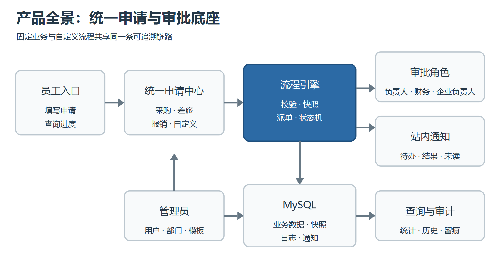

*图 1　固定业务和自定义申请共用流程引擎、MySQL 数据库及查询审计模块。*

### 产品形态与数据组织

系统以响应式 Web 工作台为主要使用入口。员工在该入口发起采购、差旅、报销和管理员发布的自定义申请，审批人在“我的待办”中处理分配给自己的节点，管理员则从独立入口维护组织和模板。三类固定业务分别保存结构化明细并执行各自的校验；申请编号、状态、流程实例、日志、附件、通知和统计由公共模块管理。


| 使用入口 | 用户操作                           | 系统记录内容                               |
| ---------- | ------------------------------------ | -------------------------------------------- |
| 发起申请 | 保存草稿、校验、提交结构化业务表单 | 申请编号、表单版本、申请人/部门及提交时间  |
| 我的待办 | 看清业务内容和审批依据后批准或驳回 | 实际审批人、节点、意见、动作时间和结果     |
| 我的申请 | 查询当前审批人、历史进度和最终结果 | 审批路径快照、追加式审批日志、状态变化通知 |
| 管理入口 | 管理组织、授权与流程模板           | 管理操作者、修改对象、变更前后摘要和时间   |

数据采用“申请主记录 + 各业务专属明细”的组织方式。申请主记录用于列表、检索、权限判断、状态保存和流程关联；采购明细、差旅行程和报销费用分别存储，不写入难以校验的大型 JSON。自定义表单值使用受模板约束的动态字段表，并保留模板版本和字段定义的引用。

采购、差旅和报销共用申请主记录、流程实例和审批服务，差异保留在业务明细和校验规则中。自定义流程通过模板版本接入相同的申请与审批流程，不复制另一套页面和流转代码。

### 技术路线与交付形态

审批动作需要在一次事务中更新申请、节点、日志和通知，课程项目也不需要承担分布式事务与多服务部署的额外成本，因此后端采用模块化单体。依赖补丁版本写入构建文件和容器镜像标签，不使用未约束的 `latest`。


| 层次       | 选型                                               | 选择理由与使用范围                                                         |
| ------------ | ---------------------------------------------------- | ---------------------------------------------------------------------------- |
| Web 前端   | Vue 3、TypeScript、Vite、Element Plus              | 组件化实现明细表单、筛选分页及模板配置                                     |
| 后端       | Java 21、Spring Boot 3.x、Spring Security、MyBatis | 单体事务覆盖申请、节点、日志和通知；显式 SQL 便于审计                      |
| 会话       | 服务端会话、HttpOnly/SameSite Cookie、CSRF 防护    | 身份来自服务端认证上下文，客户端不能替换操作者                             |
| 数据与文件 | MySQL 8.x/InnoDB；附件存独立持久化文件卷           | 数据库保存元数据、随机存储标识和业务归属；访问经服务端授权，不暴露文件路径 |
| 部署       | Docker Compose：应用、MySQL、数据卷、附件卷        | 空环境启动、迁移、合成初始化及重启持久化                                   |

初始化数据至少包含研发部、市场部、财务部，以及普通员工、部门负责人、财务审批人、企业负责人和系统管理员等合成账号。角色能力、审批岗位和数据授权分开建模；管理员身份不自动产生业务查看或审批权限。

## 1. 业务流程与权限范围

### 1.1 角色、操作与数据范围

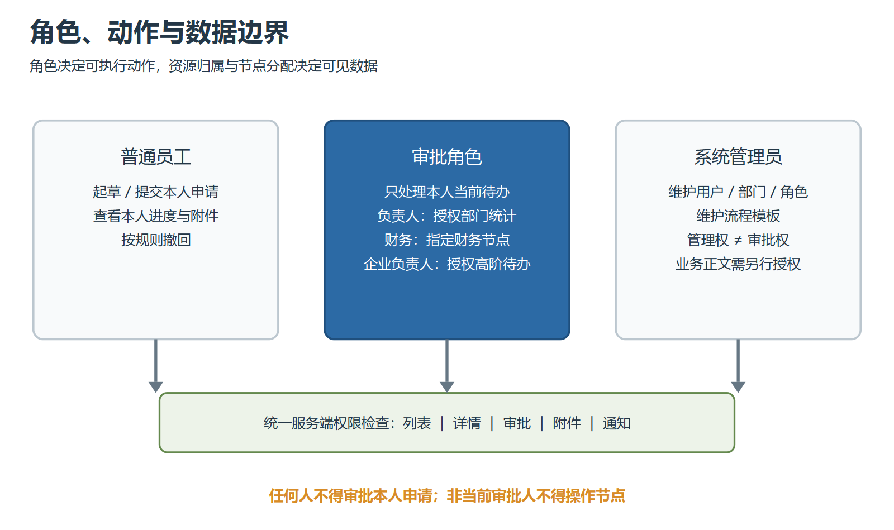

*图 2　用户可执行的操作由角色、资源归属、部门范围和当前流程节点共同决定。*

只检查角色会造成越权，例如部门负责人可能审批未分配给自己的任务，系统管理员也可能因此读取员工票据。服务端还要检查资源归属和当前流程状态：部门负责人可以查询授权部门的统计，但只能处理分配给自己的待办；系统管理员可以配置模板，却不会自动获得业务正文或票据的访问权限。


| 资源/动作          | 普通员工                       | 部门负责人/财务/企业负责人         | 系统管理员                                                                         |
| -------------------- | -------------------------------- | ------------------------------------ | ------------------------------------------------------------------------------------ |
| 查看申请详情       | 本人申请，或当前审批所需内容   | 本人待办及明确授权的数据范围       | 默认无业务正文权限，另行授权                                                       |
| 审批节点           | 禁止；兼任审批角色时仍禁止自批 | 仅当前分配给本人且未完成的个人任务 | 管理身份本身不产生审批权限                                                         |
| 转办当前任务       | 禁止                           | 仅转办当前分配给本人的待办         | 仅具备部门/流程范围 `TASK_TRANSFER` 授权者可指定任务转办；不因此获得正文或附件权限 |
| 附件预览/下载      | 本人有权查看的申请附件         | 当前待办所需附件                   | 仅获得业务查看授权后允许                                                           |
| 用户/角色/模板配置 | 禁止                           | 禁止                               | 允许，并记录管理审计日志                                                           |

服务端按以下逻辑判定权限。前端可据此控制按钮显示，最终授权仍由服务端执行。

历史审批日志只用于审计，不向历史审批人授予当前申请正文或附件权限。幂等重放仍需通过资源访问检查。若操作者失去原资源权限后仍需重试，则基于原操作记录授予最小范围权限，且只返回该动作的必要结果，不开放整单或附件。

```pseudo
function authorize(user, action, resource):
    assert user.isActive

    if action in [APPROVE, REJECT]:
        node = resource.currentWorkflowNode
        task = node.taskAssignedTo(user.id)
        return resource.status == IN_APPROVAL
           and node.status == PENDING
           and task.status == PENDING
           and resource.applicantId != user.id

    if action == TASK_TRANSFER:
        task = resource.targetTask
        return isCurrentAssignee(user, task)
            or hasScopedGrant(user, TASK_TRANSFER, task.departmentId, task.workflowType)

    if action in [VIEW_ATTACHMENT, DOWNLOAD_ATTACHMENT]:
        application = resource.ownerApplication
        return isApplicant(user, application)
            or isCurrentAssignee(user, application)
            or hasExplicitBusinessReadGrant(user, application)

    if action == MANAGE_TEMPLATE:
        return hasRole(user, SYSTEM_ADMIN)

    return defaultDeny
```

### 1.2 申请生命周期

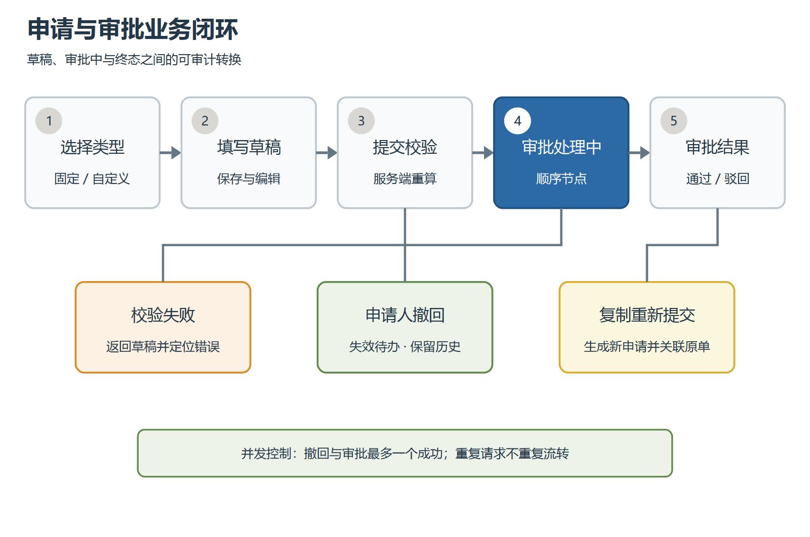

*图 3　申请从草稿进入审批，并根据批准、驳回或撤回结果结束；驳回和撤回后可复制重提。*

申请从草稿状态开始。草稿只对申请人可见，可以编辑或删除。提交成功后，服务端生成唯一申请编号，保存业务数据和审批路径，并创建首个待办。申请进入审批中后，业务正文不可覆盖修改；驳回或撤回后，用户可通过“复制重新提交”创建新申请，并以 `source_application_id` 关联原单。

如果申请状态已经变更，而下一待办或审批日志没有写入，流程会停在无法继续处理的中间状态。因此，一次状态变更在同一事务中更新申请主状态、当前有效待办、追加式审批日志和站内通知记录，任一步骤失败都回滚。查询页面直接读取已提交数据，不依赖浏览器缓存；刷新页面或重启服务后仍能查询当前状态和历史进度。


| 状态   | 可执行操作                      | 数据约束                                 |
| -------- | --------------------------------- | ------------------------------------------ |
| 草稿   | 编辑、删除、提交                | 不生成审批待办，不计入通过金额统计       |
| 审批中 | 当前审批人批准/驳回；申请人撤回 | 只有一个当前有效节点；正文按提交版本冻结 |
| 已通过 | 授权查询、附件下载              | 终态，不允许再次审批或退回草稿           |
| 已驳回 | 查询理由、复制重提              | 原日志保留，新申请拥有新编号             |
| 已撤回 | 查询历史、复制重提              | 所有原待办失效，原路径和日志保留         |

## 2. 产品界面与原型

### 2.1 信息架构

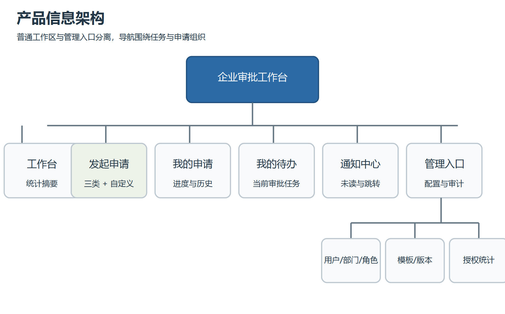

*图 4　普通工作区围绕任务和申请组织，管理入口独立承载配置与审计。*

页面按用户实际操作组织。普通用户主要使用发起申请、本人申请和通知，审批角色处理待办与已办事项，组织和模板配置放在独立管理入口。同一用户兼任多种角色时仍使用同一账号，菜单和数据范围根据当前权限显示。

列表页按类型、状态、提交时间和关键词筛选，并在服务端分页。申请编号、标题、申请人、部门和当前状态从申请主表读取；各业务的特有字段仅在详情页按需加载，以减少列表查询对明细表的连接。

### 2.2 桌面端低保真原型（工作台）

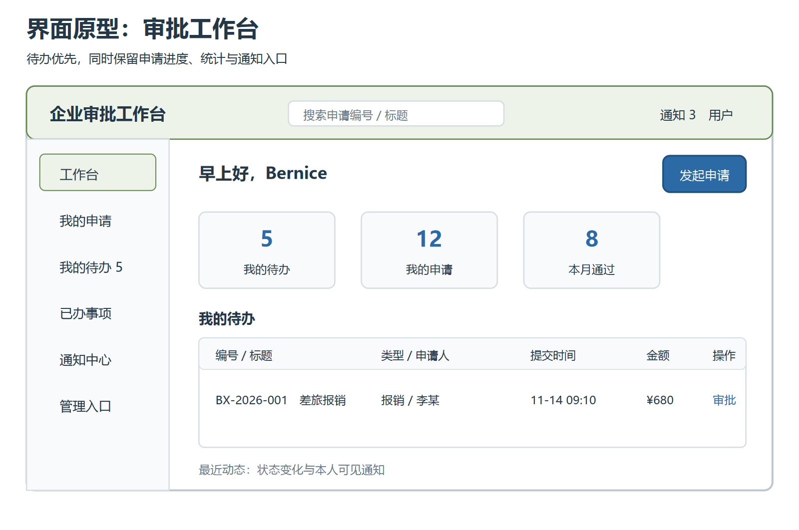

*图 5　工作台首屏包含待办、本人申请、统计摘要和发起申请入口。*

工作台先显示待处理任务，然后是状态变化和统计摘要。待办列表按收到时间倒序，展示申请类型、申请人和金额等摘要。列表不提供直接批准按钮，审批人必须进入详情页核对正文和附件后再操作。

页面分别处理加载、空结果、校验失败、提交成功和网络失败等状态。加载时显示骨架或进度，无待办时显示空态；校验错误定位到具体字段或明细行；提交成功后显示申请编号并跳转详情；网络失败时保留用户输入。撤回、删除和驳回等不可逆操作需要二次确认。手机端将横向表格改为纵向卡片，主要按钮保持可触控尺寸，金额和日期使用适合移动设备的输入控件。

### 2.3 申请详情与审批原型

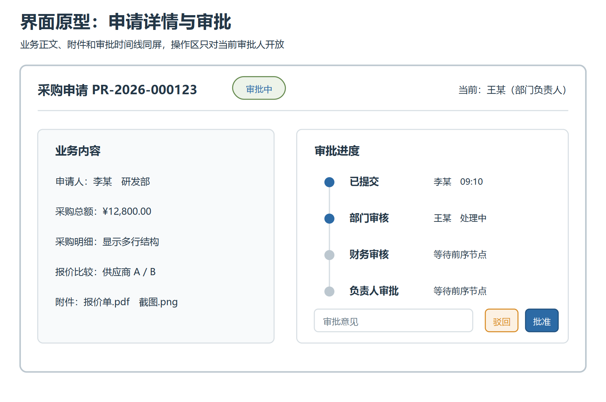

*图 6　详情页同时展示业务正文和审批时间线；服务端确认当前用户为当前审批人后，页面显示审批按钮。*

详情页分为业务正文和审批时间线。业务区按申请类型加载采购明细、差旅行程、费用项目或动态字段，并展示相关附件。时间线由审批日志和实例节点组合生成，记录操作者、时间、节点和动作。普通申请人查看进度及其授权内容，当前审批人还可输入意见并执行批准或驳回。

服务端根据当前用户计算详情接口中的 `allowed_actions`，例如 `VIEW`、`WITHDRAW`、`APPROVE`、`REJECT` 和 `DOWNLOAD_ATTACHMENT`。前端据此渲染操作区，后端在收到操作请求时再次鉴权。附件通过受保护接口预览或下载，每次访问均重新校验用户对所属申请的权限，响应中不暴露存储路径。

### 2.4 三类业务表单蓝图

固定业务流程按课程要求预置为可配置规则。下表给出默认流程基线；金额阈值及企业负责人审批节点须依据课程要求或教师意见确认，确认前不启用相应门槛。


| 业务 | 默认审批路径                                                     | 条件与边界                                                         | 通过结果                                |
| ------ | ------------------------------------------------------------------ | -------------------------------------------------------------------- | ----------------------------------------- |
| 采购 | 部门负责人 → 财务审批人；企业负责人节点经确认后作为条件节点启用 | 部门负责人适用于所有采购；金额条件由服务端配置，阈值未确认前不启用 | 无后续节点时 APPROVED，否则激活下一节点 |
| 差旅 | 部门负责人                                                       | 默认采用单节点顺序审批；预算由服务端校验并展示，不推导额外审批门槛 | APPROVED                                |
| 报销 | 部门负责人 → 财务审批人                                         | 费用与票据由财务核对；关联来源预算按 3.4 节策略预警                | APPROVED                                |

固定业务规则由服务端按版本维护，初始标识分别为 `PROCUREMENT_WORKFLOW_V1`、`TRAVEL_WORKFLOW_V1`、`REIMBURSEMENT_WORKFLOW_V1`，已发布版本只读。审批节点或金额条件调整时发布新版本，新规则只影响后续申请；已提交实例保留原版本键以及节点和审批人快照。自定义流程使用管理员发布的模板版本。

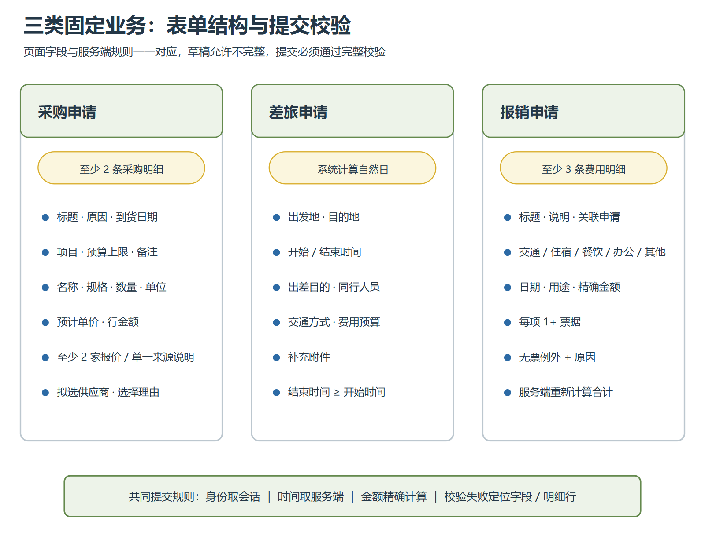

*图 7　三类业务共用草稿保存、提交和附件处理功能，并分别使用相应的结构化字段与服务端规则。*

采购表单包含基本信息、采购明细、报价比较和采购选择。明细可以增删，提交时至少保留两条；行金额由数量与单价计算。报价通常不少于两家，记录供应商、报价日期、金额、链接或附件。单一来源采购须填写原因；未选择最低报价时也须说明理由，并在审批详情中显示。

差旅表单记录出发地、目的地、开始与结束时间、目的、同行人员、交通方式、预算和补充附件。结束时间不得早于开始时间，预算不得为负。天数按自然日计算，即 `结束日期 - 开始日期 + 1`。用户可以在报销时关联本人获批的差旅申请，服务端在提交时重新检验所有权、类型和批准状态。

报销表单包含报销说明、可选关联申请和至少三条费用明细。费用类型包括交通、住宿、餐饮、办公和其他。每条明细绑定一份或多份票据；无票支出须显式标记并填写原因。客户端显示即时合计，服务端按整数分重新计算。同一报销单不得重复绑定同一票据记录。

草稿可以暂缺字段，提交时执行全部业务校验。前端按服务端定义的字段含义、时区和边界规则提供即时提示，例如在日期变化或字段失焦时检测结束时间早于开始时间、费用日期晚于当前日期或早于关联差旅行程。服务端仍执行最终校验。申请人、部门、编号和时间从认证上下文生成，不接受客户端改写。

业务校验失败统一返回 `422 VALIDATION_FAILED`。错误数组包含稳定的规则代码、字段路径、明细行标识和可读消息；前端在页面顶部汇总错误，并定位到具体字段。动态行使用稳定的客户端行 key 或服务端明细 ID，不以增删后可能变化的数组下标标识。

```json
{
  "code": "VALIDATION_FAILED",
  "errors": [
    {
      "rule": "TRAVEL_END_BEFORE_START",
      "field": "travel.endAt",
      "rowKey": null,
      "message": "结束时间不得早于开始时间"
    }
  ]
}
```

后端维护规则目录并作最终判断，OpenAPI 契约公开稳定的规则码、字段路径与错误结构。前端复用规则码常量和输入约束提供即时反馈，不复制数据库查询、权限判断或累计金额计算。契约测试检验“相同输入—相同规则码—相同字段路径”，用于发现前后端规则不同步的问题。


| 规则码                        | 服务端最终规则            | 前端即时反馈             | 契约测试重点                  |
| ------------------------------- | --------------------------- | -------------------------- | ------------------------------- |
| `PROCUREMENT_ITEMS_MIN_2`     | 提交时采购明细不少于 2 条 | 增删行后显示当前数量     | 绕过页面直接提交 1 条仍被拒绝 |
| `TRAVEL_END_BEFORE_START`     | 结束时间不得早于开始时间  | 任一时间变化后重新比较   | 时区和相等边界返回一致结果    |
| `REIMBURSEMENT_ITEMS_MIN_3`   | 提交时报销明细不少于 3 条 | 显示尚缺条数             | 草稿可少于 3 条，提交不可     |
| `EXPENSE_AMOUNT_NOT_POSITIVE` | 每条费用金额必须大于 0 分 | 输入时禁止负数并提示零值 | 服务端不信任客户端计算结果    |

日期型字段按业务日使用 ISO `YYYY-MM-DD`，带时刻字段使用带偏移量的 ISO 8601；服务端按上述格式解析后比较。OpenAPI 生成类型只解决字段和枚举同步，不能代替后端领域校验。

### 2.5 管理员自定义流程原型

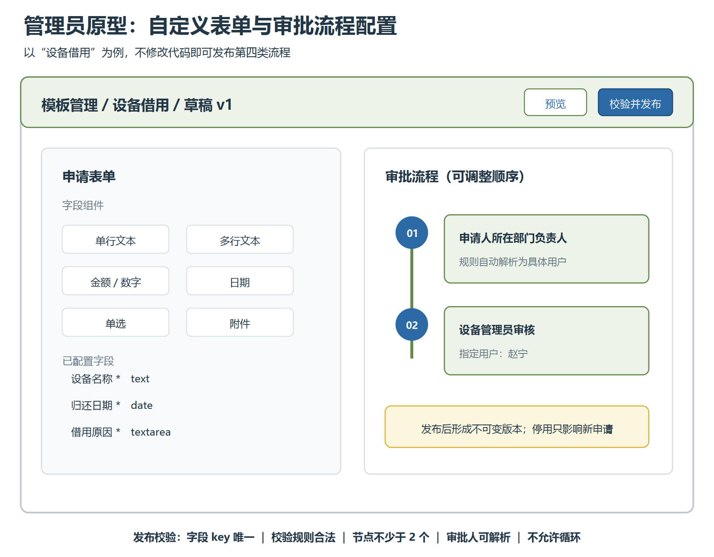

*图 8　以设备借用为第四类流程，管理员组合受控字段并配置两个顺序节点。*

模板编辑页分为表单配置和审批流程配置。字段组件限定为单行文本、多行文本、数字/金额、日期、单选和附件；每个字段配置唯一 key、名称、必填状态、选项和受控校验规则，不执行任意脚本。审批人规则包括“申请人部门负责人”和“指定用户”，节点可以排序但不能形成循环。

发布前检查字段 key 是否唯一、选项是否为空、规则是否合法，并要求节点不少于两个、序号连续、审批人有效且不存在自批。发布后的版本不可修改；再次编辑会创建新的草稿版本，停用只阻止新申请。员工端按字段 schema 渲染表单，后端使用同一版本校验并保存动态值，因此新增这类流程不需要修改固定业务表结构或另写审批页面。

### 2.6 列表、通知、统计与交互状态

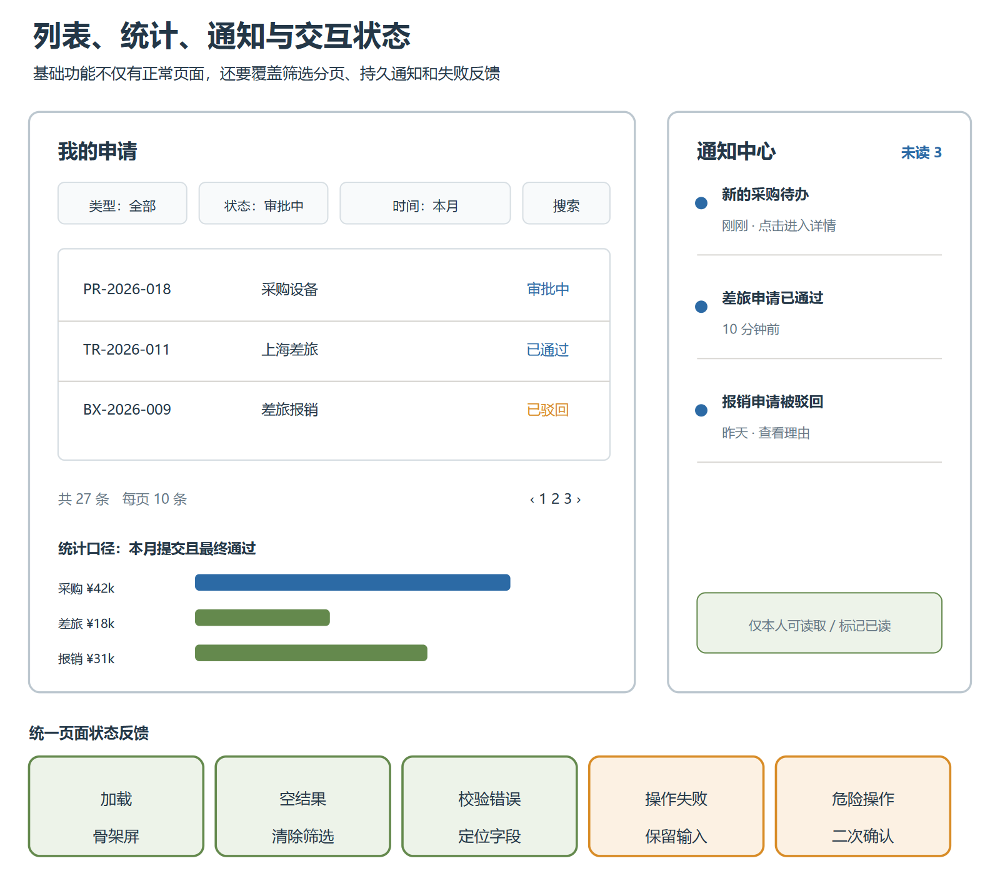

*图 9　列表页包含筛选和分页，工作台展示统计数据与通知，并分别处理加载、空结果和错误状态。*

我的申请、我的待办和已办事项支持按类型、状态、时间和关键词筛选，并由服务端分页。关键词检索仅覆盖当前用户有权访问的记录；排序使用 `submitted_at DESC, id DESC` 等稳定键，分页大小由服务端限制。“本月已通过金额”统计提交时间位于所选月份且最终状态为 `APPROVED` 的金额之和，不计入草稿、审批中、驳回和撤回记录。采购预算、差旅预算和报销实报金额分别统计。

站内通知持久化后再展示，外部通知由后台通道投递。新待办、通过、驳回和撤回均生成通知；`(recipient_id, event_key)` 唯一约束防止重试产生重复记录。通知查询、未读计数和已读操作均绑定当前会话用户；通过通知链接打开申请时仍需执行详情授权。

原型覆盖加载、空结果、字段错误、操作失败和危险操作确认。网络失败时保留输入；删除草稿、撤回和驳回需要确认，驳回理由必填。前端收到 `STATE_CHANGED` 后重新读取服务端状态，不显示未经确认的成功结果。

#### 2.6.1 注册、身份确认与个人信息

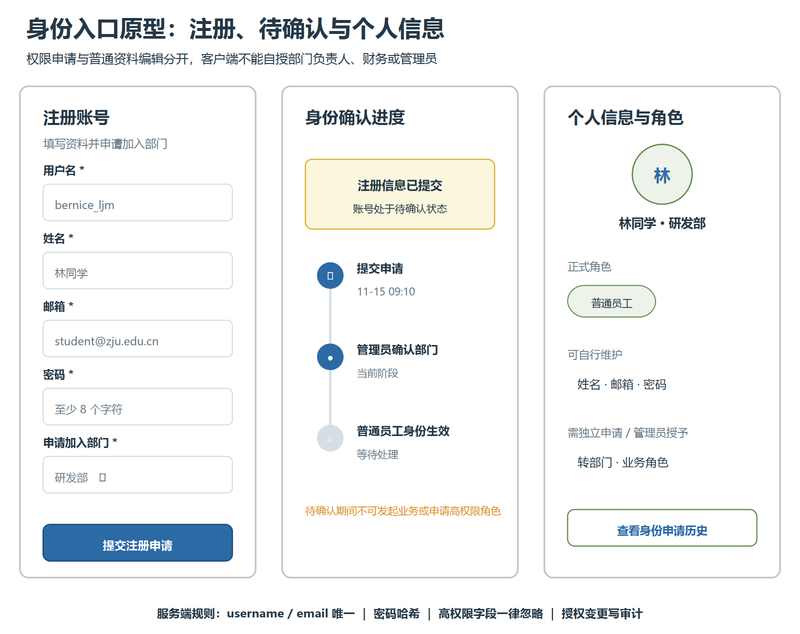

*图 10　注册只申请普通身份和部门归属；高权限角色通过独立申请或管理员授权，并留下审计记录。*

注册页收集用户名、姓名、邮箱、密码和申请加入部门。前后端均校验用户名和邮箱格式，唯一性由服务端判断；密码至少八位，并使用框架提供的自适应哈希。服务端忽略注册请求中的 `SYSTEM_ADMIN`、`FINANCE_APPROVER` 等高权限字段。

注册后身份状态为 `PENDING_CONFIRMATION`。用户可以查看处理进度，但管理员确认部门归属前不能发起业务申请。个人信息页将资料维护与权限变化分开：姓名、邮箱和密码通过本人资料接口修改；部门加入申请使用 `DEPARTMENT_JOIN`，业务角色申请使用 `ROLE_GRANT`，均由系统管理员审核。

每个用户同一时刻最多存在一条待处理身份或角色申请。创建和审核操作先锁定用户记录并检查待处理状态，以防并发产生重复申请或重复授权。`SYSTEM_ADMIN` 不能由用户自行申请，只能由现有系统管理员通过专门命令授予或撤回，并记录操作者、前后值和时间。

异常状态包括用户名或邮箱已存在、密码不合规、目标部门停用、身份申请重复，以及管理员处理时申请状态已变化。登录失败统一返回认证失败，避免泄露用户名或邮箱是否存在；退出后服务端会话失效。

#### 2.6.2 报销填写与票据核对

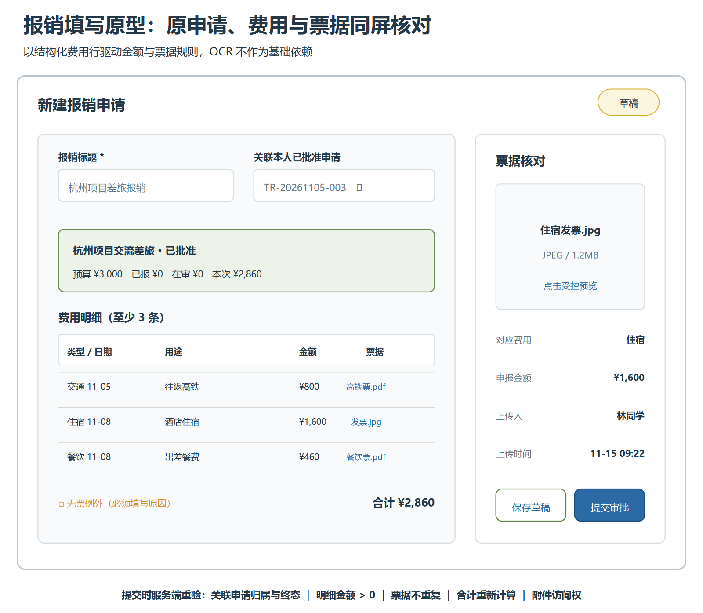

*图 11　原申请摘要、费用明细、合计和当前票据在同一页面展示，供用户提交前核对。*

选择关联申请后，页面从服务端读取来源单据类型、批准状态、预算、历史已通过金额、在审金额和本次预计累计。预计累计超过预算时，申请人页面和财务审批详情显示预算警示卡，其中包含“预算、预计累计、超额金额、超额比例、申请人说明”五项。

超额金额按 `max(预计累计 - 预算, 0)` 计算。预算大于零时，超额比例为“超额金额 ÷ 预算 × 100%”；预算为零时显示“无可用预算”，不执行除零。警示同时使用图标、标题和文本，并在财务审批操作区附近重复展示摘要。

费用行与票据保持明确绑定。用户点击票据后，在受控预览区查看原件及文件名、类型、大小、上传人和上传时间。OCR 结果以“待确认候选值”卡片呈现，与原票据并列显示发票号码、开票日期、金额、商户等字段及置信度。候选字段可逐项修改；低置信度、缺失值和格式异常需要醒目标记。

卡片提供“确认并写入费用项”和“忽略识别结果”两个操作。确认前状态保持 `PENDING_REVIEW`，候选值不得写入费用项、参与金额或预算计算，也不得触发审批。确认请求提交用户核对后的字段，服务端重新检验金额、日期、票据归属和重复绑定，再写入业务数据。

跨单重复票据检测与 OCR 确认分开处理。系统在上传和提交时显示重复风险、匹配依据及可授权查看的来源摘要，但不自动删除票据或决定审批结果。用户可返回修改、保留并说明或放弃该票据；未授权的来源申请不显示正文和附件内容。

草稿允许暂缺票据或少于三条费用，提交时必须包含至少三条费用，并满足票据绑定或无票原因规则。上传时检测 JPEG、PNG、PDF、真实 MIME、单文件建议 10MB、文件数量和总量，并使用随机存储 key。票据预览和下载均沿绑定关系对所属报销单重新鉴权，响应不返回磁盘路径或可猜测的静态 URL。

#### 2.6.3 桌面端与手机屏幕响应式审批

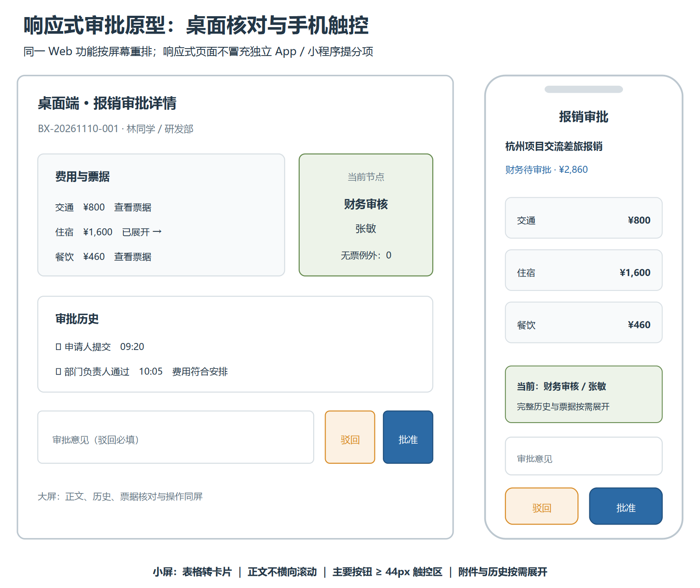

*图 12　桌面端并列展示申请材料，小屏采用卡片和分段展开方式；两端使用相同的授权规则和状态机。*

桌面端并列展示费用、票据、关联申请、审批历史和操作区，便于交叉核对。小屏按“摘要—费用卡片—当前节点—意见—操作”纵向排列，表格改为卡片，历史和附件按需展开，主要按钮的触控区域不小于约 44px。操作按钮由服务端返回的 `allowed_actions` 决定，屏幕尺寸不改变权限。

系统交付响应式 Web 和独立移动客户端。Web 分别在桌面与手机宽度下检验布局和触控；移动客户端覆盖注册/登录、三类及自定义申请、拍照或选择票据、审批、进度和通知，并提供实际设备或模拟器的运行截图、录像以及页面未打开时的后台通知触达记录。两端共用服务端 API 和权限规则；独立移动客户端的验收不以浏览器调试视口替代。


| 原型目标   | 桌面端实现判据                                 | 小屏实现判据                                      |
| ------------ | ------------------------------------------------ | --------------------------------------------------- |
| 列表与详情 | 宽屏可使用列表—详情双栏，选择记录不丢筛选条件 | 列表和详情分屏导航，返回后保留筛选与滚动位置      |
| 业务核对   | 正文、票据、审批历史和操作区可交叉查看         | 表格改为卡片，附件和历史分段展开，不横向溢出      |
| 审批操作   | 意见与批准/驳回靠近当前节点，长页面仍可定位    | 主按钮触控区域约 44px，键盘弹出后操作区不遮挡输入 |
| 状态反馈   | 分别显示加载、空态、字段错误、冲突和无权限状态 | 与桌面端使用同一服务端错误码，不删减关键错误信息  |
| 验收材料   | 关键页面截图加端到端操作录像                   | 约 375px 宽度截图及同一业务路径录像               |


### 2.7 设计参考与取舍


| 参考                                                                                                                            | 借鉴点                                               | 本项目取舍                                                               |
| --------------------------------------------------------------------------------------------------------------------------------- | ------------------------------------------------------ | -------------------------------------------------------------------------- |
| [SAP Fiori Flexible Column Layout](https://experience.sap.com/fiori-design-web/flexible-column-layout/)（访问日期：2026-11-15） | 列表、对象详情和关联信息可并列展示，减少频繁页面跳转 | 只借鉴桌面信息组织；审批权限、状态机和字段完全按本任务设计，小屏改为单列 |
| [GOV.UK Design System: Error summary](https://design-system.service.gov.uk/components/error-summary/)（访问日期：2026-11-15）   | 页面顶部汇总错误，同时在具体字段旁显示错误并可定位   | 动态明细错误携带字段 key/行号；网络失败保留输入，不照搬视觉品牌          |

上述原型均为本项目自制低保真图。外部参考用于比较信息层级和错误反馈方式，不复制其截图或扩展与课程无关的功能。

## 3. 关键业务机制设计

### 3.1 提交时解析并冻结审批路径

审批人、金额阈值和模板配置可能在申请提交后变化。若运行实例始终读取当前配置，历史申请的路径也会随之变化，无法还原提交时采用的审批规则。

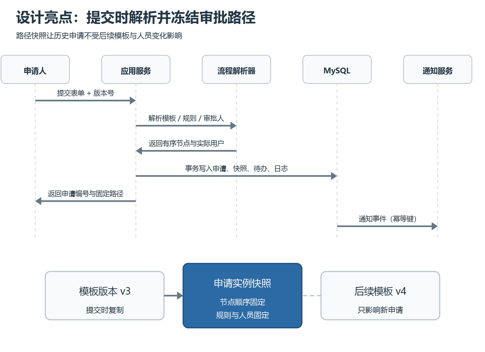

*图 13　上半部分展示申请提交事务，下半部分展示模板版本与申请实例的关系。*

提交时先按申请类型读取规则。采购、差旅和报销使用对应的固定业务校验规则和版本化审批配置；自定义申请使用已发布的模板版本及字段 schema。服务端据此构造条件上下文并依次计算节点条件。条件为假的节点保存为 `SKIPPED`，不解析审批人；条件为真或未配置条件的节点才解析审批人，并检验审批人有效、非申请人且不为空。

申请内容、流程实例和首个待办必须来自同一次提交。服务端在一个事务中保存申请及业务明细，记录规则来源版本，冻结节点条件与审批人，创建首个适用节点的待办，并追加提交日志和通知。自定义字段值关联提交时的 `template_version_id` 及字段定义；固定业务记录对应的流程配置版本键。

```pseudo
function submitApplication(applicationId, actorId, idempotencyKey):
    begin transaction

    application = lockApplication(applicationId)
    assert application.applicantId == actorId

    request = findIdempotencyRecord(actorId, SUBMIT, idempotencyKey) FOR UPDATE
    if request exists:
        assert request.resourceId == applicationId else IDEMPOTENCY_CONFLICT
        replayHash = hashCanonical({applicationId, request.draftVersion, canonicalSubmittedContent(application)})
        assert request.requestHash == replayHash else IDEMPOTENCY_CONFLICT
        result = request.savedResult
        commit transaction
        return result

    assert application.status == DRAFT

    draftVersion = application.rowVersion
    submittedContent = canonicalSubmittedContent(application)
    requestHash = hashCanonical({applicationId, draftVersion, submittedContent})

    // Unique key: (actor_id, operation, idempotency_key).
    // The claim, request hash, business writes, and saved result share this transaction.
    request = claimIdempotencyRecord(actorId, SUBMIT, idempotencyKey, applicationId, draftVersion, requestHash)

    if request conflicts with a different resource or hash:
        rollback and return IDEMPOTENCY_CONFLICT

    if request is a completed replay:
        result = request.savedResult
        commit transaction
        return result

    if application.applicationType in [PROCUREMENT, TRAVEL, REIMBURSEMENT]:
        flowConfig = loadFixedBusinessRules(application.applicationType)
        validateBusinessForm(application, flowConfig.schema)
        nodeRules = flowConfig.workflowNodes
        conditionSource = {kind: FIXED_BUSINESS, schema: flowConfig.schema, versionedConfig: flowConfig}
        flowVersionRef = {kind: FIXED_CONFIG, fixedWorkflowVersionKey: flowConfig.versionKey, templateVersionId: null}
    else if application.applicationType == CUSTOM:
        templateVersion = loadPublishedVersion(application.templateVersionId)
        validateBusinessForm(application, templateVersion.fieldSchema)
        nodeRules = templateVersion.orderedNodes
        conditionSource = {kind: CUSTOM_TEMPLATE, schema: templateVersion.fieldSchema, versionedConfig: templateVersion}
        flowVersionRef = {kind: CUSTOM_TEMPLATE, fixedWorkflowVersionKey: null, templateVersionId: templateVersion.id}
    else:
        rollback and return UNSUPPORTED_APPLICATION_TYPE

    conditionContext = buildConditionContext(application.applicationType,
                                             submittedContent, conditionSource)
    resolvedNodes = []
    for nodeRule in nodeRules ordered by sequence_no:
        conditionResult = evaluateCondition(nodeRule.conditionRule or TRUE, conditionContext)
        assert conditionResult is evaluable else CONDITION_EVALUATION_FAILED

        if conditionResult == false:
            resolvedNodes.append(snapshot(nodeRule,
                condition_result_snapshot = false, status = SKIPPED,
                assignee_snapshot = null))
            continue

        assignees = resolveToConcreteUsers(nodeRule, application.departmentId)
        assert assignees is not empty else ASSIGNEE_NOT_FOUND
        assert every assignee is active and assignee.id != actorId
        assert assignee IDs are distinct
        resolvedNodes.append(snapshot(nodeRule,
            condition_result_snapshot = true, status = WAITING,
            assignee_snapshots = assignees))

    firstApplicableNode = first node in resolvedNodes where status == WAITING
    assert firstApplicableNode exists else NO_APPLICABLE_WORKFLOW_NODE
    firstApplicableNode.status = PENDING

    submitted = persistSubmittedApplication(application, submittedContent)
    persistBusinessDetails(submitted, submittedContent)
    persistWorkflowSnapshot(submitted, flowVersionRef, resolvedNodes)  // 同时写入条件、审批人快照及 SKIPPED/PENDING/WAITING 状态
    createPendingTasks(firstApplicableNode)  // 其余适用节点激活时再创建任务
    setCurrentNodePointer(firstApplicableNode)
    appendApprovalLog(submitted, actorId, SUBMIT)
    insert notification rows with unique recipient/event keys

    result = CommandResult.success(buildApplicationDetail(submitted, actorId))
    saveIdempotencyResult(request, result)
    commit transaction
    return result
```

`canonicalSubmittedContent` 包含申请类型、规范化后的业务字段与明细、附件绑定及适用的模板版本引用，不包含状态、当前节点等提交后变化的运行字段；摘要同时绑定锁定时的 `draftVersion`。

幂等记录由 `(actor_id, operation, idempotency_key)` 唯一标识，并保存完整的 `CommandResult<ApplicationDetail>`。相同操作者、操作、键和提交内容重放原响应；同一键对应不同申请或摘要时返回 `IDEMPOTENCY_CONFLICT`；使用新键再次提交时由 `DRAFT` 状态检查拒绝。幂等记录、业务写入和响应快照在同一事务中提交。

`flowVersionRef` 记录流程规则来源：固定业务保存 `fixed_workflow_version_key`，自定义申请保存 `template_version_id`，两者互斥。自定义申请还保存模板字段定义引用。流程节点冻结序号、名称、实际审批人、审批模式和规则结果；负责人、固定规则或模板发生变化时，只影响新提交的申请，运行实例不再解析修改后的配置。无法解析审批人时，提交失败并返回具体原因，不创建流程实例。

### 3.2 审批、驳回与撤回并发控制

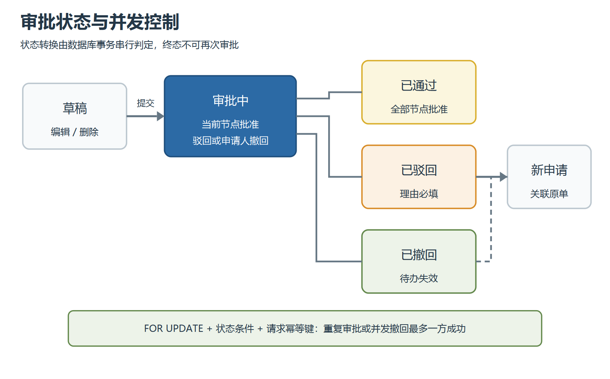

*图 14　审批、撤回和转办按相同顺序锁定申请、流程实例、节点和任务，并在更新前复核状态。*

两个审批人同时提交动作，或审批与撤回同时发生时，若只依赖前端禁用按钮，可能重复写入日志或创建多个后续待办。事务开始后，服务端按申请、流程实例、当前节点、个人审批任务的顺序执行 `SELECT ... FOR UPDATE`，随后复核申请状态、节点聚合状态、任务状态、当前操作者和版本号。条件仍匹配时才更新任务及节点状态，并写入审批日志、后续待办、站内通知和外部通知 Outbox；检查失败则回滚并返回“状态已变化，请刷新”。唯一约束和幂等键负责拦截重复写入。

审批、撤回和转办均按“申请主记录 → 流程实例 → 当前节点 → 个人任务”的顺序加锁；任务状态、节点聚合状态、申请状态和 `current_node_id` 在同一事务内更新。转办先通过 nodeId 只读定位申请 ID，再按上述顺序加锁，并复核该节点仍为当前节点。修改当前节点指针前必须锁定流程实例，不能只根据 `PENDING` 状态推导操作者任务。

幂等重放仍执行授权。服务端先确认当前会话身份并检查申请访问权限，再按操作者、操作类型和键查询幂等记录，同时核对申请、节点和规范化命令摘要。全部匹配时才返回原响应；首次请求还需检验当前任务和动作权限。

```pseudo
function actOnNode(nodeId, actorId, action, opinion, requestKey):
    begin transaction

    applicationId = SELECT wi.application_id
                    FROM workflow_instance_nodes n
                    JOIN workflow_instances wi ON wi.id = n.instance_id
                    WHERE n.id = nodeId  // identity lookup only; no application content is returned
    application = SELECT ... FROM applications
                  WHERE id = applicationId FOR UPDATE
    instance = SELECT ... FROM workflow_instances
               WHERE application_id = applicationId FOR UPDATE
    assert canAccessWorkflow(application, actorId)

    request = findIdempotencyRecord(actorId, APPROVAL_ACTION, requestKey) FOR UPDATE
    if request exists:
        log = findApprovalLogByIdempotencyRecord(request.id)
        assert log exists and log.idempotency_record_id == request.id
        assert request.resourceId == applicationId else IDEMPOTENCY_CONFLICT
        assert log.application_id == applicationId and log.actor_id == actorId
        assert log.node_id == nodeId else IDEMPOTENCY_CONFLICT
        replayHash = hashCanonical({applicationId, nodeId, action, normalizeOpinion(opinion)})
        assert request.requestHash == replayHash else IDEMPOTENCY_CONFLICT
        result = request.savedResult                 // 仅返回该操作者原请求的原响应
        commit transaction
        return result

    node = SELECT ... FROM workflow_instance_nodes
           WHERE id = nodeId AND instance_id = instance.id FOR UPDATE
    task = SELECT ... FROM workflow_node_tasks
           WHERE node_id = nodeId AND assignee_id = actorId FOR UPDATE

    assert application.status == 'IN_APPROVAL'
    assert node.id == instance.current_node_id and node.status == 'PENDING'
    assert task.status == 'PENDING'
    assert application.applicant_id != actorId
    if action == REJECT: assert opinion is not blank

    requestHash = hashCanonical({applicationId, node.id, action, normalizeOpinion(opinion)})
    request = claimIdempotencyRecord(actorId, APPROVAL_ACTION, requestKey,
                                     applicationId, null, requestHash)

    complete(task, action)
    aggregateNodeFromTasks(node)
    if node.status == 'REJECTED':
        application.status = 'REJECTED'
        cancelRemainingTasksAndWaitingNodes(instance)  // SKIPPED 节点保持原状态
        instance.current_node_id = null
    else if node.status == 'APPROVED':
        nextNode = resolveNextNode(instance, afterSequence = node.sequence_no)
        if nextNode exists:
            nextNode.status = 'PENDING'
            createPendingTasks(nextNode)
            instance.current_node_id = nextNode.id
        else:
            application.status = 'APPROVED'
            instance.current_node_id = null

    append immutable approval_log(request.id, requestKey, actorId, nodeId, task.id,
                                  action, opinion, result_status = application.status)
    insert notification and outbox rows with unique recipient/event keys
    result = buildCommandResult(application, actorId)
    saveIdempotencyResult(request, result)
    commit transaction
    return result
```

流程实例保存全部有序节点及 `condition_result_snapshot`。条件为假的节点标记为 `SKIPPED`；条件为真或无条件的节点初始为 `WAITING`，其中第一个可执行节点转为 `PENDING` 并创建任务。若没有可执行节点，系统拒绝提交并返回规则校验错误。条件只读取提交时冻结的申请字段，不读取审批期间的可变数据，也不支持任意脚本、循环、并行分支或运行时重新求值。

`current_node_id` 始终指向唯一的当前节点，该节点按审批模式拥有一个或多个 `PENDING` 任务。`SINGLE` 在唯一任务完成后聚合节点；`ALL` 在全部任务通过后通过，任一任务驳回后驳回；`ANY_ONE` 在首个任务通过后通过，全部任务驳回后驳回。

节点通过后，`resolveNextNode` 按 `sequence_no` 查找之后第一个 `condition_result_snapshot = TRUE` 且状态为 `WAITING` 的节点，将其标记为 `PENDING`，创建任务并更新指针。没有匹配节点时完成申请并清空指针。

`SKIPPED` 表示提交时条件不匹配，`CANCELLED` 表示驳回或撤回导致流程终止。终止操作取消剩余个人任务和 `WAITING` 节点，但保留已有的 `SKIPPED` 状态及条件快照。节点状态、任务集合或当前指针不一致时，事务失败。

条件数据来源随流程类型确定。自定义流程只能引用同一模板版本中标记为必填的字段；采购、差旅和报销等固定流程引用各自的结构化业务字段及固定流程配置中的版本化参数，例如金额阈值，无需映射到 `template_fields`。两类规则均限定字段、操作符和值类型。发布或配置阶段执行静态检验，提交时根据规范化内容和对应规则版本计算并冻结结果。引用值缺失、字段类型非法或表达式无法计算时拒绝提交，不将异常结果按 `false` 处理。

```pseudo
function resolveNextNode(instance, completedSequence):
    candidates = load nodes where instance_id = instance.id
                and sequence_no > completedSequence order by sequence_no
    for candidate in candidates:
        if candidate.condition_result_snapshot == false:
            assert candidate.status == SKIPPED
            continue
        if candidate.status == WAITING:
            return candidate
        assert candidate.status in [APPROVED, SKIPPED]
    return null  // 无后续适用节点，流程正常完成
```

`idempotency_records(actor_id, operation, idempotency_key)` 约束幂等键的唯一性。每次成功动作由 `approval_logs.idempotency_record_id` 唯一关联对应幂等记录；`request_key` 仅保留诊断副本，不要求全局唯一。任务表不保存动作幂等键。流程实例节点另以 `(instance_id, sequence_no)` 保证顺序唯一。

`workflow_instance_nodes.id` 作为 `nodeId`，表示流程中的审批环节；每名审批人的独立任务使用 `taskId`。接口、伪代码和日志分别记录节点与任务。事务锁处理并发竞争，唯一约束拦截重复写入。


| 风险               | 控制点                                           | 验收判据                                                    |
| -------------------- | -------------------------------------------------- | ------------------------------------------------------------- |
| 非当前审批人操作   | 服务端核对当前节点 assignee 与认证用户           | 越权接口测试返回拒绝                                        |
| 自己审批本人申请   | 创建路径与节点执行前双重校验                     | 申请人兼任负责人仍不能自批                                  |
| 双击/重试重复批准  | 事务锁、状态条件更新、请求幂等键                 | 仅一条有效流转日志/下一待办                                 |
| 幂等重放授权       | 重放前重新授权，并绑定申请、节点、操作和请求摘要 | 未授权请求拒绝；资源或摘要不匹配返回 `IDEMPOTENCY_CONFLICT` |
| 撤回与批准同时发生 | 锁定同一申请，终态条件更新                       | 两请求最多一个成功                                          |
| 通知重复           | 唯一业务事件键                                   | 重试不增加重复通知                                          |

转办通过更新当前有效任务的负责人实现，不复制任务。当前负责人可以转办自己的未完成待办；管理员代办转办时，必须持有与目标部门和流程类型匹配的 `TASK_TRANSFER` 范围授权。该授权只允许读取定位任务所需的最小元数据并修改负责人，不授予申请正文、业务明细或附件访问权。

目标审批人必须有效、符合节点职责、不是申请人，且未持有该节点的其他有效任务；否则返回 `ASSIGNEE_ALREADY_HAS_TASK`。任务表保存当前负责人和任务状态。每次人员变化由追加式 `approval_logs` 和 `admin_audit_logs` 记录原审批人、新审批人、原因、操作者、时间和幂等记录，多次转办的人员链路从日志还原。任务更新、业务时间线、管理审计和通知在同一事务中提交，任一步骤失败均回滚。

```pseudo
function transferPendingTask(nodeId, taskId, newAssigneeId, reason, actorId, requestKey):
    begin transaction
    applicationId = SELECT wi.application_id
                    FROM workflow_instance_nodes n
                    JOIN workflow_instances wi ON wi.id = n.instance_id
                    WHERE n.id = nodeId  // identity lookup only
    application = SELECT ... FROM applications WHERE id = applicationId FOR UPDATE
    instance = SELECT ... FROM workflow_instances WHERE application_id = application.id FOR UPDATE
    node = SELECT ... FROM workflow_instance_nodes
           WHERE id = nodeId AND instance_id = instance.id FOR UPDATE
    task = SELECT ... FROM workflow_node_tasks
           WHERE id = taskId AND node_id = node.id FOR UPDATE
    request = findIdempotencyRecord(actorId, TASK_TRANSFER, requestKey) FOR UPDATE
    if request exists:
        log = findTransferLogByIdempotencyRecord(request.id)
        assert log exists and log.idempotency_record_id == request.id
        assert request.resourceId == applicationId else IDEMPOTENCY_CONFLICT
        assert log.application_id == applicationId and log.node_id == nodeId and log.task_id == taskId
        assert log.actor_id == actorId and log.to_assignee_id == newAssigneeId
        assert normalize(log.opinion) == normalize(reason)
        replayHash = hashCanonical({applicationId, nodeId, taskId, newAssigneeId, normalize(reason)})
        assert request.requestHash == replayHash else IDEMPOTENCY_CONFLICT
        // 仍有当前转办权限时按正常权限返回；否则原操作者只能重放最小回执，不能读取申请正文。
        assert canTransferTask(actorId, application, node, task)
            or isExactTransferActor(actorId, log, request)
        result = request.savedResult  // 仅 TransferReceiptView，不返回申请详情
        commit transaction
        return result

    assert application.status == IN_APPROVAL and node.status == PENDING
    assert instance.current_node_id == node.id and node.id == nodeId
    // 负责人只能转办自己的待办；管理员必须有匹配部门和流程类型的范围授权。
    assert canTransferTask(actorId, application, node, task)
    assert task.status == PENDING
    assert reason is not blank
    assert newAssignee is active and satisfies node.duty_snapshot
    assert newAssigneeId != task.assignee_id
    assert newAssigneeId != application.applicant_id
    assert noOtherActiveTaskForAssignee(node.id, newAssigneeId, excludingTaskId = task.id)
           else ASSIGNEE_ALREADY_HAS_TASK

    requestHash = hashCanonical({applicationId, nodeId, taskId, newAssigneeId, normalize(reason)})
    request = claimIdempotencyRecord(actorId, TASK_TRANSFER, requestKey,
                                     applicationId, null, requestHash)

    oldAssigneeId = task.assignee_id
    update task.assignee_id = newAssigneeId
    task.transferred_from_id = oldAssigneeId
    append approval_log(application_id = applicationId, node_id = nodeId, task_id = taskId,
                        action = TRANSFER, actor_id = actorId,
                        from_assignee_id = oldAssigneeId, to_assignee_id = newAssigneeId,
                        opinion = reason, result_status = application.status,
                        idempotency_record_id = request.id)
    append admin_audit_log(action = TASK_TRANSFER, object_id = taskId,
                           actor_id = actorId, from_assignee_id = oldAssigneeId,
                           to_assignee_id = newAssigneeId, reason = reason,
                           idempotency_record_id = request.id)
    insert notification rows for old/new assignee with unique event keys
    result = buildTransferReceipt(task, oldAssigneeId, newAssigneeId, request.id)
    saveIdempotencyResult(request, result)
    commit transaction
    return result
```

转办保留原节点快照中的规则来源和初始解析结果，并在运行任务和追加日志中记录人员变化。详情页据此展示初始分配依据以及后续转办的操作者、原因和目标人员。转办完成后，旧审批人的待办立即失效，新审批人获得唯一有效待办；重复请求返回首次转办结果。

### 3.3 管理员自定义模板生命周期

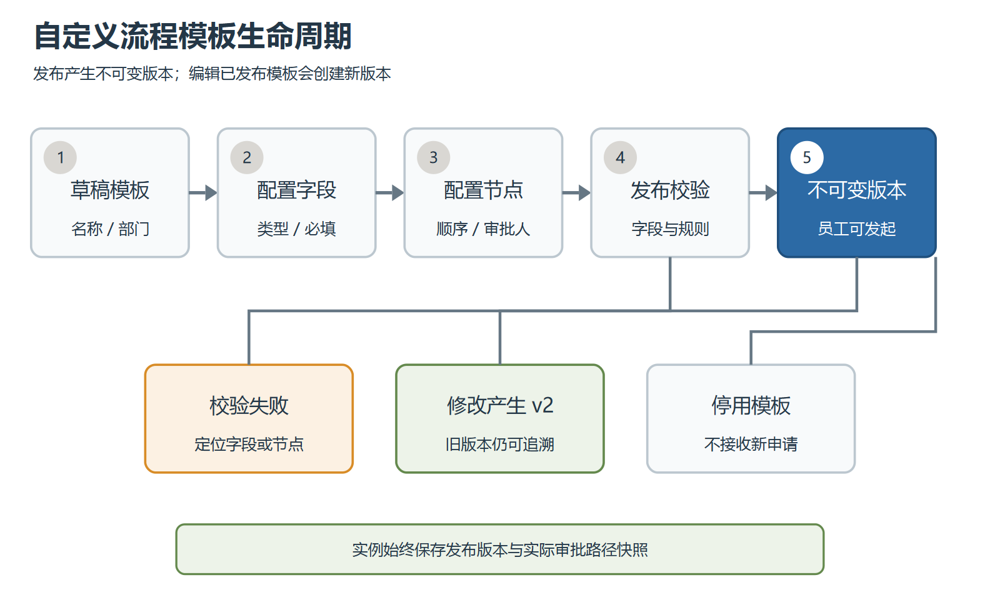

*图 15　模板发布后成为不可变版本，后续修改和停用均不改变历史实例。*

动态表单由受控字段类型和校验规则组合，不接受可执行代码。编辑期间，字段定义绑定草稿版本；发布时复制为不可变版本。员工发起申请时，系统将所选版本 ID 固定到申请，并将字段值关联至该版本的字段定义。已发布版本不能原位修改或删除；再次编辑会创建新草稿或新版本。停用模板只阻止新申请，不影响已有实例读取字段 schema、字段值和审批快照。以下用于说明 schema 与节点规则的存储方式，不表示最终接口格式。

```json
{
  "template": "设备借用",
  "version": 3,
  "fields": [
    {"key": "device_name", "type": "text", "required": true},
    {"key": "return_date", "type": "date", "required": true},
    {"key": "reason", "type": "textarea", "maxLength": 500}
  ],
  "nodes": [
    {"order": 1, "name": "部门审核", "assigneeRule": "APPLICANT_DEPARTMENT_MANAGER"},
    {"order": 2, "name": "资产管理员审核", "assigneeRule": "SPECIFIED_USER", "userId": 28}
  ]
}
```

发布时检验字段 key 唯一，字段类型、必填状态、选项和校验规则合法；审批节点不少于两个且顺序有效，聚合模式为顺序、会签或或签。审批规则须能解析为有效用户，引用的部门和用户必须存在且处于有效状态。条件字段须属于同一模板版本并标记为必填，操作符和值类型须匹配。条件规则采用结构化表达式，仅在提交时计算并冻结，不支持任意脚本、循环、并行分支或运行时重路由。模板停用只阻止新申请，不删除模板版本或修改运行实例。

### 3.4 报销金额、票据与关联申请

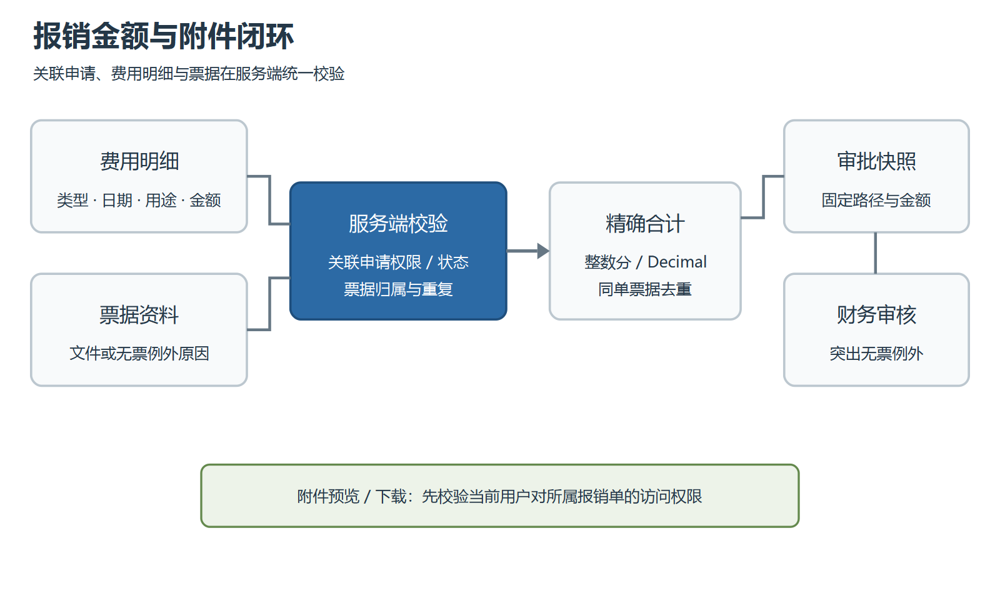

*图 16　服务端校验费用、票据和关联申请，按整数分计算合计并生成审批快照。*

报销单作为申请主记录下的业务聚合，包含多条费用项目，每条费用项目可以关联一份或多份票据。用户可以关联本人已批准的采购或差旅申请；服务端重新检验关联申请的所有者和状态，不接受客户端传入的“已批准”标记。无票支出通过例外字段和原因记录，并在财务审批界面突出显示。

金额先换算为最小货币单位“分”再计算，否则浮点误差可能使合计或金额条件出现边界偏差。客户端合计只用于填写时反馈，提交结果以服务端重新计算的数值为准。

关联申请的额度校验由服务端策略控制。`WARN_ONLY` 计算 `历史已通过金额 + 当前审批中金额 + 本次金额`；超预算时返回结构化警告并要求填写说明，由财务审批人结合材料判断。`HARD_LIMIT` 使用相同口径，在提交事务中锁定来源申请，串行汇总已通过及审批中金额，超额时拒绝提交。草稿、驳回和撤回记录不占用累计额度。`WARN_ONLY` 的累计值是事务当时可见记录的预警快照，并发提交不保证串行化；详情查询重新汇总最新值。


| 决策项       | 设计选择                                         | 选择原因                                           | 验收判据                                     |
| -------------- | -------------------------------------------------- | ---------------------------------------------------- | ---------------------------------------------- |
| 预算占用口径 | 已通过 + 当前审批中 + 本次；排除草稿、驳回、撤回 | 同时反映已发生金额和潜在占用，避免只看历史通过金额 | 服务端返回四项金额及统一币种                 |
| 预警模式     | `WARN_ONLY`，必须填写超额说明                    | 保留财务人员结合票据和业务原因判断的空间           | 页面醒目警告，说明进入快照和审批详情         |
| 强管控模式   | `HARD_LIMIT`                                     | 对需严格执行预算上限的业务提供服务端强校验         | 锁定来源申请后重算；并发超额测试最多一个成功 |

服务端配置项 `REIMBURSEMENT_BUDGET_POLICY` 只接受 `WARN_ONLY` 或 `HARD_LIMIT`，客户端请求不能覆盖。配置值非法时应用启动失败。提交时将实际策略和预算计算结果写入报销快照；配置变更只影响后续申请，历史详情保留原预警或拒绝依据。

```yaml
# application.yml；部署时可由同名环境变量覆盖
reimbursement:
  budget-policy: ${REIMBURSEMENT_BUDGET_POLICY:WARN_ONLY}
```

```pseudo
function validateAndTotal(expenseItems, actorId):
    assert count(expenseItems) >= 3
    totalMinor = 0
    usedAttachmentIds = set()

    for item in expenseItems:
        assert item.amountMinor > 0
        assert item.type in enabledExpenseTypes
        assert item.occurredOn is valid

        if item.noReceiptException:
            assert item.exceptionReason is not blank
        else:
            assert count(item.attachments) >= 1

        for attachment in item.attachments:
            assert attachment.id not in usedAttachmentIds
            assert attachment.uploaderId == actorId
            usedAttachmentIds.add(attachment.id)

        totalMinor = checkedAdd(totalMinor, item.amountMinor)

    return totalMinor
```

附件表保存原文件名、MIME、大小、上传人、上传时间、校验摘要和随机存储 key，二进制内容写入持久化文件卷。上传时检验扩展名、MIME、文件大小和数量；下载时根据附件所属申请重新鉴权，不提供可猜测的直接访问路径。

### 3.5 会签与或签设计

流程节点支持 `SINGLE`、`ALL`（会签）和 `ANY_ONE`（或签）三种模式。运行模型由父节点和审批子任务组成：父节点保存流程顺序和聚合状态，每名审批人拥有独立子任务，记录处理人、状态、意见和时间。请求幂等键保存在独立记录中，并由审批日志关联。多人不共享待办，也不轮流覆盖同一 `assignee_id`。

任务转办只替换一个 `PENDING` 任务的负责人，不改变父节点的 `approval_mode`。在 `ALL` 模式下，转办只影响选定任务，其他审批人的待办保持不变；在 `ANY_ONE` 模式下，转办替换一个候选人的任务，不新增并行任务。

```pseudo
function aggregateMultiAssigneeNode(nodeId, mode):
    lock parent node and all active child tasks
    tasks = loadChildTasks(nodeId)

    if mode == ALL and every task is APPROVED:
        complete parent node as APPROVED
    else if mode == ALL and any task is REJECTED:
        cancel remaining tasks; complete parent node as REJECTED
    else if mode == ANY_ONE and any task is APPROVED:
        cancel remaining tasks; complete parent node as APPROVED
    else if mode == ANY_ONE and every task is REJECTED:
        complete parent node as REJECTED
    else:
        keep parent node PENDING
```

`ANY_ONE` 中首个有效通过后，其余待办转为 `CANCELLED`，但不物理删除。`ALL` 要求全部任务通过，任一任务驳回即可结束父节点。聚合与子任务动作在同一事务内执行，并通过条件状态更新、幂等记录唯一键和审批日志关联约束防止重复完成。验收覆盖转办、候选人为空、审批人重复和同一父节点多任务并发竞争；首期不包含加签操作。

## 4. 数据库设计（MySQL）

### 4.1 ER 概念图

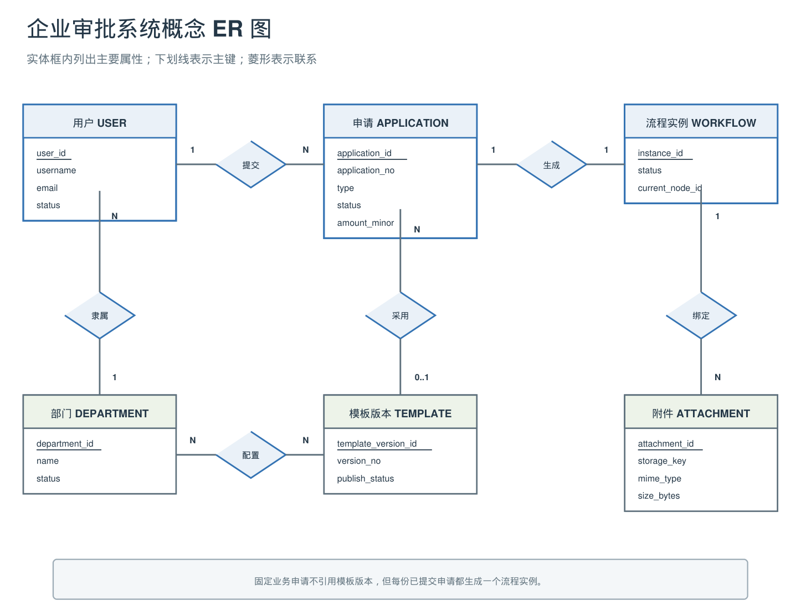

*图 17 展示主要实体、联系和基数；下划线属性为主键。

`applications` 是业务查询和流程关联的聚合根，保存申请共有的编号、类型、申请人、部门、状态、标题、合计金额和模板版本引用。固定业务明细使用一对一或一对多专属表。自定义表单通过 `application_field_values` 同时关联申请、不可变模板版本及该版本的字段定义，复合外键和唯一约束阻止字段值跨版本引用。列表和流程查询从申请主表读取共用字段，采购数量、报销金额等业务字段仍按各自类型保存。

模板配置与流程运行分开存储：`workflow_template_versions` 描述可用于新申请的模板版本，`workflow_instance_nodes` 保存提交时生成的运行节点。审批日志只追加，不提供普通更新或删除接口。附件元数据与业务绑定分表保存：普通附件通过 `attachment_binds` 关联申请或报价，报销票据通过 `item_receipts` 关联费用项；访问鉴权沿绑定关系回溯至申请。通知按收件人隔离，标记已读时同时匹配通知 ID 和当前用户 ID。

### 4.2 字段级关系模型

图 18—20 沿用 Chen/EER 表示法：实体属性写在矩形框内，主键使用下划线，联系使用菱形，关系两端标明基数；多对多联系转换后的关系表及外键约束在第 4.3—4.4 节列出。

#### 4.2.1 组织、角色与审批岗位

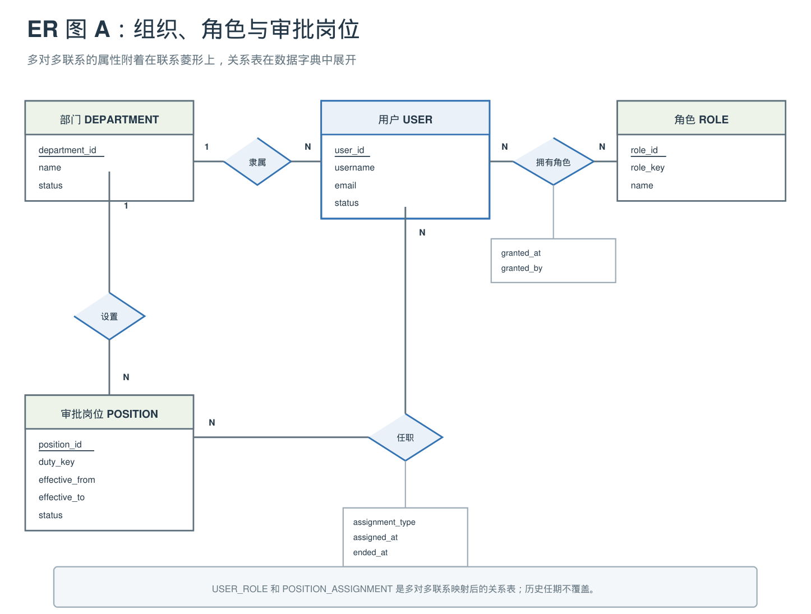

*图 18　部门、用户、角色和审批岗位之间通过一对多或多对多联系关联，联系属性用于记录授权和任职信息。*

用户正式归属一个部门，并可通过 `user_roles` 兼任多个角色。研发部、市场部和财务部由合成初始化数据创建。审批职责由带有效期的岗位和任职关系表示。同一部门、职责和有效期内只允许一名主审批人；备用人员不持有并行待办。人员接替时保留旧任期，新申请解析新任人员；已提交申请继续使用人员快照，未完成任务只能通过记录原负责人、新负责人、原因和操作者的显式转办改变。

#### 4.2.2 申请主记录与固定业务明细

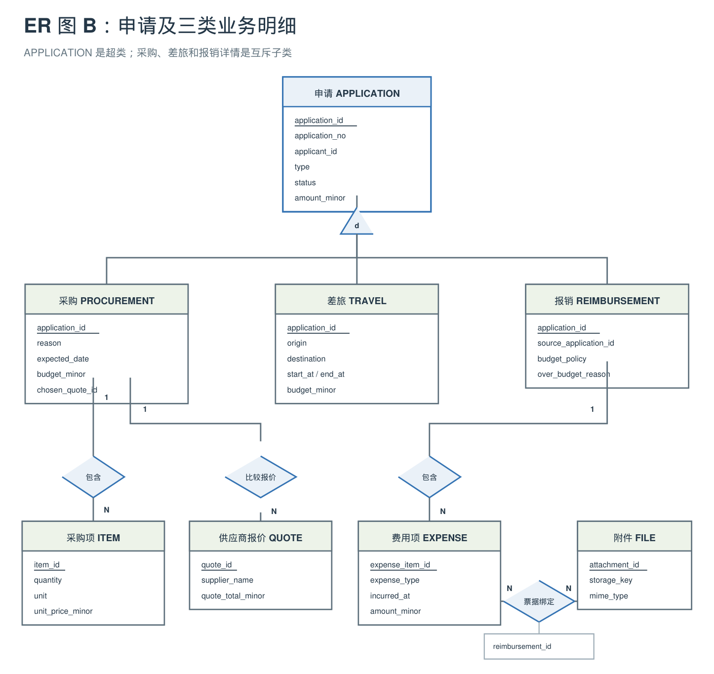

*图 19　申请作为超类，采购、差旅和报销为互斥子类；采购项、报价和费用项通过联系与对应子类关联。*

`applications` 保存编号、类型、申请人、部门、状态、精确合计、模板版本、来源申请和并发版本。采购、差旅和报销详情以 `application_id` 同时作为主键和外键；提交时必须存在且仅存在一份与申请类型匹配的详情。采购项目、报价、费用项目和票据绑定分别成行存储，不写入自由文本或任意 JSON。

报销来源可以为空；非空时必须指向本人已批准的采购或差旅申请，且不能指向本单。课程未要求单次结清，因此系统允许分次报销。服务端计算并展示历史已通过、当前在审、本次和预计累计金额。`WARN_ONLY` 模式要求超预算时填写原因，并在审批详情中标记；`HARD_LIMIT` 模式在提交事务中锁定来源申请，重新汇总已通过和在审金额后判断。驳回、撤回和草稿均不计入占用。

#### 4.2.3 流程、附件、通知与审计

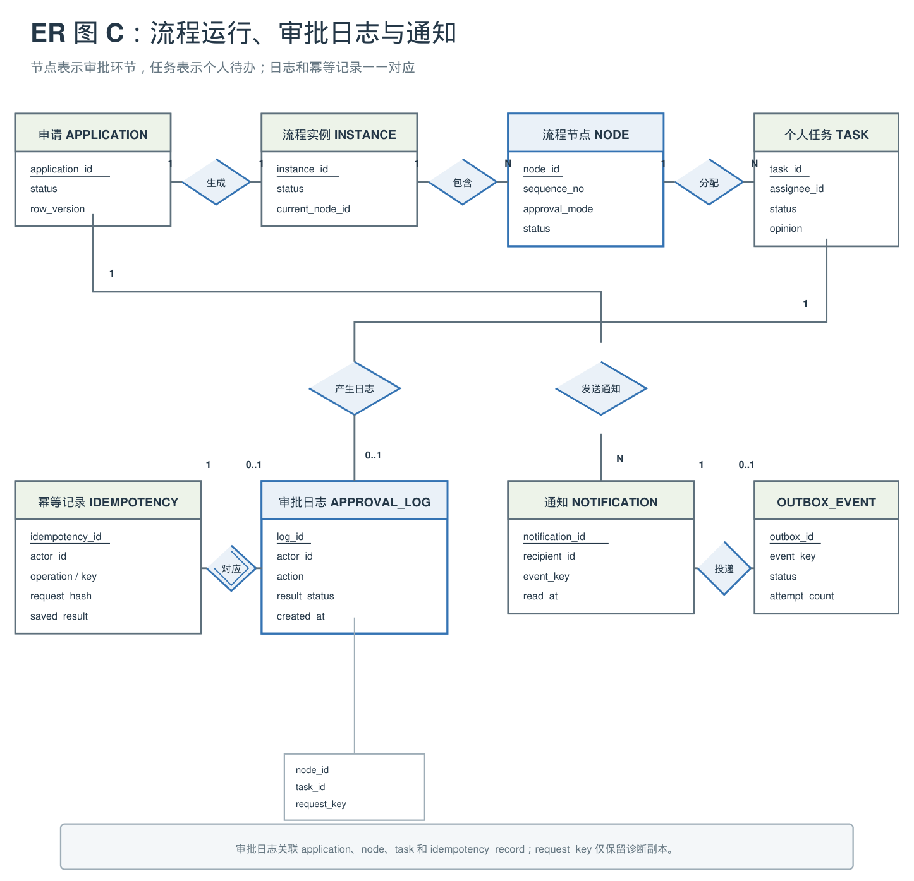

*图 20　流程实例包含运行节点，节点包含个人任务；审批日志、通知、附件绑定和 Outbox 分别关联业务记录。*

固定业务实例保存 `fixed_workflow_version_key`，自定义申请实例保存 `template_version_id`；两者互斥并在提交时确定。`applications.template_version_id` 仅用于自定义业务。

实例持久化全部节点及提交时冻结的条件结果：不匹配节点为 `SKIPPED`，第一个适用节点为 `PENDING`，其余适用节点为 `WAITING`，实例指针指向当前节点。节点按 `SINGLE`、`ALL` 或 `ANY_ONE` 创建一个或多个独立任务。流程推进在同一事务中更新任务、父节点聚合状态、下一适用节点任务和当前指针；驳回或撤回时取消未完成任务及剩余 `WAITING` 节点，`SKIPPED` 节点保持不变。

一份已提交申请对应一个流程实例。`workflow_instance_nodes.instance_id` 外键指向该实例，节点序号在实例内唯一；节点保存名称、规则来源、审批模式、候选审批人和状态快照。每名审批人对应一条独立任务。同一节点的 `PENDING` 任务通过 `(node_id, active_assignee_id)` 唯一约束防止负责人重复；动作重放由 `idempotency_records` 的唯一键控制，父节点保存任务聚合结果并驱动流程推进。

审批日志不可修改，每条成功动作日志通过唯一 `idempotency_record_id` 关联幂等记录；通知以 `(recipient_id, event_key)` 保证唯一。附件原件与业务绑定分开保存，上传后只能绑定到本人可编辑的草稿或费用项。删除草稿时先解除绑定，未引用文件延迟清理；已提交申请、审批日志、通知和审计记录不级联物理删除。

### 4.3 主要数据字典

下表列出关系模型的主键、主要字段、外键方向、空值与唯一规则及删除语义。金额字段使用最小货币单位整数，时间统一采用服务端时间。`CASCADE` 仅适用于未提交的草稿子项；已被历史记录引用的用户、部门、模板和业务记录只能停用或软删除。表名为逻辑设计名，最终字段类型、组合外键和索引以迁移脚本为准。


| 表（主键）                                             | 关键字段与关系                                                                                                                                                                                             | 约束、空值与删除策略                                                                                                                                                                                                  |
| -------------------------------------------------------- | ------------------------------------------------------------------------------------------------------------------------------------------------------------------------------------------------------------ | ----------------------------------------------------------------------------------------------------------------------------------------------------------------------------------------------------------------------- |
| `users` (`id`)                                         | `department_id` → `departments.id`（待确认时可空）, `username`, `email`, `password_hash`, `status`, `created_at`, `updated_at`                                                                            | 激活用户正式归属一个部门；用户名/邮箱唯一；密码只存哈希；被历史引用后停用，不物理删除                                                                                                                                 |
| `departments` (`id`)                                   | `department_code`, `name`, `parent_id` → `departments.id`, `status`                                                                                                                                       | 编码唯一；根部门 `parent_id` 可空；被申请/岗位引用后停用                                                                                                                                                              |
| `roles` (`id`)                                         | `role_key`, `display_name`, `status`                                                                                                                                                                       | `role_key` 唯一；被授权记录引用后停用                                                                                                                                                                                 |
| `user_roles` (`user_id`, `role_id`)                    | 两列分别 FK 到用户和角色；`granted_by`, `granted_at`                                                                                                                                                       | 复合主键；`granted_by` FK 到授权操作者；撤权保留审计记录                                                                                                                                                              |
| `membership_requests` (`id`)                           | `user_id`, `request_type` (`DEPARTMENT_JOIN`/`ROLE_GRANT`), `requested_department_id`, `requested_role_id`, `status` (`PENDING`/`APPROVED`/`REJECTED`/`WITHDRAWN`), `reason`, `reviewed_by`, `reviewed_at` | CHECK 要求部门申请仅有 `requested_department_id`、角色申请仅有 `requested_role_id`；两类均由系统管理员审核；`SYSTEM_ADMIN` 只能由现有管理员直接授予；同一用户至多一条待处理申请，事务内锁定用户后检查；处理动作留审计 |
| `approval_positions` (`id`)                            | `department_id`, `duty_key`, `effective_from`, `effective_to`, `status`                                                                                                                                    | FK 到部门；有效期左闭右开；同部门职责的主岗位有效期不得重叠；岗位历史保留                                                                                                                                             |
| `position_assignments` (`id`)                          | `position_id`, `user_id`, `assignment_type` (`PRIMARY`/`BACKUP`), `assigned_at`, `ended_at`                                                                                                                | FK 到岗位/用户；每岗位同一时刻至多一名有效 PRIMARY；BACKUP 不生成并行待办                                                                                                                                             |
| `workflow_templates` (`id`)                            | `template_key`, `name`, `status`, `created_by`, `created_at`                                                                                                                                               | `template_key` 唯一；停用不删除已被申请引用的版本                                                                                                                                                                     |
| `workflow_template_versions` (`id`)                    | `template_id`, `version_no`, `status`, `published_at`, `created_by`                                                                                                                                        | FK 到模板；(`template_id`, `version_no`) 唯一；发布后不可更新/删除                                                                                                                                                    |
| `template_fields` (`id`)                               | `template_version_id`, `field_key`, `label`, `data_type`, `required`, `validation_rule`, `sequence_no`                                                                                                     | FK 到版本；版本内 `field_key`、`sequence_no` 唯一；随未发布版本维护，发布后只读                                                                                                                                       |
| `template_nodes` (`id`)                                | `template_version_id`, `sequence_no`, `node_name`, `approval_mode` (`SINGLE`/`ALL`/`ANY_ONE`), `duty_key`, `assignee_rule`, `condition_rule`                                                               | FK 到版本；(`template_version_id`, `sequence_no`) 唯一；规则为受控结构化表达式；发布后只读                                                                                                                            |
| `applications` (`id`)                                  | `application_no`, `application_type`, `applicant_id`, `department_id`, `title`, `status`, `total_amount_minor`, `template_version_id`, `source_application_id`, `row_version`, `submitted_at`              | 编号唯一；申请人/部门 FK 必填；模板版本和来源申请可空；提交后正文不可覆盖；历史单不物理删除                                                                                                                           |
| `procurement_details` (`application_id`)               | `reason`, `expected_date`, `budget_minor`, `chosen_quote_id` → `procurement_quotes.id`                                                                                                                    | PK 同时 FK 到申请；一申请一详情；预算非负；所选报价须属于本采购单                                                                                                                                                     |
| `procurement_items` (`id`)                             | `procurement_id` → `procurement_details.application_id`, `item_name`, `specification`, `quantity`, `unit`, `unit_price_minor`, `line_total_minor`                                                         | 数量为正、金额非负；草稿子项可级联，提交后保留                                                                                                                                                                        |
| `procurement_quotes` (`id`)                            | `procurement_id` → `procurement_details.application_id`, `supplier_name`, `quote_total_minor`, `quoted_at`, `is_selected`, `selection_reason`                                                             | FK 到采购详情；金额非负；选中报价理由依规则必填；提交后保留                                                                                                                                                           |
| `travel_details` (`application_id`)                    | `purpose`, `origin`, `destination`, `start_at`, `end_at`, `budget_minor`, `duration_days`                                                                                                                  | PK 同时 FK 到申请；预算非负、结束不早于开始；仅差旅类型可有                                                                                                                                                           |
| `reimbursement_details` (`application_id`)             | `source_application_id`, `explanation`, `budget_policy_snapshot`, `over_budget_reason`                                                                                                                     | PK 同时 FK 到申请；来源可空，非空时 FK 到本人已批准采购/差旅；超额说明按策略校验                                                                                                                                      |
| `expense_items` (`id`)                                 | `reimbursement_id` → `reimbursement_details.application_id`, `expense_type`, `incurred_at`, `amount_minor`, `purpose`, `no_receipt_exception`, `exception_reason`                                         | 金额大于零；无票时原因必填；(`id`, `reimbursement_id`) 唯一供票据绑定复合 FK；草稿子项可级联                                                                                                                          |
| `item_receipts` (`expense_item_id`, `attachment_id`)   | `reimbursement_id`, 两个关系键分别 FK 到费用项/附件                                                                                                                                                        | `UNIQUE(reimbursement_id, attachment_id)` 防止同单重复绑票；复合 FK 确保费用项属于该报销单                                                                                                                            |
| `application_field_values` (`id`)                      | `application_id`, `template_version_id`, `template_field_id`, `value_text`                                                                                                                                 | FK 到申请、模板版本、字段定义；申请/字段唯一；复合 FK 保证字段定义属于该版本                                                                                                                                          |
| `workflow_instances` (`id`)                            | `application_id`, `template_version_id`, `fixed_workflow_version_key`, `current_node_id`, `status`, `row_version`                                                                                          | 每申请至多一实例；固定业务版本键与自定义模板版本 ID 恰有一个非空，二者共同构成 `flowVersionRef`；实际节点和审批人冻结在节点/任务快照中，运行时不重新解析规则                                                          |
| `workflow_instance_nodes` (`id`)                       | `instance_id` → `workflow_instances.id`, `sequence_no`, `node_name`, `approval_mode`, `condition_result_snapshot`, `rule_snapshot`, `status`, `acted_at`                                                  | FK 到实例；(`instance_id`, `sequence_no`) 唯一；提交时冻结条件求值结果；状态含 `SKIPPED`（条件不匹配）和 `CANCELLED`（流程终止），受 CHECK 约束                                                                       |
| `workflow_node_tasks` (`id`)                           | `node_id`, `assignee_id`, `status`, `opinion`, `acted_at`, `transferred_from_id`, 生成列 `active_assignee_id`                                                                                              | FK 到节点和用户；仅对 `PENDING` 任务以 (`node_id`, `active_assignee_id`) 唯一，允许同一人保留历史终态任务；负责人变更在当前任务上更新，完整转办历史由审批/管理审计日志保存；不承担请求幂等键职责                      |
| `approval_logs` (`id`)                                 | `application_id`, `node_id`, `task_id`, `actor_id`, `action`, `opinion`, `from_assignee_id`, `to_assignee_id`, `result_status`, `idempotency_record_id`, `request_key`                                     | FK 到申请/节点/任务/操作者；`result_status` 记录本次动作提交后申请主状态，不表示节点聚合状态；每条动作唯一关联一个幂等记录；`request_key` 仅作诊断字段，不单独定义为全局唯一；追加写，不更新/删除                     |
| `idempotency_records` (`id`)                           | `actor_id`, `operation`, `idempotency_key`, `resource_id`, `draft_version`, `request_hash`, `status`, `saved_result`                                                                                       | 操作者/操作/键复合唯一；`draft_version` 对非草稿操作可空；过期清理不得早于重试窗口                                                                                                                                    |
| `attachments` (`id`)                                   | `uploader_id`, `storage_key`, `original_name`, `mime_type`, `size_bytes`, `sha256`, `created_at`                                                                                                           | `storage_key` 唯一；仅存元数据；被绑定文件不能直接删除，解除绑定后延迟清理                                                                                                                                            |
| `attachment_binds` (`application_id`, `attachment_id`) | `purpose`, `quote_id`（可空）；FK 到申请/附件，报价 FK 可空                                                                                                                                                | 复合主键防止同附件在同申请重复绑定；非空报价须属于同一申请；草稿删除仅解除绑定                                                                                                                                        |
| `notifications` (`id`)                                 | `recipient_id`, `event_key`, `notification_type`, `application_id`, `read_at`, `created_at`                                                                                                                | FK 到收件人/申请；(`recipient_id`, `event_key`) 唯一；删除已提交申请不级联删除通知                                                                                                                                    |
| `outbox_events` (`id`)                                 | `event_key`, `event_type`, `payload`, `status`, `attempt_count`, `next_attempt_at`, `delivered_at`, `last_error`                                                                                           | 业务事件键唯一；与状态变更同事务写入；失败重试并保留投递结果                                                                                                                                                          |
| `push_subscriptions` (`id`)                            | `user_id`, `endpoint_hash`, `encrypted_endpoint`, `encrypted_key_material`, `created_at`, `revoked_at`                                                                                                     | FK 到用户；端点摘要唯一；敏感端点和密钥加密保存；撤销后不再投递                                                                                                                                                       |
| `receipt_extractions` (`id`)                           | `attachment_id`, `content_sha256`, `extracted_fields`, `confidence`, `review_status` (`PENDING_REVIEW`/`CONFIRMED`/`IGNORED`), `reviewed_by`, `reviewed_at`                                                | 附件 FK；摘要用于跨单重复检测；候选值可编辑，确认前不写入费用项、不参与金额或预算计算；确认/忽略均记录操作者和时间                                                                                                    |
| `admin_audit_logs` (`id`)                              | `actor_id`, `action`, `target_type`, `target_id`, `before_summary`, `after_summary`, `reason`, `idempotency_record_id`, `request_key`, `created_at`                                                        | FK 到操作者；幂等业务动作关联对应记录（可空）；`request_key` 仅作诊断；追加写；目标可用类型+ID记录，审计记录不级联删除                                                                                                |

### 4.4 主要表字段草案与约束示例

本节给出主要表字段草案和代表性约束，不是可直接执行的建库脚本。实现阶段的迁移脚本还需补齐全部实体表、外键、索引、`CHECK`、初始化数据以及升级和回滚处理，并与最终 MySQL 结构逐项核对。

```sql
CREATE TABLE applications (
    id                    BIGINT PRIMARY KEY AUTO_INCREMENT,
    application_no        VARCHAR(32) NOT NULL UNIQUE,
    application_type      VARCHAR(32) NOT NULL,
    applicant_id          BIGINT NOT NULL,
    department_id         BIGINT NOT NULL,
    title                 VARCHAR(200) NOT NULL,
    status                VARCHAR(24) NOT NULL,
    total_amount_minor    BIGINT NULL,
    template_version_id   BIGINT NULL,
    source_application_id BIGINT NULL,
    row_version           INT NOT NULL DEFAULT 0,
    submitted_at          DATETIME(3) NULL,
    created_at            DATETIME(3) NOT NULL,
    updated_at            DATETIME(3) NOT NULL,
    INDEX idx_applicant_status_time (applicant_id, status, created_at),
    INDEX idx_department_type_status (department_id, application_type, status, submitted_at)
) ENGINE=InnoDB DEFAULT CHARSET=utf8mb4;

CREATE TABLE workflow_instances (
    id                  BIGINT PRIMARY KEY AUTO_INCREMENT,
    application_id      BIGINT NOT NULL UNIQUE,
    template_version_id BIGINT NULL,
    fixed_workflow_version_key VARCHAR(64) NULL,
    current_node_id     BIGINT NULL,
    status              VARCHAR(24) NOT NULL,
    row_version         INT NOT NULL DEFAULT 0,
    created_at          DATETIME(3) NOT NULL,
    updated_at          DATETIME(3) NOT NULL,
    CHECK ((template_version_id IS NULL) <> (fixed_workflow_version_key IS NULL))
) ENGINE=InnoDB DEFAULT CHARSET=utf8mb4;

-- current_node_id 在节点表建成后补外键；所有模式下均由实例事务维护该指针。

CREATE TABLE workflow_instance_nodes (
    id             BIGINT PRIMARY KEY AUTO_INCREMENT,
    instance_id     BIGINT NOT NULL,
    sequence_no    INT NOT NULL,
    node_name      VARCHAR(100) NOT NULL,
    approval_mode  VARCHAR(16) NOT NULL, -- SINGLE, ALL, ANY_ONE
    condition_result_snapshot BOOLEAN NOT NULL, -- 提交时基于冻结表单值求值；无条件节点为 TRUE
    rule_snapshot  JSON NOT NULL,
    status         VARCHAR(24) NOT NULL, -- WAITING, PENDING, APPROVED, REJECTED, SKIPPED, CANCELLED
    acted_at       DATETIME(3) NULL,
    UNIQUE KEY uk_instance_sequence (instance_id, sequence_no),
    CHECK (approval_mode IN ('SINGLE', 'ALL', 'ANY_ONE')),
    CHECK (status IN ('WAITING', 'PENDING', 'APPROVED', 'REJECTED', 'SKIPPED', 'CANCELLED'))
) ENGINE=InnoDB DEFAULT CHARSET=utf8mb4;

CREATE TABLE workflow_node_tasks (
    id                 BIGINT PRIMARY KEY AUTO_INCREMENT,
    node_id            BIGINT NOT NULL,
    assignee_id        BIGINT NOT NULL,
    status             VARCHAR(24) NOT NULL, -- PENDING, APPROVED, REJECTED, CANCELLED
    opinion            TEXT NULL,
    transferred_from_id BIGINT NULL, -- 仅记录当前任务最近一次转办来源；完整链路以日志为准
    acted_at           DATETIME(3) NULL,
    active_assignee_id BIGINT GENERATED ALWAYS AS
        (CASE WHEN status = 'PENDING' THEN assignee_id ELSE NULL END) STORED,
    UNIQUE KEY uk_node_active_assignee (node_id, active_assignee_id),
    INDEX idx_assignee_status (assignee_id, status, node_id),
    CHECK (status IN ('PENDING', 'APPROVED', 'REJECTED', 'CANCELLED'))
) ENGINE=InnoDB DEFAULT CHARSET=utf8mb4;

CREATE TABLE approval_logs (
    id             BIGINT PRIMARY KEY AUTO_INCREMENT,
    application_id BIGINT NOT NULL,
    node_id        BIGINT NULL,
    task_id        BIGINT NULL,
    idempotency_record_id BIGINT NOT NULL UNIQUE,
    actor_id       BIGINT NOT NULL,
    action         VARCHAR(24) NOT NULL,
    opinion        TEXT NULL,
    from_assignee_id BIGINT NULL,
    to_assignee_id   BIGINT NULL,
    result_status  VARCHAR(24) NOT NULL,
    request_key    VARCHAR(80) NOT NULL, -- 诊断副本；唯一性由幂等记录复合键负责
    created_at     DATETIME(3) NOT NULL,
    INDEX idx_application_time (application_id, created_at)
) ENGINE=InnoDB DEFAULT CHARSET=utf8mb4;

-- action = 'TRANSFER' 时，from_assignee_id、to_assignee_id 和 opinion 必填；
-- 其他审批动作的两个 assignee 字段为空。actor_id 始终表示实际操作者。

CREATE TABLE idempotency_records (
    id               BIGINT PRIMARY KEY AUTO_INCREMENT,
    actor_id         BIGINT NOT NULL,
    operation        VARCHAR(32) NOT NULL,
    idempotency_key  VARCHAR(120) NOT NULL,
    resource_id      BIGINT NOT NULL,
    draft_version    INT NULL,
    request_hash     CHAR(64) NOT NULL,
    status           VARCHAR(16) NOT NULL,
    saved_result     JSON NULL,
    created_at       DATETIME(3) NOT NULL,
    completed_at     DATETIME(3) NULL,
    UNIQUE KEY uk_actor_operation_idempotency (actor_id, operation, idempotency_key)
) ENGINE=InnoDB DEFAULT CHARSET=utf8mb4;

CREATE TABLE notifications (
    id             BIGINT PRIMARY KEY AUTO_INCREMENT,
    recipient_id   BIGINT NOT NULL,
    event_key      VARCHAR(120) NOT NULL,
    notification_type VARCHAR(32) NOT NULL,
    application_id BIGINT NOT NULL,
    read_at        DATETIME(3) NULL,
    created_at     DATETIME(3) NOT NULL,
    UNIQUE KEY uk_recipient_event (recipient_id, event_key),
    INDEX idx_recipient_unread (recipient_id, read_at, created_at)
) ENGINE=InnoDB DEFAULT CHARSET=utf8mb4;
```

下面列出几个影响数据归属正确性的组合约束示例。正式迁移需先为被引用字段建立相同列顺序的唯一索引，再在所有相关表建成后添加循环引用约束；其余表的普通外键、索引和检查约束也一并写入版本化迁移脚本。

```sql
-- 报价 ID 与采购申请 ID 组合，保证所选报价属于本采购单。
ALTER TABLE procurement_quotes
    ADD UNIQUE KEY uk_quote_id_procurement (id, procurement_id);
ALTER TABLE procurement_details
    ADD CONSTRAINT fk_chosen_quote_same_procurement
    FOREIGN KEY (chosen_quote_id, application_id)
    REFERENCES procurement_quotes (id, procurement_id);

-- 动态字段值必须同时属于该申请绑定的模板版本和字段定义。
ALTER TABLE template_fields
    ADD UNIQUE KEY uk_field_id_version (id, template_version_id);
ALTER TABLE applications
    ADD UNIQUE KEY uk_application_id_template (id, template_version_id);
ALTER TABLE application_field_values
    ADD CONSTRAINT fk_value_application_template
    FOREIGN KEY (application_id, template_version_id)
    REFERENCES applications (id, template_version_id),
    ADD CONSTRAINT fk_value_field_template
    FOREIGN KEY (template_field_id, template_version_id)
    REFERENCES template_fields (id, template_version_id);

-- 当前节点必须属于该流程实例，避免跨实例误指向。
ALTER TABLE workflow_instance_nodes
    ADD UNIQUE KEY uk_node_id_instance (id, instance_id);
ALTER TABLE workflow_instances
    ADD CONSTRAINT fk_current_node_same_instance
    FOREIGN KEY (current_node_id, id)
    REFERENCES workflow_instance_nodes (id, instance_id);

-- 将业务记录、实例、运行节点和个人任务限制在已知父记录/有效操作者范围内。
ALTER TABLE applications
    ADD CONSTRAINT fk_application_applicant FOREIGN KEY (applicant_id) REFERENCES users (id),
    ADD CONSTRAINT fk_application_department FOREIGN KEY (department_id) REFERENCES departments (id);
ALTER TABLE workflow_instances
    ADD CONSTRAINT fk_instance_application FOREIGN KEY (application_id) REFERENCES applications (id);
ALTER TABLE workflow_instance_nodes
    ADD CONSTRAINT fk_node_instance FOREIGN KEY (instance_id) REFERENCES workflow_instances (id);
ALTER TABLE workflow_node_tasks
    ADD CONSTRAINT fk_task_node FOREIGN KEY (node_id) REFERENCES workflow_instance_nodes (id),
    ADD CONSTRAINT fk_task_assignee FOREIGN KEY (assignee_id) REFERENCES users (id);
ALTER TABLE approval_logs
    ADD CONSTRAINT fk_log_application FOREIGN KEY (application_id) REFERENCES applications (id),
    ADD CONSTRAINT fk_log_node FOREIGN KEY (node_id) REFERENCES workflow_instance_nodes (id),
    ADD CONSTRAINT fk_log_task FOREIGN KEY (task_id) REFERENCES workflow_node_tasks (id),
    ADD CONSTRAINT fk_log_actor FOREIGN KEY (actor_id) REFERENCES users (id),
    ADD CONSTRAINT fk_log_idempotency FOREIGN KEY (idempotency_record_id) REFERENCES idempotency_records (id);
```

### 4.5 数据完整性、事务与删除策略

- MySQL 8.x、InnoDB、`utf8mb4`；金额统一使用整数分（或经论证的 `DECIMAL(12,2)`），审批金额阈值比较不使用浮点数。
- 状态流转、节点任务、审批日志、下一待办及通知 Outbox 记录在同一 MySQL 事务内提交；后台消费者负责外部通知投递、失败重试和死信处理，不回滚已提交的业务审批结果。
- 所有业务外键定义约束；用户/部门/模板等已被引用数据优先停用或软删除，审批日志和已提交申请不可级联物理删除。
- 索引优先覆盖待办查询 `(assignee_id, status, created_at)`、本人申请 `(applicant_id, status, created_at)`、部门统计 `(department_id, type, status, submitted_at)`；按真实查询计划调整。
- 附件二进制不放数据库；数据库保存存储标识、原文件名、MIME、大小、上传人、业务归属、时间及校验摘要。访问文件前先鉴权。
- 迁移脚本纳入 Git；初始化数据可重复执行且只包含合成用户/示例数据。用唯一约束和应用层校验共同防止重复。

## 5. 技术结构与模块依赖

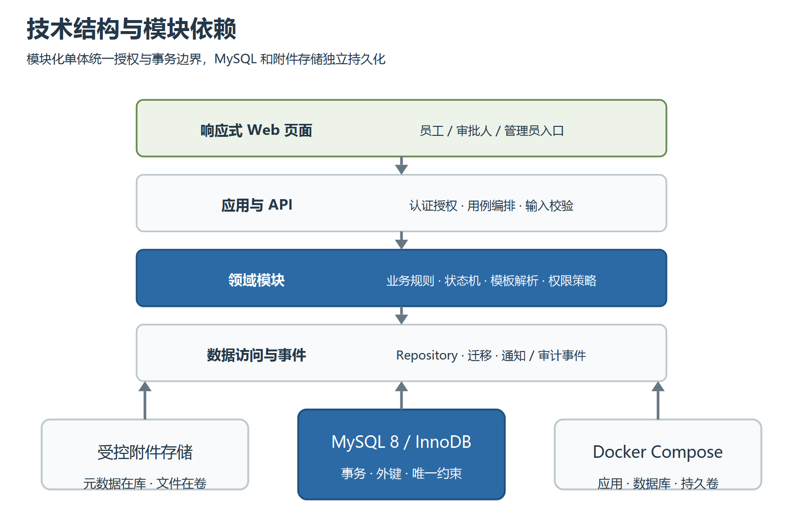

*图 21　模块化单体包含认证、申请、工作流和通知等模块；MySQL、附件存储与容器部署分别承担数据、文件和运行环境。*

一次审批动作要同步维护申请、节点、日志和站内通知记录，这些写入由同一应用在 MySQL 本地事务中完成。模块之间通过应用服务接口调用，控制器不直接访问其他模块的数据表。


| 模块       | 主要职责                             | 允许依赖                     |
| ------------ | -------------------------------------- | ------------------------------ |
| 认证与组织 | 注册登录、用户、部门、角色和授权     | 基础持久层、审计模块         |
| 申请中心   | 草稿、申请列表、详情、编号和撤回     | 三类业务模块、工作流、附件   |
| 三类业务   | 采购、差旅、报销的字段与专属校验     | 申请中心提供的领域接口       |
| 工作流     | 模板版本、路径解析、实例节点和状态机 | 组织查询、通知事件、审计日志 |
| 附件       | 上传限制、元数据和受控下载           | 统一授权服务、文件存储       |
| 通知与统计 | 幂等站内通知和授权范围统计           | 申请/工作流只读查询接口      |

### 5.1 页面、接口、服务与数据对应关系

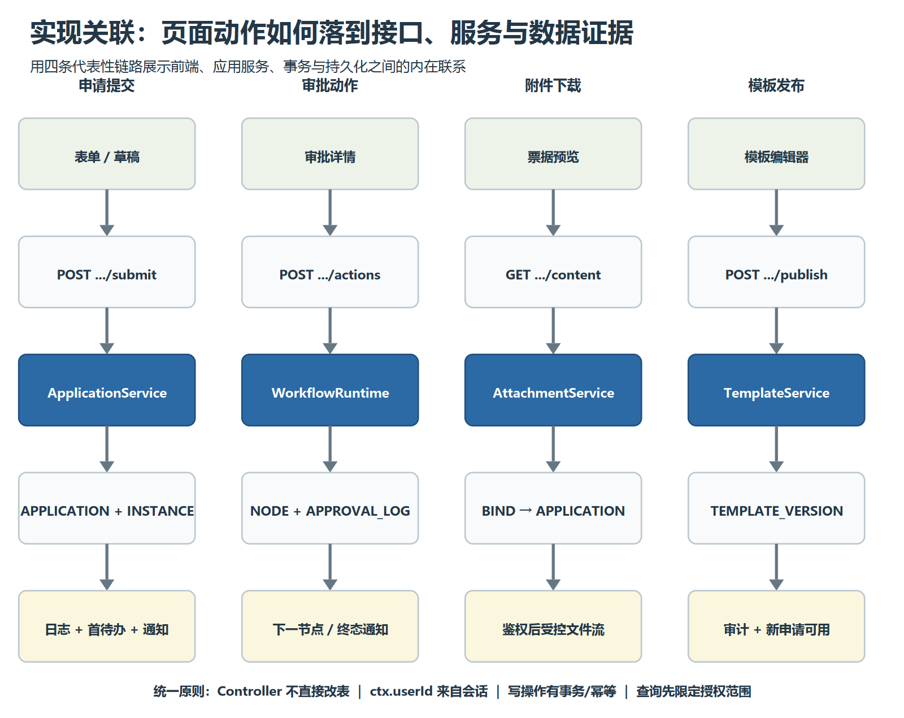

*图 22　四条代表性链路分别连接页面操作、HTTP 接口、应用服务事务和持久化记录。*

申请提交由申请服务协调业务校验和工作流快照，并在同一事务中写入申请、实例节点、提交日志、首个待办和站内通知记录。审批动作由工作流服务锁定当前节点并检验实际审批人；成功后写入一条对应日志，并创建下一节点待办或终态通知。两条链路均使用幂等键和状态版本控制重复请求。

附件服务先按绑定关系定位所属申请，完成访问校验后返回文件流，不开放静态文件目录。模板服务检查字段结构、规则和审批人，发布不可变版本并写入管理审计；员工只能选择已发布模板。Controller 只负责请求转换和读取认证上下文，不跨模块修改数据表。

### 5.2 模块接口设计

以下代码块使用接近 TypeScript 的语言无关伪代码表达 L4 模块契约，实际后端使用 Java 接口和 DTO 实现。控制器只能调用应用服务接口，不能绕过服务层修改其他模块的数据表。身份信息来自 `RequestContext`，客户端请求体不能指定当前用户、角色或审批权限。

#### 5.2.1 公共契约

```typescript
// 每次请求由认证中间件创建；userId 不接受客户端覆盖。
interface RequestContext {
  readonly userId: UserId;
  readonly requestId: string;       // 用于日志关联，不等同于业务幂等键
  readonly occurredAt: Instant;     // 服务端时间
}

// 写接口统一返回最新资源版本，便于前端发现并发修改。
interface CommandResult<T> {
  readonly data: T;
  readonly resourceVersion: number;
}

// 列表查询必须服务端分页；cursor/page 方案在技术栈确定后选择一种。
interface PageQuery {
  readonly page: number;
  readonly pageSize: number;        // 服务端限制最大值
}

interface Page<T> {
  readonly items: readonly T[];
  readonly total: number;
}

interface TransferTaskCommand {
  readonly taskId: TaskId;              // 明确选择要转办的个人任务
  readonly newAssigneeId: UserId;
  readonly reason: string;
}

interface TransferReceiptView {
  readonly nodeId: NodeId;
  readonly taskId: TaskId;
  readonly fromAssigneeId: UserId;
  readonly toAssigneeId: UserId;
  readonly occurredAt: Instant;
  // 不包含申请正文、业务明细或附件；详情读取仍走独立资源授权。
}

// 对外错误使用稳定错误码，不暴露 SQL、堆栈和文件存储路径。
type DomainErrorCode =
  | "FORBIDDEN"
  | "AUTH_FAILED"
  | "VALIDATION_FAILED"
  | "STATE_CHANGED"
  | "IDEMPOTENCY_CONFLICT"
  | "AMBIGUOUS_ASSIGNEE"
  | "ASSIGNEE_NOT_FOUND"
  | "ASSIGNEE_ALREADY_HAS_TASK"
  | "CONDITION_EVALUATION_FAILED"
  | "NO_APPLICABLE_WORKFLOW_NODE"
  | "FILE_POLICY_VIOLATION";
```

#### 5.2.2 认证与组织模块

```typescript
interface IdentityOrganizationService {
  // 公开接口：注册时只能申请加入部门，不能声明管理员、财务等高权限角色。
  register(command: RegisterUserCommand): Promise<CommandResult<PendingIdentityView>>;

  // 登录失败统一返回认证失败，避免泄露用户名或邮箱是否存在。
  login(command: LoginCommand): Promise<SessionView>;

  // 销毁当前服务端会话；重复退出按成功处理。
  logout(ctx: RequestContext): Promise<void>;

  // 当前用户维护自己的非权限资料；用户名/邮箱唯一性由服务端校验。
  getMyProfile(ctx: RequestContext): Promise<UserProfile>;

  updateMyProfile(ctx: RequestContext, command: UpdateProfileCommand)
    : Promise<CommandResult<UserProfile>>;

  // 管理接口：审核部门加入或业务角色申请。执行前校验 SYSTEM_ADMIN，
  // 锁定申请用户并条件更新 PENDING 状态；通过/拒绝均追加管理审计。
  reviewMembershipRequest(ctx: RequestContext, command: ReviewMembershipRequestCommand)
    : Promise<CommandResult<MembershipRequestView>>;

  // 管理接口：授权采用独立命令，禁止复用普通资料更新接口。
  grantRole(ctx: RequestContext, command: GrantRoleCommand)
    : Promise<CommandResult<RoleGrantView>>;

  revokeRole(ctx: RequestContext, command: RevokeRoleCommand)
    : Promise<CommandResult<RoleGrantView>>;

  // 供其他模块只读查询；不返回密码哈希、会话密钥等敏感字段。
  getActiveUser(userId: UserId): Promise<ActiveUserView | null>;
  getDepartmentManager(departmentId: DepartmentId, at: Instant)
    : Promise<UserId | null>;
}
```

#### 5.2.3 审批岗位与人员变更模块

```typescript
type ApprovalDuty = "DEPARTMENT_REVIEW" | "FINANCE_REVIEW" | "EXECUTIVE_REVIEW";

interface ApprovalPositionService {
  // 同一部门 + 职责 + 生效时间范围内只能存在一个主审批人。
  // 若时间范围与另一主审批人重叠，返回 AMBIGUOUS_ASSIGNEE。
  appointPrimary(ctx: RequestContext, command: AppointPrimaryCommand)
    : Promise<CommandResult<ApprovalPositionView>>;

  // 人员接替不覆盖老人记录：结束旧任期，再创建带生效时间的新任期。
  // 新提交申请解析新人；已提交申请继续使用原审批路径快照。
  replacePrimary(ctx: RequestContext, command: ReplacePrimaryCommand)
    : Promise<CommandResult<ApprovalPositionView>>;

  // 备用人员只是可转办候选人，不与主审批人同时持有有效待办。
  setBackup(ctx: RequestContext, command: SetBackupCommand)
    : Promise<CommandResult<ApprovalPositionView>>;

  // 工作流提交时按节点模式解析候选人；SINGLE 必须一人，ALL/ANY_ONE 至少一人。
  resolveAssignees(query: ResolveDutyQuery, mode: AssigneeMode): Promise<UserId[]>;
}
```

#### 5.2.4 申请中心模块

```typescript
interface ApplicationService {
  // applicantId、departmentId 和创建时间取自 ctx 与服务端组织关系。
  createDraft(ctx: RequestContext, command: CreateDraftCommand)
    : Promise<CommandResult<ApplicationSummary>>;

  // 只能修改本人草稿；已提交正文不能通过该接口覆盖。
  updateDraft(ctx: RequestContext, applicationId: ApplicationId, command: UpdateDraftCommand)
    : Promise<CommandResult<ApplicationSummary>>;

  // 提交在一个事务中调用业务校验、路径解析、首待办、日志和通知接口。
  submit(ctx: RequestContext, applicationId: ApplicationId, idempotencyKey: string)
    : Promise<CommandResult<ApplicationDetail>>;

  // 与审批竞争时锁定同一申请；若状态已变化返回 STATE_CHANGED。
  withdraw(ctx: RequestContext, applicationId: ApplicationId, idempotencyKey: string)
    : Promise<CommandResult<ApplicationDetail>>;

  // 驳回/撤回后复制成新草稿，并通过 sourceApplicationId 关联原单。
  copyAsNewDraft(ctx: RequestContext, sourceApplicationId: ApplicationId)
    : Promise<CommandResult<ApplicationSummary>>;

  // allowedActions 由服务端计算；详情只返回当前用户有权查看的字段和附件元数据。
  getDetail(ctx: RequestContext, applicationId: ApplicationId): Promise<ApplicationDetail>;
  listMine(ctx: RequestContext, query: ApplicationListQuery): Promise<Page<ApplicationSummary>>;
}
```

#### 5.2.5 采购业务模块

```typescript
interface ProcurementService {
  // 草稿阶段保存结构化采购明细，不使用一段自由文本替代多行项目。
  saveDraftDetails(ctx: RequestContext, applicationId: ApplicationId, command: SaveProcurementCommand)
    : Promise<CommandResult<ProcurementView>>;

  // 提交校验：至少两条明细；通常至少两家报价。
  // 单一来源必须有说明，并在返回视图中设置 singleSourceWarning=true。
  validateForSubmit(applicationId: ApplicationId): Promise<ProcurementValidationResult>;

  // 单价 × 数量与总额由服务端以最小货币单位重新计算。
  calculateExpectedTotal(items: readonly ProcurementItemInput[]): MoneyMinor;

  // 只返回授权用户可见的报价附件引用，不直接返回文件存储路径。
  getView(ctx: RequestContext, applicationId: ApplicationId): Promise<ProcurementView>;
}
```

#### 5.2.6 差旅业务模块

```typescript
interface TravelService {
  saveDraftDetails(ctx: RequestContext, applicationId: ApplicationId, command: SaveTravelCommand)
    : Promise<CommandResult<TravelView>>;

  // 结束时间不得早于开始时间；预算不得为负。
  validateForSubmit(applicationId: ApplicationId): Promise<TravelValidationResult>;

  // 基础口径采用自然日，并把口径写入返回结果，避免前后端各算一套。
  calculateDuration(startAt: Instant, endAt: Instant, policy: "CALENDAR_DAY")
    : TravelDuration;

  // 只列出当前用户本人且状态为 APPROVED 的差旅，供报销选择关联。
  listApprovedForReimbursement(ctx: RequestContext): Promise<readonly TravelReference[]>;
}
```

#### 5.2.7 报销业务模块

```typescript
interface ReimbursementService {
  saveDraftDetails(ctx: RequestContext, applicationId: ApplicationId, command: SaveReimbursementCommand)
    : Promise<CommandResult<ReimbursementView>>;

  // 服务端重新验证关联申请属于本人且已批准，不能信任客户端传来的状态。
  validateLinkedApplication(ctx: RequestContext, linkedApplicationId: ApplicationId)
    : Promise<LinkedApplicationView>;

  // 金额使用“分”或精确 Decimal；同一报销单内票据 ID 不得重复。
  validateAndCalculate(items: readonly ExpenseItemInput[])
    : Promise<ReimbursementCalculation>;

  // 无票例外必须带原因；返回结果供财务页面突出显示。
  validateForSubmit(applicationId: ApplicationId): Promise<ReimbursementValidationResult>;

  getView(ctx: RequestContext, applicationId: ApplicationId): Promise<ReimbursementView>;
}
```

#### 5.2.8 工作流模板与运行模块

```typescript
type AssigneeMode = "SINGLE" | "ALL" | "ANY_ONE";
// ALL/ANY_ONE 为每位审批人创建独立子任务，不能让多个用户共享同一条待办记录。

interface WorkflowTemplateService {
  createDraft(ctx: RequestContext, command: CreateTemplateCommand)
    : Promise<CommandResult<TemplateDraftView>>;

  updateDraft(ctx: RequestContext, templateId: TemplateId, command: UpdateTemplateCommand)
    : Promise<CommandResult<TemplateDraftView>>;

  // 发布前检查字段 key、节点顺序、适用部门和审批规则。
  // 发布后版本不可修改，再次编辑必须产生新版本。
  publish(ctx: RequestContext, templateId: TemplateId)
    : Promise<CommandResult<PublishedTemplateView>>;

  disable(ctx: RequestContext, templateId: TemplateId)
    : Promise<CommandResult<TemplateView>>;
}

interface WorkflowRuntimeService {
  // 提交时把规则解析成节点与候选审批人快照，按模式实例化独立任务。
  resolveSnapshot(command: ResolveWorkflowCommand): Promise<WorkflowSnapshot>;

  // action 为 APPROVE 或 REJECT；服务端从 nodeId 和会话用户解析个人任务。
  // 会签/或签以 taskId 记录单人动作；驳回意见必填，requestKey 按操作者幂等。
  actOnNode(ctx: RequestContext, nodeId: NodeId, command: TaskActionCommand, requestKey: string)
    : Promise<CommandResult<WorkflowProgressView>>;

  // 当前负责人可转办自己的任务；管理员须有匹配部门/流程范围的 TASK_TRANSFER 授权。
  // command.taskId 标识待转办任务；此权限不授予申请正文或附件访问权。
  // 同一事务更新待办，并追加含 actor/from/to/opinion 的业务日志、管理审计和双方通知。
  // requestKey 用于幂等；不允许通过直接更新 assignee_id 静默改变历史。
  transferPendingTask(ctx: RequestContext, nodeId: NodeId, command: TransferTaskCommand,
    requestKey: string): Promise<CommandResult<TransferReceiptView>>;

  listMyPendingTasks(ctx: RequestContext, query: TaskListQuery): Promise<Page<TaskSummary>>;
  listMyHandledTasks(ctx: RequestContext, query: TaskListQuery): Promise<Page<TaskSummary>>;
  getProgress(ctx: RequestContext, applicationId: ApplicationId): Promise<WorkflowProgressView>;
}
```

#### 5.2.9 附件模块

```typescript
interface AttachmentService {
  // 校验扩展名、真实 MIME、单文件大小、文件数量和总大小。
  // storageKey 由服务端随机生成；originalName 仅用于显示。
  upload(ctx: RequestContext, command: UploadAttachmentCommand, content: BinaryStream)
    : Promise<CommandResult<AttachmentMetadata>>;

  // 绑定前确认上传者与目标草稿/费用项目关系，防止复用他人的临时文件。
  bindToOwner(ctx: RequestContext, attachmentId: AttachmentId, owner: AttachmentOwnerRef)
    : Promise<CommandResult<AttachmentMetadata>>;

  // 每次预览/下载都沿 owner 关系回到申请重新鉴权。
  // 返回受控流，不向调用方暴露服务器文件系统路径。
  openForAuthorizedUser(ctx: RequestContext, attachmentId: AttachmentId)
    : Promise<AuthorizedFileStream>;
}

interface ReceiptRecognitionService {
  // 仅对已授权的票据附件执行识别；重复检测使用文件摘要和票据关键字段双重匹配。
  // 返回逐字段候选值、置信度和异常标记，不自动修改费用字段或触发审批。
  extractCandidates(ctx: RequestContext, attachmentId: AttachmentId)
    : Promise<CommandResult<ReceiptExtractionView>>;

  // 用户可修改候选值；确认前状态为 PENDING_REVIEW，不参与金额和预算计算。
  // 确认时重新执行金额、日期、票据归属和重复绑定校验，requestKey 防止重复生成费用项。
  confirmExtraction(ctx: RequestContext, extractionId: ExtractionId,
    command: ConfirmReceiptFieldsCommand, requestKey: string)
    : Promise<CommandResult<ExpenseItemView>>;

  // 忽略仅结束本次候选核对，不删除原票据；状态与操作者需要留痕。
  ignoreExtraction(ctx: RequestContext, extractionId: ExtractionId)
    : Promise<CommandResult<ReceiptExtractionView>>;
}
```

#### 5.2.10 通知模块

```typescript
interface NotificationService {
  // 仅供业务模块调用；recipientId 由事件规则计算，不接受普通客户端指定。
  // (recipientId, eventKey) 唯一，重试不会创建重复通知。
  appendEvent(command: AppendNotificationEventCommand): Promise<NotificationEventId>;

  // 用户只能读取自己的通知；默认按创建时间倒序分页。
  listMine(ctx: RequestContext, query: NotificationQuery): Promise<Page<NotificationView>>;
  countUnread(ctx: RequestContext): Promise<number>;

  // UPDATE 必须同时匹配 notificationId 与 ctx.userId。
  markRead(ctx: RequestContext, notificationId: NotificationId)
    : Promise<CommandResult<NotificationView>>;
}
```

#### 5.2.11 查询统计模块

```typescript
interface StatisticsService {
  // 个人统计只聚合本人申请、本人待办和本人已办。
  getMyDashboard(ctx: RequestContext, query: TimeRangeQuery): Promise<PersonalDashboardView>;

  // 部门统计先校验负责人身份和授权部门范围。
  // “已通过金额”只统计指定提交时间范围内最终状态为 APPROVED 的申请。
  getDepartmentDashboard(ctx: RequestContext, query: DepartmentStatisticsQuery)
    : Promise<DepartmentDashboardView>;

  // 财务统计不会因为用户拥有 FINANCE 角色就自动覆盖全企业，仍按显式授权范围过滤。
  getFinanceSummary(ctx: RequestContext, query: FinanceStatisticsQuery)
    : Promise<FinanceSummaryView>;
}
```

#### 5.2.12 审计模块

```typescript
interface AuditService {
  // 业务审批写 approval_logs；角色、模板和转办等管理动作写 admin_audit_logs。
  // 两类日志均采用追加写，业务接口不提供 update/delete。
  appendManagementEvent(event: ManagementAuditEvent): Promise<AuditEventId>;

  // 查询审计日志本身也需要授权，并记录查询范围。
  search(ctx: RequestContext, query: AuditQuery): Promise<Page<AuditEventView>>;
}
```

调用方向为页面/API 层调用应用服务。`ApplicationService` 协调提交和撤回事务，并调用业务校验及 `WorkflowRuntimeService`。`WorkflowRuntimeService` 是审批动作的唯一入口，负责锁定实例和节点，并更新申请状态、当前节点指针及节点状态。

每类用例由一个事务入口维护状态。业务模块、通知模块和控制器不直接写入流程状态；通知与审计在调用方事务内追加记录，不反向修改申请状态。

### 5.3 对外 HTTP 契约示例

接口按资源组织，通过认证会话确定操作者；客户端不能以 `applicant_id` 或 `role` 替代身份。提交、审批和撤回接口接收幂等键，响应返回最新状态和允许动作，供前端在冲突后刷新。

#### API—权限—数据实体索引

下表列出前后端联调所需的主要路由、关键参数、成功响应、权限和数据实体。服务端使用稳定错误码：权限拒绝为 `FORBIDDEN`，状态竞争为 `STATE_CHANGED`，幂等键内容冲突为 `IDEMPOTENCY_CONFLICT`，字段校验失败为 `VALIDATION_FAILED`。


| 方法与路径                                                                                                                  | 请求 → 成功响应                                                                         | 权限与主要错误                                                                                                                                    | 主要数据实体                                                              |
| ----------------------------------------------------------------------------------------------------------------------------- | ------------------------------------------------------------------------------------------ | --------------------------------------------------------------------------------------------------------------------------------------------------- | --------------------------------------------------------------------------- |
| `POST /api/auth/register`                                                                                                   | `RegisterUserCommand` → `PendingIdentityView`                                           | 公开；创建待确认普通身份，不接收角色字段                                                                                                          | `users`, membership requests                                              |
| `POST /api/auth/login`                                                                                                      | `LoginCommand` → `SessionView`                                                          | 公开；统一 `AUTH_FAILED`                                                                                                                          | `users`, 服务端会话                                                       |
| `POST /api/auth/logout`                                                                                                     | 当前会话 → `204`                                                                        | 已登录；重复退出视为成功                                                                                                                          | 服务端会话                                                                |
| `GET/PATCH /api/me`                                                                                                         | 个人资料/`UpdateProfileCommand` → `UserProfile`                                         | 仅本人；`VALIDATION_FAILED`                                                                                                                       | `users`                                                                   |
| `POST /api/me/department-requests` / `POST /api/me/role-requests`                                                           | 部门/角色申请 → `MembershipRequestView`                                                 | 已登录本人；不能请求 `SYSTEM_ADMIN`                                                                                                               | membership requests                                                       |
| `POST /api/admin/membership-requests/{id}/review`                                                                           | `{decision, reason}` → 处理结果                                                         | `SYSTEM_ADMIN`；锁定用户并检查 `PENDING`；记录审计；`STATE_CHANGED`                                                                               | `users`, `user_roles`, `membership_requests`, `admin_audit_logs`          |
| `POST /api/admin/users/{id}/roles` / `DELETE /api/admin/users/{id}/roles/{roleKey}`                                         | 授权/撤权命令 → `RoleGrantView`                                                         | `SYSTEM_ADMIN`；不得通过个人资料接口改角色                                                                                                        | `user_roles`, `admin_audit_logs`                                          |
| `POST /api/admin/departments`; `PATCH /api/admin/departments/{id}`                                                          | 部门创建/修改 → `DepartmentView`                                                        | `SYSTEM_ADMIN`；停用被引用部门不物理删除                                                                                                          | `departments`, `admin_audit_logs`                                         |
| `POST /api/admin/approval-positions` / `POST /api/admin/approval-positions/{id}/replace`                                    | 职责、主/备审批人及生效时间 → `ApprovalPositionView`                                    | `SYSTEM_ADMIN`；任期重叠返回 `AMBIGUOUS_ASSIGNEE`                                                                                                 | `approval_positions`, `position_assignments`, `admin_audit_logs`          |
| `GET /api/applications`                                                                                                     | 类型、状态、时间、页码 → `Page<ApplicationSummary>`                                     | 仅本人申请；越权范围 `FORBIDDEN`                                                                                                                  | `applications`                                                            |
| `POST /api/applications`                                                                                                    | `CreateDraftCommand` → `ApplicationSummary`                                             | 已登录且属于有效部门；`VALIDATION_FAILED`                                                                                                         | `applications`, 对应业务详情                                              |
| `PATCH /api/applications/{id}`                                                                                              | `UpdateDraftCommand` → `ApplicationSummary`                                             | 本人且仍为草稿；否则 `FORBIDDEN`/`STATE_CHANGED`                                                                                                  | `applications`, 业务明细                                                  |
| `PUT /api/applications/{id}/procurement` / `PUT /api/applications/{id}/travel` / `PUT /api/applications/{id}/reimbursement` | 对应业务详情 → `ApplicationDetail`                                                      | 本人草稿；字段规则服务端校验                                                                                                                      | 对应业务详情表                                                            |
| `POST /api/applications/{id}/procurement-items`; `PATCH/DELETE /api/applications/{id}/procurement-items/{itemId}`           | 采购明细 → 明细视图/`204`                                                               | 本人采购草稿；金额、数量服务端重算                                                                                                                | `procurement_items`                                                       |
| `POST /api/applications/{id}/procurement-quotes`; `PATCH/DELETE /api/applications/{id}/procurement-quotes/{quoteId}`        | 报价信息 → 报价视图/`204`                                                               | 本人采购草稿；报价归属该采购单                                                                                                                    | `procurement_quotes`, `attachments`                                       |
| `POST /api/applications/{id}/expense-items`; `PATCH/DELETE /api/applications/{id}/expense-items/{itemId}`                   | 费用行 → 费用视图/`204`                                                                 | 本人报销草稿；服务端重算总额和预算状态                                                                                                            | `expense_items`, `reimbursement_details`                                  |
| `PUT/DELETE /api/applications/{id}/expense-items/{itemId}/receipts/{attachmentId}`                                          | 票据绑定/解除 → `204`                                                                   | 仅本人报销草稿；检查附件归属及重复绑定                                                                                                            | `item_receipts`, `attachments`                                            |
| `POST /api/applications/{id}/submit`                                                                                        | `Idempotency-Key` → `ApplicationDetail`                                                 | 本人草稿；规则或审批人校验失败、`IDEMPOTENCY_CONFLICT`                                                                                            | 申请、业务明细、实例/节点、日志、通知、幂等记录                           |
| `GET /api/applications/{id}`                                                                                                | 无 → 授权范围内 `ApplicationDetail`                                                     | 本人、当前流程所需或显式授权；附件单独复核                                                                                                        | `applications`, `workflow_instance_nodes`, `approval_logs`, `attachments` |
| `POST /api/applications/{id}/withdraw`                                                                                      | `Idempotency-Key` → `ApplicationDetail`                                                 | 本人且申请审批中；`FORBIDDEN`/`STATE_CHANGED`                                                                                                     | 申请、实例/节点、日志、通知、幂等记录                                     |
| `GET /api/todos` / `GET /api/handled`                                                                                       | 筛选、分页 → `Page<TaskSummary>`                                                        | 仅本人当前待办/已处理节点                                                                                                                         | `workflow_instance_nodes`, `approval_logs`, `applications`                |
| `POST /api/workflow-nodes/{nodeId}/actions`                                                                                 | `Idempotency-Key` + `{action, opinion}` → `WorkflowProgressView`                        | 当前节点个人任务审批人；`FORBIDDEN`/`STATE_CHANGED`/`IDEMPOTENCY_CONFLICT`                                                                        | `workflow_instances`, nodes, tasks, logs, notifications, Outbox, 幂等记录 |
| `POST /api/templates`; `PATCH /api/templates/{id}`; `POST /api/templates/{id}/publish`; `POST /api/templates/{id}/disable`  | 模板草案/发布/停用 → 版本视图                                                           | `SYSTEM_ADMIN`；校验失败 `VALIDATION_FAILED`                                                                                                      | `workflow_templates`, versions, fields, nodes, `admin_audit_logs`         |
| `POST /api/attachments` / `GET /api/attachments/{id}/content`                                                               | 文件流/附件 ID → 元数据或受控文件流                                                     | 上传者草稿绑定；下载按申请重新授权；`FILE_POLICY_VIOLATION`/`FORBIDDEN`                                                                           | `attachments`, `attachment_binds`, `item_receipts`                        |
| `POST /api/receipt-extractions`; `POST /api/receipt-extractions/{id}/confirm`; `POST /api/receipt-extractions/{id}/ignore`  | 附件 ID → 逐字段候选/置信度；核对后字段 + `Idempotency-Key` → 费用项；忽略 → 候选状态 | 仅附件授权用户；确认前保持 `PENDING_REVIEW`，不写费用项或参与计算；确认时重新校验；重复票据返回 `DUPLICATE_RECEIPT_WARNING`                       | `receipt_extractions`, `attachments`, `expense_items`, `item_receipts`    |
| `GET /api/notifications` / `PATCH /api/notifications/{id}/read`                                                             | 分页/已读命令 → 通知视图                                                                | 仅收件人；他人通知 `FORBIDDEN`                                                                                                                    | `notifications`                                                           |
| `PUT/DELETE /api/notifications/subscriptions/web-push`                                                                      | Push 订阅端点 → `204`                                                                   | 仅本人；订阅密钥加密存储且可撤销                                                                                                                  | push subscriptions, `users`                                               |
| `GET /api/statistics/me`、`/department`、`/finance`                                                                         | 时间范围及授权部门 → 对应统计视图                                                       | 本人/授权部门/显式财务范围；`FORBIDDEN`                                                                                                           | `applications`, nodes, `expense_items`                                    |
| `POST /api/workflow-nodes/{nodeId}/transfer`                                                                                | `{taskId, newAssigneeId, reason}` + `Idempotency-Key` → `TransferReceiptView`           | 当前任务负责人，或具有匹配部门/流程范围 `TASK_TRANSFER` 授权的管理员；正文/附件仍单独授权；目标已有同节点有效任务返回 `ASSIGNEE_ALREADY_HAS_TASK` | nodes, tasks, `approval_logs`, `admin_audit_logs`, notifications          |

表中路由与 5.2 节服务接口及第 4.3 节数据字典对应，字段校验以命令 DTO 和业务规则为准。控制器不直接访问数据库。

```http
POST /api/applications/{id}/submit
Idempotency-Key: 8d2e...          # 同一提交重试使用同一键

POST /api/workflow-nodes/{nodeId}/actions
Idempotency-Key: e91a...
Content-Type: application/json

{"action": "REJECT", "opinion": "报价依据不足，请补充说明"}

GET /api/applications/{id}
-> {"status": "IN_APPROVAL", "allowed_actions": ["VIEW", "WITHDRAW"]}
```

Docker Compose 包含应用、MySQL 和持久卷。启动时依次执行数据库健康检查、迁移和可重复的演示数据初始化；上传目录与数据库分别挂载持久卷。敏感配置通过环境变量注入，仓库只提交 `.env.example`，不保存真实密码或令牌。

## 6. 非功能与安全设计


| 目标               | 设计措施                                          | 中期/最终验证               |
| -------------------- | --------------------------------------------------- | ----------------------------- |
| 权限隔离           | API 层按资源、动作、当前节点校验；默认拒绝        | 越权列表/详情/附件/审批测试 |
| 数据一致性与持久化 | InnoDB 事务、外键、唯一键、迁移、持久卷           | 并发审批；重启后核对记录    |
| 凭据安全           | 框架密码哈希；环境变量注入密钥；不提交密钥        | 仓库扫描、注册登录验证      |
| 文件安全           | MIME/后缀/大小/数量限制，随机存储 key，下载前鉴权 | 非授权用户访问应拒绝        |
| 可维护性           | 业务模块分离、模板版本、测试与文档同步            | 新建一种模板不改应用代码    |
| 可部署性           | Docker Compose、健康检查、迁移说明、示例配置      | 空环境按说明启动成功        |

没有匹配授权规则的请求默认拒绝。注册接口忽略高权限字段，管理员授权只能通过独立接口执行并记录审计。密码至少 8 个字符，使用框架提供的自适应哈希；动态查询使用参数绑定；错误响应不返回堆栈、SQL 或存储路径。原文件名仅用于显示，实际文件使用随机 key 存储，防止目录遍历和重名覆盖。

一致性测试直接检查最终数据：应用和数据库重启后，已提交记录仍可查询；提交和审批接口超时重试不会增加重复日志、待办或通知；迁移与初始化脚本可以重复执行。性能测试按演示数据量进行，列表查询使用分页并核对组合索引的执行计划，附件内容不随列表接口加载。

## 7. 验证计划与风险

### 7.1 测试策略

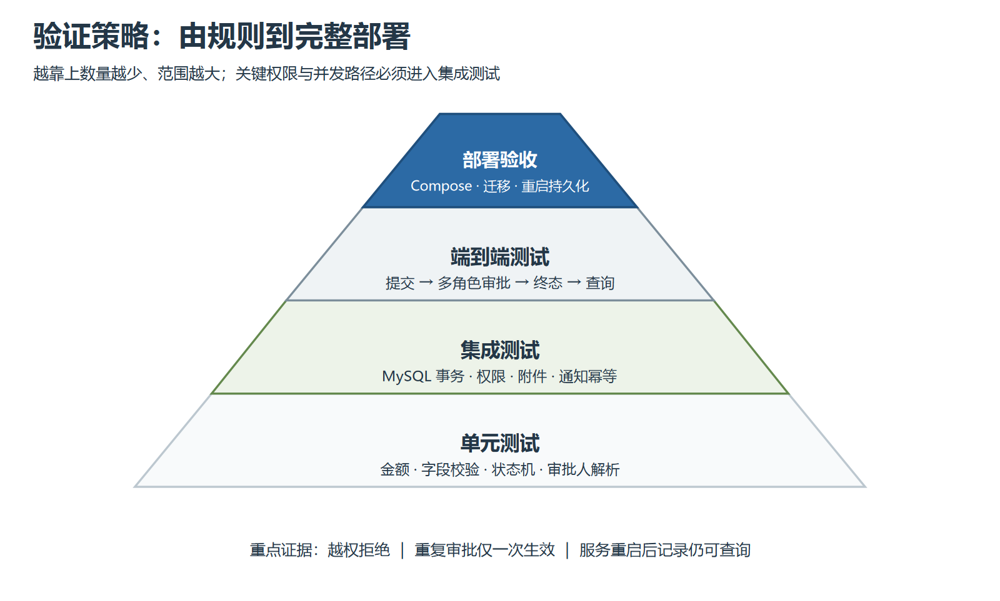

*图 23　规则测试数量最多，部署验收数量最少；权限、事务与幂等性集中在集成层验证。*

单元测试检验金额、日期、动态字段、审批状态机和审批人解析等规则。集成测试连接真实 MySQL，检验事务锁、唯一约束、权限查询和附件归属。端到端测试通过浏览器完成提交、多人审批、通知和查询。部署验收从空环境启动 Compose，执行迁移和初始化，并在重启后检查持久卷中的数据。


| 测试主题         | 关键输入                                                                                       | 预期结果                                                                                                                                                                                         |
| ------------------ | ------------------------------------------------------------------------------------------------ | -------------------------------------------------------------------------------------------------------------------------------------------------------------------------------------------------- |
| 权限越界         | 普通员工请求他人详情或票据                                                                     | 返回拒绝；无业务数据泄露                                                                                                                                                                         |
| 本人审批         | 申请人同时兼任部门负责人                                                                       | 路径解析或节点执行拒绝自批                                                                                                                                                                       |
| 并发审批         | 两个浏览器同时批准同一节点                                                                     | 只有一次成功；仅一个下一待办和一条有效日志                                                                                                                                                       |
| 审批与撤回竞争   | 两请求并发操作同一申请                                                                         | 最多一方成功，另一方收到状态已变化                                                                                                                                                               |
| 数据关系约束     | 错配业务详情类型、跨模板版本字段、跨报销单复用票据                                             | FK/唯一/CHECK 与服务端校验均拒绝；无孤立绑定                                                                                                                                                     |
| 通知幂等         | 相同收件人/业务事件重复写入                                                                    | 唯一键阻止重复；未读数与记录数一致                                                                                                                                                               |
| 通知事件覆盖     | 新待办、通过、驳回、撤回依次触发                                                               | 正确收件人收到可跳转通知；用户间隔离                                                                                                                                                             |
| 模板版本冻结     | 发布 v4 后回看 v3 申请，再提交新申请                                                           | 旧申请字段定义/值和节点不变；新申请采用 v4                                                                                                                                                       |
| 固定流程版本冻结 | 首次提交使用 V1，发布 V2 后再提交同类申请                                                      | 旧实例仍记录 V1 和原节点快照；新实例使用 V2                                                                                                                                                      |
| 条件节点路由     | 自定义必填字段及固定业务字段/配置分别触发匹配与不匹配分支；为不适用节点配置不存在的审批人      | 不适用节点不解析审批人且为 `SKIPPED`；适用节点才解析审批人；推进选择下一个匹配的 `WAITING` 节点；条件不可求值时提交拒绝                                                                          |
| 节点状态推进     | 两节点顺序流程提交、首节点通过、终态驳回/撤回                                                  | 首节点 `PENDING`、后续适用节点 `WAITING`；推进时仅一节点 `PENDING`；终止时剩余 `WAITING` 节点 `CANCELLED`                                                                                        |
| 会话防护         | 缺少 CSRF Token、会话失效后重放、停用用户继续请求                                              | 请求拒绝；停用后会话立即失效                                                                                                                                                                     |
| 身份申请与授权   | 重复提交部门/角色申请；普通用户请求 `SYSTEM_ADMIN`；两个管理员同时审核同一申请                 | 同一用户最多一条待处理申请；高权限自助申请被拒；仅一个审核状态更新成功并生成一次授权审计                                                                                                         |
| 采购规则         | 少于两条明细；仅一家报价无单一来源说明；非最低价无理由                                         | 服务端拒绝并返回稳定规则码；满足条件后审批详情显示原因                                                                                                                                           |
| 额度口径排除     | 同一来源下存在草稿、驳回及撤回报销                                                             | 三类金额均不计入占用，服务端与页面金额一致                                                                                                                                                       |
| 响应式与移动端   | Web 与独立移动客户端分别完成同一审批                                                           | Web 桌面/手机布局通过；移动客户端完成注册、申请、审批和通知，并有设备或模拟器运行记录                                                                                                            |
| 转办授权与审计   | 当前负责人转办本人任务；范围授权管理员代办转办指定任务并重放相同请求；无范围授权管理员尝试转办 | 前两者仅产生一次转办；后一请求拒绝；甲的原待办失效、乙获得唯一新待办；日志正确记录 `actor_id`、`from_assignee_id`、`to_assignee_id`、`opinion` 并关联同一幂等记录；管理员不因此获得正文/附件权限 |
| 非法转办         | 转给申请人、停用用户、无相应职责用户，或转给同节点已有有效任务的用户                           | 事务拒绝并返回稳定规则码（重复目标为 `ASSIGNEE_ALREADY_HAS_TASK`）；原待办、日志和通知均不变化                                                                                                   |
| 日期一致性       | 前端绕过校验提交结束早于开始的差旅                                                             | 服务端返回 422、稳定规则码和字段路径；前端定位同一字段                                                                                                                                           |
| 校验契约         | 固定错误样例运行前端映射测试和后端接口测试                                                     | 规则码、字段路径与草稿/提交边界保持一致                                                                                                                                                          |
| 预算策略         | 分别以 WARN_ONLY、HARD_LIMIT 启动并提交同一超额申请                                            | WARN_ONLY 产生预警及说明；HARD_LIMIT 串行拒绝超额提交并保存策略快照                                                                                                                              |
| OCR 与重复票据   | OCR 返回高/低置信候选；用户修改后确认、直接忽略或重复点击确认；同一票据跨报销单再次上传        | 原件与候选卡片并列；低置信字段有提示；确认前不写费用项、不参与金额/预算或审批；确认仅生成一次费用项；忽略保留原件；重复项提示不泄露未授权来源信息                                                |
| 流程聚合与转办   | ALL/ANY_ONE 节点多人并发审批、部分驳回及转办其中一项任务                                       | 父节点聚合规则不变；转办仅替换目标任务负责人；取消剩余任务；日志和通知不重复                                                                                                                     |
| 原型还原         | 桌面和约 375px 小屏各完成一次提交与审批                                                        | 无横向溢出、遮挡或关键信息缺失，筛选和输入状态可恢复                                                                                                                                             |
| 持久化           | 提交后重启应用与数据库容器                                                                     | 申请、日志、通知和附件元数据仍可查询                                                                                                                                                             |

并发测试使用两个独立数据库连接和同步屏障，使两个事务在读取同一状态后竞争锁，再检查最终数据库状态和日志数量。演示视频保留双击或双窗口操作，测试报告记录自动化结果。

### 7.2 关键演示路径

1. 员工提交采购，负责人批准，财务审批，查询申请历史。
2. 员工提交差旅并获批，关联至报销；报销含多行费用与票据，由财务审核。
3. 管理员发布设备借用模板（动态字段 + 两个顺序节点），员工不改代码即可发起并流转。
4. 展示驳回理由、申请人撤回、重复审批被拒、无权附件被拒、通知已读及重启后记录保留。
