# 企业审批系统中期设计文档

> 课程：BS 体系软件设计　　学生：Bernice-ljm　　学号：3240105697
>
> 版本：中期设计稿　　数据库：MySQL　　日期：2026 年 11 月 15 日

## 文档使用说明

本稿以图示为主要表达方式。所有流程图、架构图、ER 图和低保真原型采用统一视觉规范，并同时保留 PNG 预览、可编辑 SVG 和 PDF 矢量版；正文只补充图中无法表达的设计取舍，避免重复说明。

### 课程要求复核与设计覆盖

本文于 2026 年 11 月 15 日重新逐页核对 `assignment(2026).pdf`。下表将基础必做项映射到设计证据；设计内容不等同于已经实现，最终仍以代码、测试和演示视频验收。

| 课程基础要求 | 本文设计证据 | 实现阶段验收重点 |
|---|---|---|
| 注册、登录、退出、个人信息、独立管理入口 | 图 2、图 4、图 20及认证组织接口 | 待确认用户不能自授高权限；密码只存哈希 |
| 我的申请、待办、已办、筛选分页与页面状态 | 图 5、图 16及申请中心接口 | 类型/状态/时间/关键词筛选；加载、空态、失败态 |
| 三类结构化业务 | 图 10、图 14、图 21及业务接口 | 采购 2+ 明细/报价；报销 3+ 明细；差旅时间和预算校验 |
| 可配置第四类流程 | 图 9、图 15，以设备借用为例 | 不改代码/数据库配置字段及至少两个顺序节点 |
| 状态、历史、撤回与重提 | 图 3、图 8及审批日志设计 | 驳回理由必填、终态不可重审、原历史保留 |
| 查询统计和图表 | 图 5、图 16及统计接口 | 说明口径；草稿、驳回不计入通过金额 |
| 附件、票据、访问控制 | 图 10、图 19及附件接口 | JPEG/PNG/PDF；建议 10MB 上限；下载前鉴权 |
| 持久化站内通知 | 图 16、Highlight B及通知接口 | 新待办/通过/驳回/撤回；未读、跳转、幂等和隔离 |
| 数据库、部署和初始化 | 图 11、图 17—19、图 12 | MySQL 迁移、合成数据、Compose 重启后数据仍在 |
| Git、文档及演示 | 第 8、9 节和 `agent.md` | 提交 Git 历史、手册、测试报告和操作视频 |

范围优先级为“基础必做闭环 > 可靠性亮点 > 少量提分项”。基础版采用顺序审批，每个节点解析为一名实际审批人。会签、OCR、跨单重复票据检测和后台推送不作为首期承诺。响应式 Web 不等同于课程提分项所说的小程序或独立 App；若选择该项，需覆盖全部核心操作并提供演示证据。


## 0. 一页总览：我们要做成什么

### 产品定位

面向多部门企业的审批工作台：员工提交采购、差旅、报销或管理员配置的自定义申请；系统按提交时固定的流程分配待办，审批决定、附件和通知可追踪、可审计。

### 目标体验

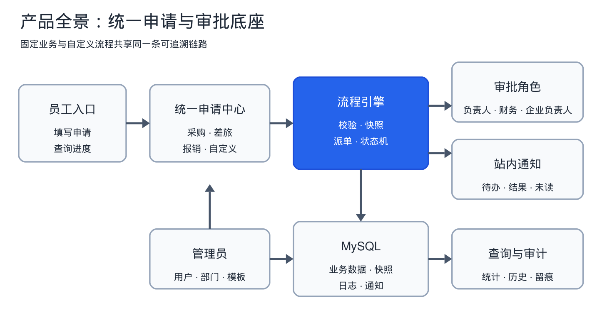

*图 1　固定业务和自定义申请共享统一流程引擎、MySQL 持久层与查询审计能力。*

### 预期产品形态

系统最终呈现为一个响应式企业审批 Web 工作台。员工从同一入口发起采购、差旅、报销及管理员发布的自定义申请；审批人从“我的待办”处理当前分配给自己的节点；管理员在独立入口维护组织和模板。三类固定业务保留各自的结构化明细和校验规则，但申请编号、状态、审批实例、日志、附件、通知与统计复用统一底座。

| 使用入口 | 用户希望完成的事情 | 系统需要留下的证据 |
|---|---|---|
| 发起申请 | 保存草稿、校验、提交结构化业务表单 | 申请编号、表单版本、申请人/部门及提交时间 |
| 我的待办 | 看清业务内容和审批依据后批准或驳回 | 实际审批人、节点、意见、动作时间和结果 |
| 我的申请 | 查询当前审批人、历史进度和最终结果 | 审批路径快照、追加式审批日志、状态变化通知 |
| 管理入口 | 管理组织、授权与流程模板 | 管理操作者、修改对象、变更前后摘要和时间 |

这里采用“统一申请主记录 + 各业务专属明细”的组织方式。统一主记录用于列表、检索、权限、状态和流程关联；采购明细、差旅行程和报销费用仍分别存储，避免为了复用而把所有数据塞入不可校验的大型 JSON。自定义表单值可以使用受模板约束的动态字段表，但模板版本和字段定义必须可追溯。

**一句话设计主张：**三种固定业务复用同一套申请与审批底座，差异放在业务明细和规则中；自定义流程通过模板版本化接入，而不是复制一套新页面和审批代码。

### 技术路线与交付形态

本项目采用模块化单体，避免课程周期内跨服务事务和部署复杂度。具体依赖补丁版本由构建文件和容器镜像标签锁定，不使用不受约束的 `latest`。

| 层次 | 选型 | 选择理由与边界 |
|---|---|---|
| Web 前端 | Vue 3、TypeScript、Vite、Element Plus | 组件化实现明细表单、筛选分页及模板配置 |
| 后端 | Java 21、Spring Boot 3.x、Spring Security、MyBatis | 单体事务覆盖申请、节点、日志和通知；显式 SQL 便于审计 |
| 会话 | 服务端会话、HttpOnly/SameSite Cookie、CSRF 防护 | 身份来自服务端认证上下文，客户端不能替换操作者 |
| 数据与文件 | MySQL 8.x/InnoDB；附件存 Docker 持久卷 | 关系和约束进数据库，大文件与元数据分离 |
| 部署 | Docker Compose：应用、MySQL、数据卷、附件卷 | 空环境启动、迁移、合成初始化及重启持久化 |

初始化数据至少包含研发部、市场部、财务部，以及普通员工、部门负责人、财务审批人、企业负责人和系统管理员等合成账号。角色能力、审批岗位和数据授权分开建模；管理员身份不自动产生业务查看或审批权限。


## 1. 业务全景与范围

### 1.1 角色—动作—数据边界图

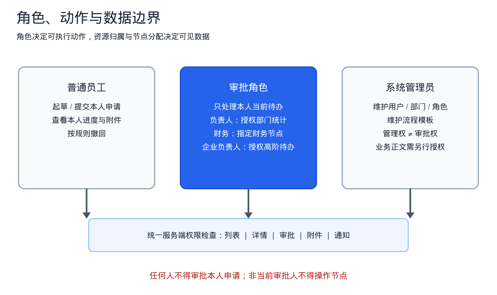

*图 2　角色只授予动作能力，具体资源是否可见仍由本人归属、部门范围和当前节点共同决定。*

角色权限采用“角色能力 + 资源关系 + 当前流程状态”的组合判断，而不是只判断用户是否拥有某个角色。比如部门负责人可以查询授权范围内的部门统计，但仍不能处理没有分配给自己的待办；系统管理员可以配置模板，却不能因此自动下载员工票据。

| 资源/动作 | 普通员工 | 部门负责人/财务/企业负责人 | 系统管理员 |
|---|---|---|---|
| 查看申请详情 | 本人申请，或当前审批所需内容 | 本人待办及明确授权的数据范围 | 默认无业务正文权限，另行授权 |
| 审批节点 | 禁止；兼任审批角色时仍禁止自批 | 仅当前分配给本人且未完成的节点 | 管理身份本身不产生审批权限 |
| 附件预览/下载 | 本人有权查看的申请附件 | 当前待办所需附件 | 仅获得业务查看授权后允许 |
| 用户/角色/模板配置 | 禁止 | 禁止 | 允许，并记录管理审计日志 |

服务端权限判定伪代码如下。前端可以根据同一结果控制按钮显示，但前端隐藏不是安全边界。

```pseudo
function authorize(user, action, resource):
    assert user.isActive

    if action in [APPROVE, REJECT]:
        node = resource.currentWorkflowNode
        return resource.status == IN_APPROVAL
           and node.status == PENDING
           and node.assigneeId == user.id
           and resource.applicantId != user.id

    if action in [VIEW_ATTACHMENT, DOWNLOAD_ATTACHMENT]:
        application = resource.ownerApplication
        return isApplicant(user, application)
            or isCurrentAssignee(user, application)
            or hasExplicitBusinessReadGrant(user, application)

    if action == MANAGE_TEMPLATE:
        return hasRole(user, SYSTEM_ADMIN)

    return defaultDeny
```

### 1.2 核心业务闭环


*图 3　主流程保持从左向右，失败、撤回和复制重提作为独立结果展示。*

每份申请以草稿开始。草稿只对申请人可见，可反复编辑或删除；提交成功后，服务端生成唯一申请编号、固定业务数据与审批路径，并创建首个待办。进入审批中后，业务正文不再直接覆盖修改；若驳回或撤回，用户通过“复制重新提交”生成新申请，并通过 `source_application_id` 与原单关联。

状态变更必须同时维护四类信息：申请主状态、当前有效待办、追加式审批日志和站内通知事件。任何一步失败都回滚整个事务，避免出现“页面显示审批成功，但下一位审批人没有待办”之类的不一致。查询页面只读取已提交的数据，不依赖浏览器缓存，因此刷新页面或重启服务后仍能还原完整进度。

| 状态 | 可执行操作 | 数据约束 |
|---|---|---|
| 草稿 | 编辑、删除、提交 | 不生成审批待办，不计入通过金额统计 |
| 审批中 | 当前审批人批准/驳回；申请人撤回 | 只有一个当前有效节点；正文按提交版本冻结 |
| 已通过 | 授权查询、附件下载 | 终态，不允许再次审批或退回草稿 |
| 已驳回 | 查询理由、复制重提 | 原日志保留，新申请拥有新编号 |
| 已撤回 | 查询历史、复制重提 | 所有原待办失效，原路径和日志保留 |

## 2. 产品界面与原型

### 2.1 信息架构


*图 4　普通工作区围绕任务和申请组织，管理入口独立承载配置与审计。*

信息架构按“我现在要做什么”组织，而不是按数据库表或后端模块组织。普通用户最常访问的是发起申请、本人申请和通知；审批角色最关心待办和已办事项；管理配置被放到独立入口，减少普通用户误入高风险页面的机会。若同一用户兼任多种角色，仍使用同一账号登录，通过可见菜单和数据范围切换工作上下文。

列表页采用统一筛选模型：类型、状态、提交时间和关键词共同组成查询条件，并在服务端分页。搜索结果中的申请编号、标题、申请人、部门和当前状态来自统一申请主表；业务类型特有字段只在详情页按需加载，从而避免列表查询连接大量明细表。

### 2.2 桌面端低保真原型（工作台）


*图 5　工作台将待办、本人申请和统计摘要放在首屏，发起申请保持为主操作。*

工作台首屏的优先级是“待处理任务 > 状态变化 > 统计摘要”。待办列表默认按收到时间倒序，并提供申请类型、申请人和金额等审批所需摘要；点击后进入详情，而不是直接在列表中批准，避免审批人未阅读完整业务和附件就误操作。

页面统一处理以下交互状态：加载时显示骨架或进度；无待办时显示明确空态；表单校验错误定位到具体字段或明细行；提交成功后显示申请编号并跳转详情；网络失败保留用户输入；撤回、删除和驳回等不可逆操作必须二次确认。手机端将横向表格转换为纵向卡片，主要按钮保持可触控尺寸，金额和日期输入使用适合移动设备的控件。

详细原型继续覆盖身份入口、费用明细与票据核对、模板编辑以及响应式审批。所有页面统一标注空态、加载态、错误态、确认弹窗及无权限态；小屏将表格重排为卡片，正文和核心操作不依赖横向滚动。

### 2.3 申请详情与审批原型

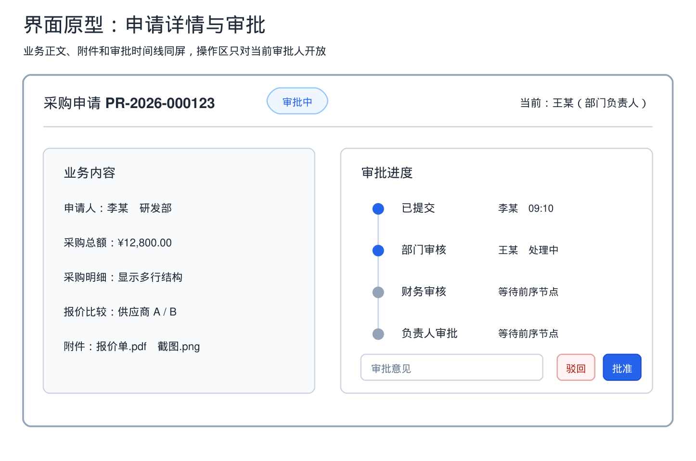

*图 6　业务正文与审批时间线同屏，审批按钮只在服务端确认当前用户为当前审批人时开放。*

详情页分成业务正文与审批时间线两个信息区。业务区根据申请类型加载采购明细、差旅行程、费用项目或动态字段，并统一展示附件；时间线从审批日志和实例节点组合得到，显示“谁在什么时间基于哪个节点执行了什么动作”。普通申请人只看到进度和授权内容，审批人额外看到意见输入和批准/驳回按钮。

详情接口返回的 `allowed_actions` 由服务端依据当前用户计算，例如 `VIEW`、`WITHDRAW`、`APPROVE`、`REJECT`、`DOWNLOAD_ATTACHMENT`。前端按该集合渲染操作区；用户即使手工构造请求，后端仍会重新执行同一权限判断。附件链接不直接暴露存储路径，而是使用受保护的附件接口，在每次预览或下载时重新校验所属申请的访问权。

### 2.4 三类业务表单蓝图

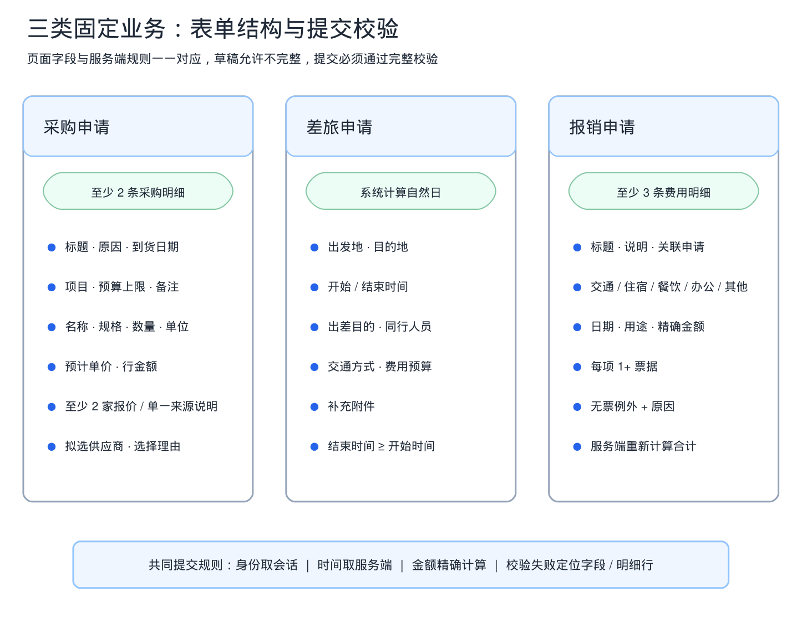

*图 14　三类业务共享草稿、提交和附件能力，但保留各自的结构化字段与服务端规则。*

采购表单分为基本信息、采购明细、报价比较和采购选择。明细可增删且至少两条，行金额由数量与单价计算；报价通常至少两家，保存供应商、报价日期、金额、链接或附件。单一来源必须提供原因；未选最低价也必须说明理由，并在审批详情显著提示。

差旅表单包括出发地、目的地、开始与结束时间、目的、同行人员、交通方式、预算和补充附件。结束时间不能早于开始时间，预算不能为负；天数按自然日计算，即 `结束日期 - 开始日期 + 1`。获批差旅可被本人报销选择，但服务端提交时再次验证所有权、类型和批准状态。

报销表单包含报销说明、可选关联申请和费用明细，至少三条；类型采用交通、住宿、餐饮、办公、其他。每条明细绑定一份或多份票据，无票支出必须显式选择并填写原因。客户端显示即时合计，服务端以整数分重算；同一报销单不能重复绑定同一票据记录。

草稿校验允许暂缺字段，完整业务校验只在提交时执行。错误结果携带字段 key 或明细行号，前端定位并聚焦错误；申请人、部门、编号和时间由服务端从认证上下文生成，不接受客户端改写。

### 2.5 管理员自定义流程原型

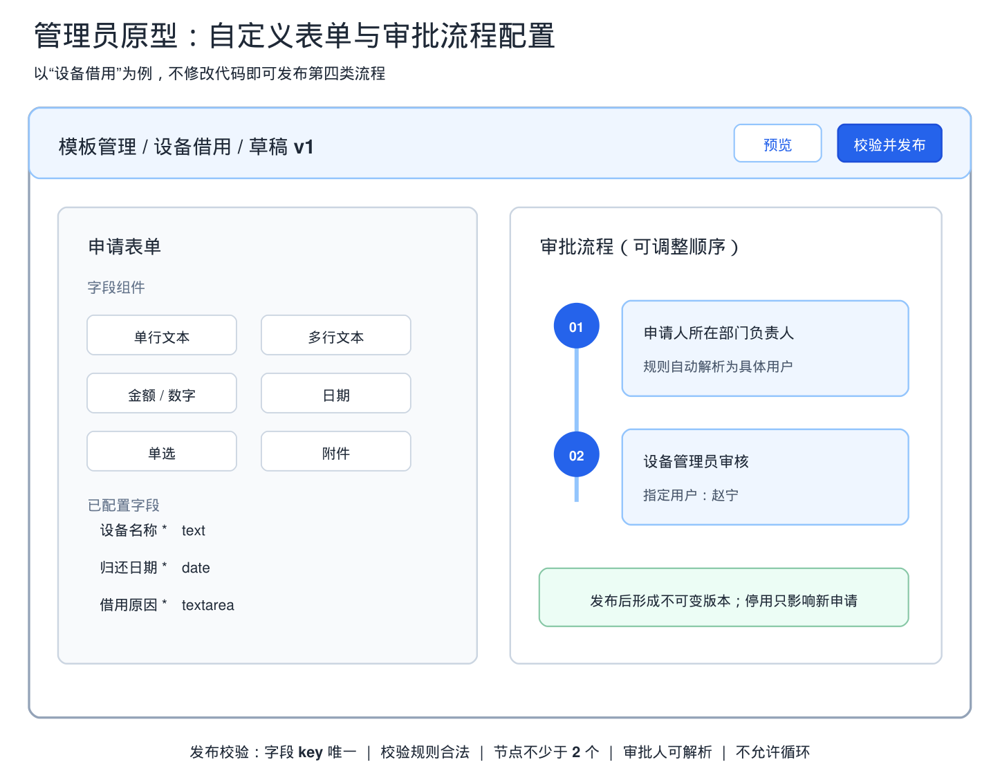

*图 15　以设备借用为第四类流程，管理员组合受控字段并配置两个顺序节点。*

模板编辑页分为表单和审批流程。字段组件限定为单行文本、多行文本、数字/金额、日期、单选和附件；字段设置包括唯一 key、名称、必填、选项及受控校验规则，不允许运行任意脚本。流程支持“申请人部门负责人”和“指定用户”两种审批人规则，节点可排序但不能形成循环。

发布前校验字段 key 唯一、选项非空、规则合法、节点至少两个且序号连续、审批人有效、无自批。发布产生不可变版本，继续编辑创建新草稿版本；停用仅阻止新申请。员工端按字段 schema 渲染表单，后端按同一版本校验并保存动态值，因此新增流程不需要改代码、数据库或复制固定页面。

### 2.6 列表、通知、统计与交互状态

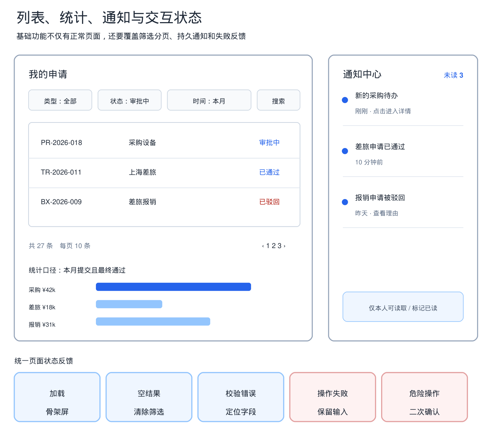

*图 16　筛选分页、统计口径、通知隔离和页面异常状态纳入同一交互规范。*

我的申请、我的待办和已办事项支持类型、状态、时间、关键词及服务端分页。关键词只检索授权记录；排序使用 `submitted_at DESC, id DESC` 等稳定键，分页大小有服务端上限。统计图中的“本月已通过金额”定义为提交时间在所选月份且最终状态为 `APPROVED` 的金额之和；草稿、审批中、驳回和撤回不计入。采购预算、差旅预算与报销实报金额分别命名，不混用统计口径。

站内通知先持久化再展示，基础版可短轮询。新待办、通过、驳回和撤回均产生通知；`(recipient_id, event_key)` 唯一，重试不重复。读取、未读计数和标记已读均绑定当前会话用户，通知链接仍须重新通过申请详情授权。

原型还覆盖加载、空结果、字段错误、操作失败和危险操作确认。网络失败保留输入；删除草稿、撤回和驳回需要确认，驳回理由必填。收到 `STATE_CHANGED` 后前端刷新真实状态，不乐观伪报成功。

### 2.7 关键页面详细原型

#### 2.7.1 注册、身份确认与个人信息

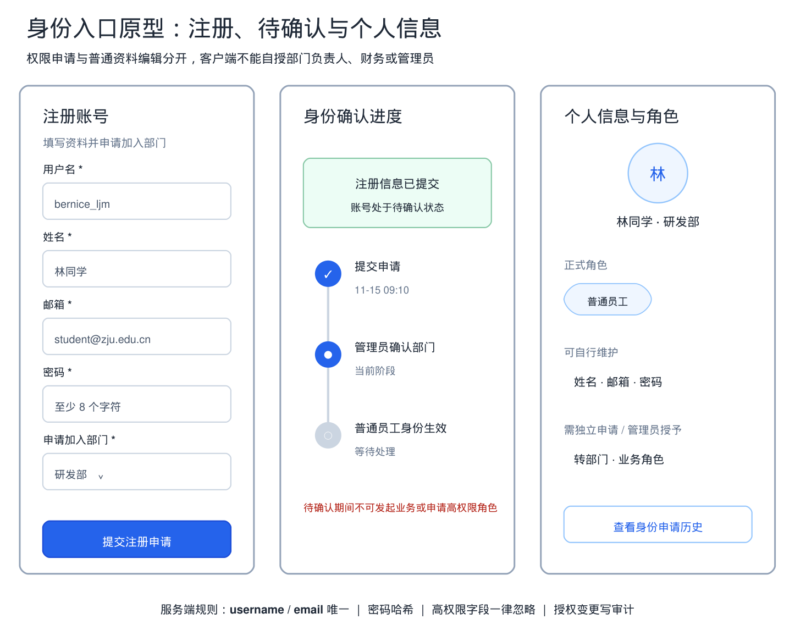

*图 20　注册只申请普通身份和部门归属；高权限角色通过独立申请或管理员授权，并留下审计记录。*

注册页只收集用户名、姓名、邮箱、密码和申请加入部门。用户名、邮箱的格式与唯一性前后端都校验，但后端结果为准；密码至少八位并交给框架自适应哈希。请求中即使附带 `SYSTEM_ADMIN`、`FINANCE_APPROVER` 等字段也会被忽略，而不是依靠前端不显示选项。

提交后进入待确认页，用户能看到当前阶段但不能在正式身份生效前发起业务申请。个人信息页将“普通资料维护”和“权限变化”分开：姓名、邮箱、密码走本人资料接口；转部门和申请业务角色产生独立申请，最终授权由管理员确认。管理员直接授予或撤回角色也使用专门命令，并记录操作者、前后值和时间。

异常状态包括用户名/邮箱已存在、密码不合规、目标部门停用、身份申请重复和管理员处理时申请状态已变化。登录失败统一返回认证失败，避免泄露某个用户名或邮箱是否存在；退出使服务端会话失效。

#### 2.7.2 报销填写与票据核对

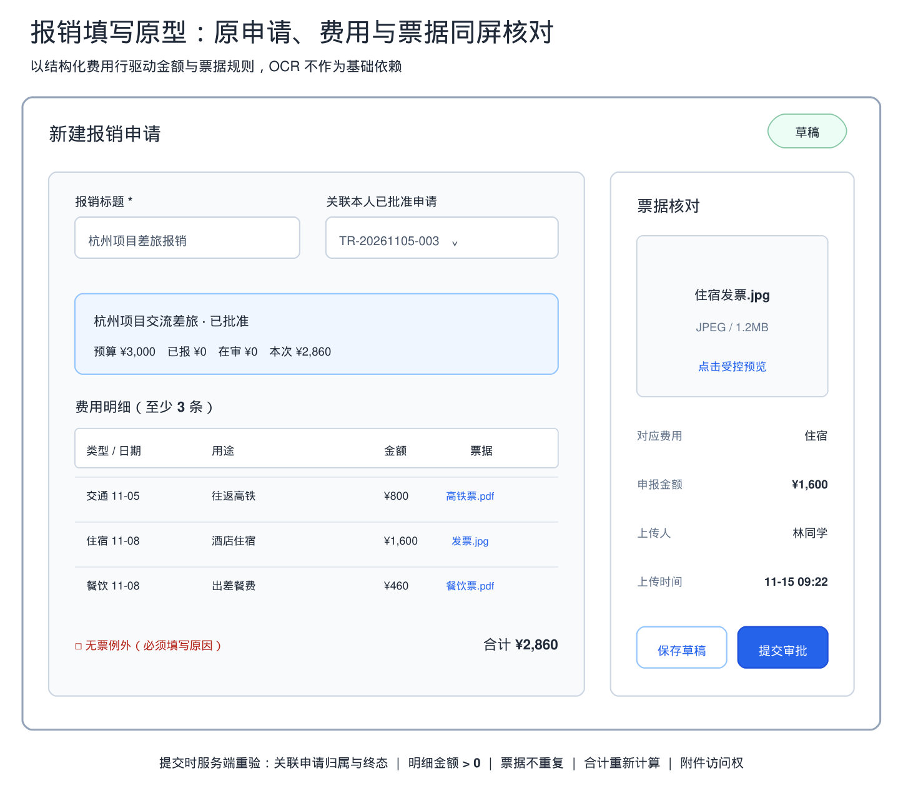

*图 21　原申请摘要、费用明细、合计和当前票据同屏，使用户在提交前完成可解释核对。*

选择关联申请后，页面显示来源单据类型、批准状态、预算、历史已通过金额、在审金额和本次预计累计；这些数值由服务端查询，不能由客户端传入。费用行和票据建立明确关系，点击某行票据在侧栏受控预览，用户能核对文件名、类型、大小、上传人与时间。基础版不依赖 OCR；若后续增加识别，只作为候选值，仍需用户确认并由服务端验证。

保存草稿允许暂缺票据或少于三条费用，提交时则必须满足完整规则。上传校验 JPEG、PNG、PDF、真实 MIME、单文件建议 10MB、文件数量和总量；文件使用随机存储 key。票据预览和下载每次沿绑定关系回到所属报销单重新鉴权，不返回磁盘路径或可猜测的静态 URL。

#### 2.7.3 桌面端与手机屏幕响应式审批

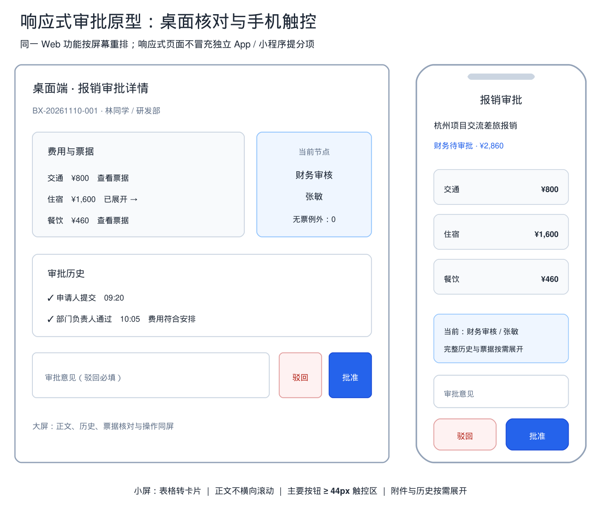

*图 22　桌面端强调并列核对，小屏强调卡片、分段展开和触控操作；两者共享同一授权和状态机。*

桌面端同时展示费用、票据、关联申请、审批历史和操作区，适合审批人交叉核对；小屏按“摘要—费用卡片—当前节点—意见—操作”纵向重排，表格转为卡片，历史和附件按需展开，主要按钮保持不小于约 44px 的触控区域。操作按钮仍由服务端返回的 `allowed_actions` 决定，屏幕尺寸不会改变权限。

该设计属于响应式 Web 基础体验，不宣称完成任务书中的“小程序或独立 App”提分项。若后续选择移动端提分功能，需另行证明注册/登录、三类及自定义申请、拍照或选择票据、审批、进度和通知均可在手机独立客户端完成，并提供页面打开时实时提醒或后台触达证据。

### 2.8 设计参考与取舍

| 参考 | 借鉴点 | 本项目取舍 |
|---|---|---|
| [SAP Fiori Flexible Column Layout](https://experience.sap.com/fiori-design-web/flexible-column-layout/)（访问日期：2026-11-15） | 列表、对象详情和关联信息可并列展示，减少频繁页面跳转 | 只借鉴桌面信息组织；审批权限、状态机和字段完全按本任务设计，小屏改为单列 |
| [GOV.UK Design System: Error summary](https://design-system.service.gov.uk/components/error-summary/)（访问日期：2026-11-15） | 页面顶部汇总错误，同时在具体字段旁显示错误并可定位 | 动态明细错误携带字段 key/行号；网络失败保留输入，不照搬视觉品牌 |

上述原型均为本项目自制低保真图，不复制参考网站截图。参考的价值在于验证信息层级和错误反馈方式，而不是增加与课程无关的功能。


## 3. 复杂流程设计

### 3.1 提交时解析并冻结审批路径（设计亮点一）

**问题：**审批人、金额阈值或模板配置可能在申请提交后变化；若实例继续引用“当前配置”，历史申请会被无声改道，难以解释和审计。


*图 7　上半部分展示提交事务，下半部分强调模板版本与申请实例分离。*

提交操作分为四个阶段：第一，读取已发布模板版本并校验业务字段；第二，根据申请部门、金额等输入解析节点规则；第三，将角色或“申请人部门负责人”等抽象规则解析成具体用户，并检查是否出现本人审批或无人可审批；第四，在一个数据库事务中写入申请、业务明细、流程实例、节点快照、首个待办、提交日志和通知事件。

```pseudo
function submitApplication(draftId, actorId, idempotencyKey):
    begin transaction

    draft = lockDraft(draftId)
    assert draft.ownerId == actorId
    assert not existsProcessedRequest(idempotencyKey)

    templateVersion = loadPublishedVersion(draft.templateVersionId)
    validateBusinessForm(draft, templateVersion.fieldSchema)

    resolvedNodes = []
    for nodeRule in templateVersion.orderedNodes:
        assignee = resolveToConcreteUser(nodeRule, draft.departmentId)
        assert assignee exists
        assert assignee.id != actorId
        resolvedNodes.append(snapshot(nodeRule, assignee))

    application = persistSubmittedApplication(draft)
    persistBusinessDetails(application, draft)
    persistWorkflowSnapshot(application, templateVersion, resolvedNodes)
    activateFirstNode(application, resolvedNodes[0])
    appendApprovalLog(application, actorId, SUBMIT)
    appendNotificationEvent(uniqueEventKey(application, NEW_TODO))
    recordProcessedRequest(idempotencyKey)

    commit transaction
    return application.number
```

快照不是简单保存模板 ID，而是保存模板版本、节点序号、节点名称、规则来源和最终实际审批人。后续部门负责人变更或模板发布 v4 时，旧申请仍按 v3 的历史快照解释；新配置只影响之后提交的申请。这样可以回答“这份申请当时为什么交给这个人审批”，也是第一个设计 Highlight 的核心。


**实现约束：**模板与实例分离；节点存实际审批用户、顺序、节点名称及规则来源快照。管理员修改模板只影响新申请。无法解析审批人时提交失败并给出可理解原因，不生成半条流程。

### 3.2 审批、驳回与撤回并发控制

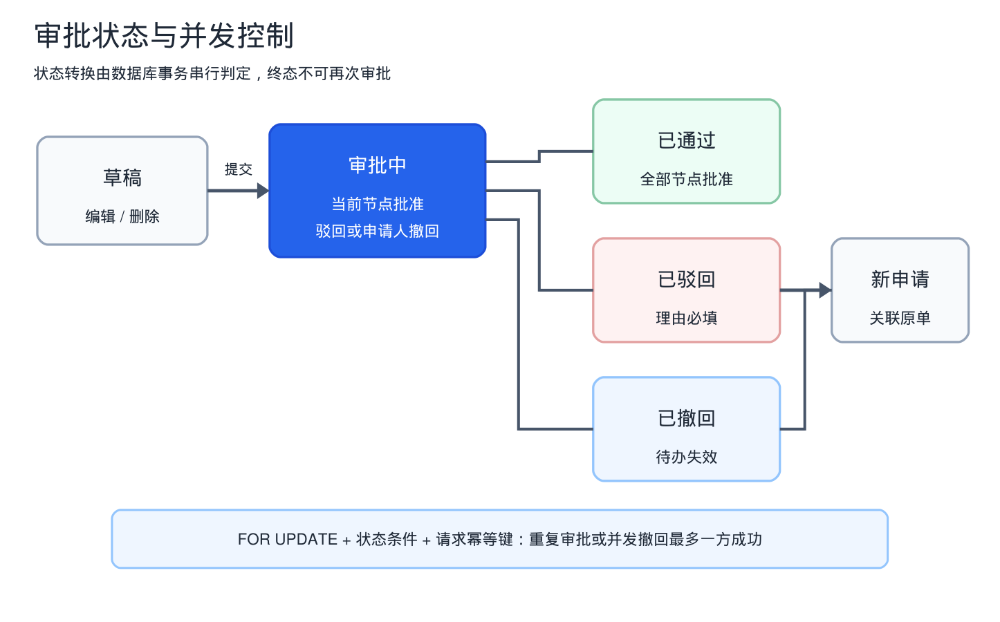

*图 8　所有竞争操作锁定同一申请记录并重新检查状态，避免重复有效流转。*

**事务方案（MySQL/InnoDB）：**开始事务后锁定申请/当前节点记录（`SELECT ... FOR UPDATE`），重新检查申请状态、节点状态、当前操作者与版本号；仅条件匹配时更新节点和申请状态，并追加审批日志、创建下一待办及通知事件。任一检查失败则回滚并返回“状态已变化，请刷新”。数据库唯一约束和幂等键作为重复请求的第二道保护。不得仅依赖前端禁用按钮。

下面的审批伪代码强调“锁定后重新判断”，而不是先在事务外判断状态。撤回操作也锁定同一份申请，因此审批与撤回同时发生时只有先获得锁的一方能完成状态转换。

```pseudo
function actOnNode(applicationId, actorId, action, opinion, requestKey):
    begin transaction

    application = SELECT ... FROM applications
                  WHERE id = applicationId FOR UPDATE
    node = SELECT ... FROM workflow_instance_nodes
           WHERE application_id = applicationId
             AND status = 'PENDING' FOR UPDATE

    if exists approval_log where request_key = requestKey:
        return previousResult(requestKey)          // 网络重试，返回原结果

    assert application.status == 'IN_APPROVAL'
    assert node.assignee_id == actorId
    assert application.applicant_id != actorId
    if action == REJECT: assert opinion is not blank

    complete(node, action)
    if action == REJECT:
        application.status = 'REJECTED'
    else if hasNextNode(application):
        activateNextNode(application)
    else:
        application.status = 'APPROVED'

    append immutable approval_log(requestKey, actorId, action, opinion)
    append idempotent notification_event(application, action)
    commit transaction
```

建议在 `approval_logs.request_key` 上建立唯一索引，同时对实例节点使用 `(application_id, sequence_no)` 唯一约束。事务锁负责解决同时到达的竞争请求，唯一约束负责兜底应用层遗漏；两者共同保证一次业务动作只产生一次有效流转。

| 风险 | 控制点 | 验收证据 |
|---|---|---|
| 非当前审批人操作 | 服务端核对当前节点 assignee 与认证用户 | 越权接口测试返回拒绝 |
| 自己审批本人申请 | 创建路径与节点执行前双重校验 | 申请人兼任负责人仍不能自批 |
| 双击/重试重复批准 | 事务锁、状态条件更新、请求幂等键 | 仅一条有效流转日志/下一待办 |
| 撤回与批准同时发生 | 锁定同一申请，终态条件更新 | 两请求最多一个成功 |
| 通知重复 | 唯一业务事件键 | 重试不增加重复通知 |

### 3.3 管理员自定义模板生命周期


*图 9　模板从草稿到发布形成不可变版本，后续修改和停用均不改变历史实例。*

**发布校验：**字段 key 唯一；类型、必填与校验规则合法；审批节点不少于两个且有序；审批规则能解析为有效用户；适用部门有效。基础范围先实现顺序审批，不承诺未在作业要求中定义的条件分支/循环。

动态表单不允许管理员录入任意可执行代码，而是从受控字段类型和校验规则中组合。模板草稿可以编辑；发布时复制成不可变版本，员工只能选择已启用模板的已发布版本。下面给出一段配置草案，说明字段 schema 和节点规则如何存储，而不是最终接口格式。

```json
{
  "template": "设备借用",
  "version": 3,
  "fields": [
    {"key": "device_name", "type": "text", "required": true},
    {"key": "return_date", "type": "date", "required": true},
    {"key": "reason", "type": "textarea", "maxLength": 500}
  ],
  "nodes": [
    {"order": 1, "name": "部门审核", "assigneeRule": "APPLICANT_DEPARTMENT_MANAGER"},
    {"order": 2, "name": "资产管理员审核", "assigneeRule": "SPECIFIED_USER", "userId": 28}
  ]
}
```

发布校验先检查字段 key 和节点顺序的结构完整性，再检查引用的部门、用户是否存在且处于有效状态。模板停用只阻止新申请，不删除模板版本或修改运行中的实例。基础版本坚持顺序审批，暂不引入任意条件表达式、脚本和循环，从设计上控制动态流程的复杂度和安全风险。

### 3.4 报销金额与附件闭环

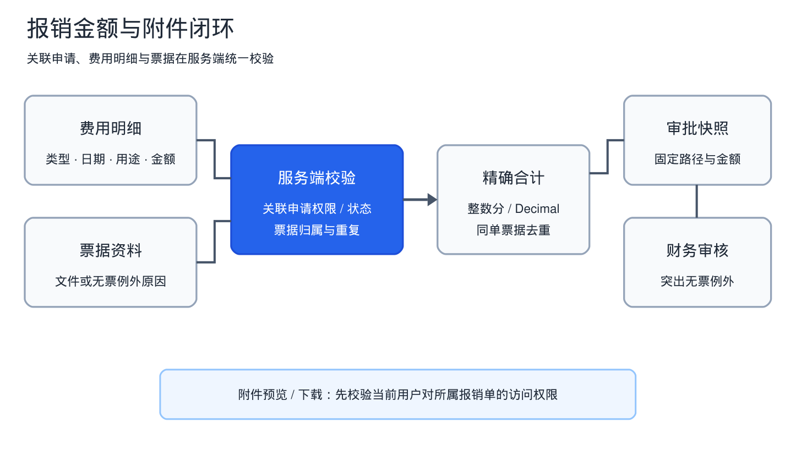

*图 10　费用、票据和关联申请在服务端汇合校验，精确合计后才生成审批快照。*

报销单是申请主记录下的业务聚合：报销信息包含多条费用项目，每条费用项目关联一份或多份票据。用户可关联本人已批准的采购或差旅申请；服务端必须重新验证关联对象的申请人和状态，不能相信浏览器传来的“已批准”标记。无票支出通过显式例外字段和原因表达，并在财务审批界面突出显示。

金额统一换算为最小货币单位“分”后计算，避免二进制浮点误差影响合计或审批路径。客户端即时合计只用于反馈，服务端提交时必须重新计算。

```pseudo
function validateAndTotal(expenseItems, actorId):
    assert count(expenseItems) >= 3
    totalMinor = 0
    usedAttachmentIds = set()

    for item in expenseItems:
        assert item.amountMinor > 0
        assert item.type in enabledExpenseTypes
        assert item.occurredOn is valid

        if item.noReceiptException:
            assert item.exceptionReason is not blank
        else:
            assert count(item.attachments) >= 1

        for attachment in item.attachments:
            assert attachment.id not in usedAttachmentIds
            assert attachment.uploaderId == actorId
            usedAttachmentIds.add(attachment.id)

        totalMinor = checkedAdd(totalMinor, item.amountMinor)

    return totalMinor
```

附件表只保存原文件名、MIME、大小、上传人、上传时间、校验摘要和随机存储 key，二进制文件放在持久化文件卷中。上传时同时校验扩展名、MIME、文件大小和数量；下载时依据附件所属申请重新鉴权，禁止直接用可猜测路径访问文件。

## 4. 数据库设计（MySQL）

### 4.1 ER 概念图

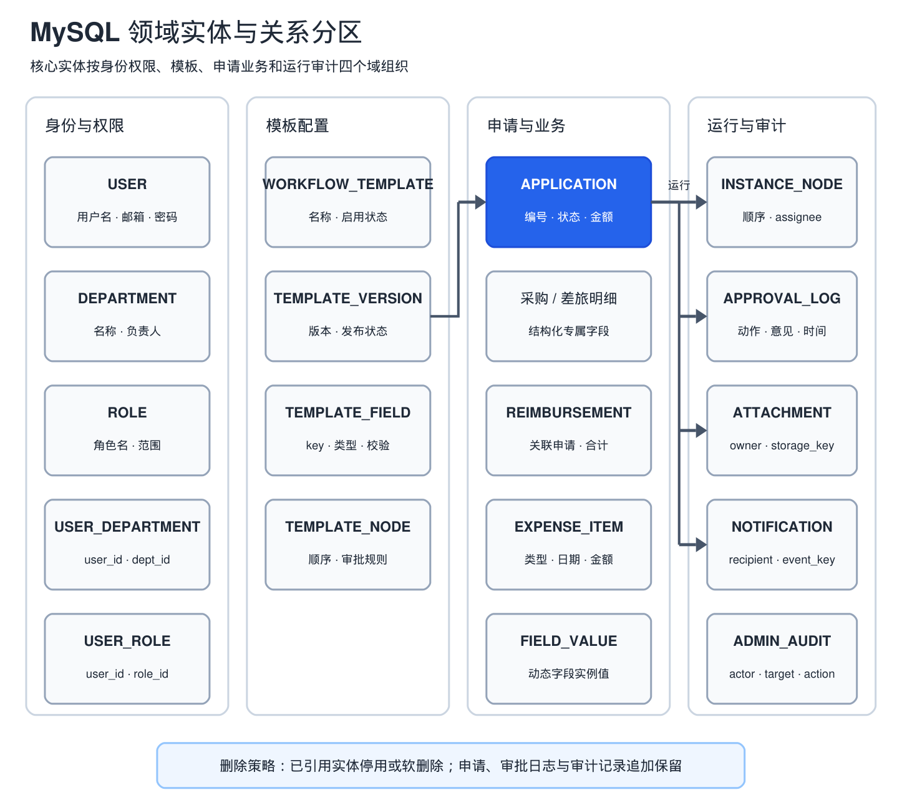

*图 11　概念模型按身份权限、模板配置、申请业务和运行审计分区；正式建表时再补充字段级外键与基数。*

`applications` 是业务查询和流程关联的聚合根，保存所有申请共有的编号、类型、申请人、部门、状态、标题、合计金额和模板版本引用。固定业务明细使用一对一或一对多专属表；自定义表单通过 `application_field_values` 关联提交时的字段定义。这样既能统一查询，又能在数据库层保持采购数量、报销金额等字段的明确类型。

模板域和运行域严格分离：`workflow_template_versions` 描述可以用于新申请的版本；`workflow_instance_nodes` 是提交时产生的实际运行节点。审批日志为追加式记录，不提供普通更新/删除接口。附件属于申请或费用项目，但访问权最终沿所属关系回到申请。通知以收件人为隔离边界，标记已读时必须同时匹配 `notification.id` 和当前用户 ID。

### 4.2 字段级关系模型

总图用于理解领域边界，下面三张关系图展开外键、基数和唯一约束，重点区分角色与岗位、申请与业务明细、模板与运行实例。

#### 4.2.1 组织、角色与审批岗位

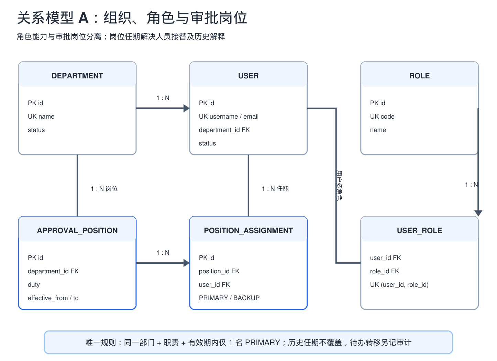

*图 17　角色表示能力，审批岗位表示某部门某职责在一段时间内由谁承担。*

用户正式归属部门，并可通过 `user_roles` 兼任多个角色。研发部、市场部、财务部由合成初始化数据创建。审批职责落在带有效期的岗位及任职关系上，而不是仅靠泛化角色匹配多人。同一部门、职责和有效期内只允许一名主审批人；备用人员不是并行待办持有人。人员接替保留旧任期，新的申请解析新人；已提交申请沿用人员快照，未完成任务只能经记录原人、新人、原因和操作者的显式转办改变。

#### 4.2.2 统一申请与固定业务明细

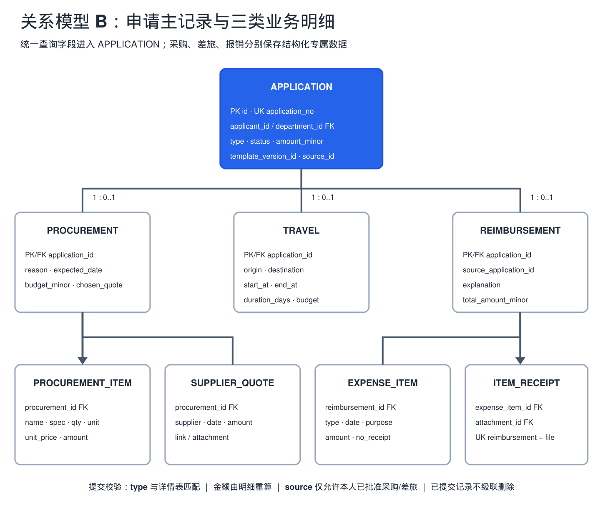

*图 18　统一主表支撑权限、列表与状态查询，业务详情和多行明细分表保存。*

`applications` 保存编号、类型、申请人、部门、状态、精确合计、模板版本、来源申请和并发版本。采购、差旅、报销详情以 `application_id` 同时作主键和外键；提交时必须恰有一份与申请类型匹配的详情。采购项目、报价、费用项目及票据绑定独立成行，不把可校验明细塞进自由文本或任意 JSON。

报销来源可以为空；非空时必须指向本人已批准的采购或差旅申请，不能指向本单。课程未要求单次结清，基础版允许分次报销；展示历史已通过、在审和本次金额，为后续预算预警保留数据但不额外强制拦截。

#### 4.2.3 流程、附件、通知与审计证据

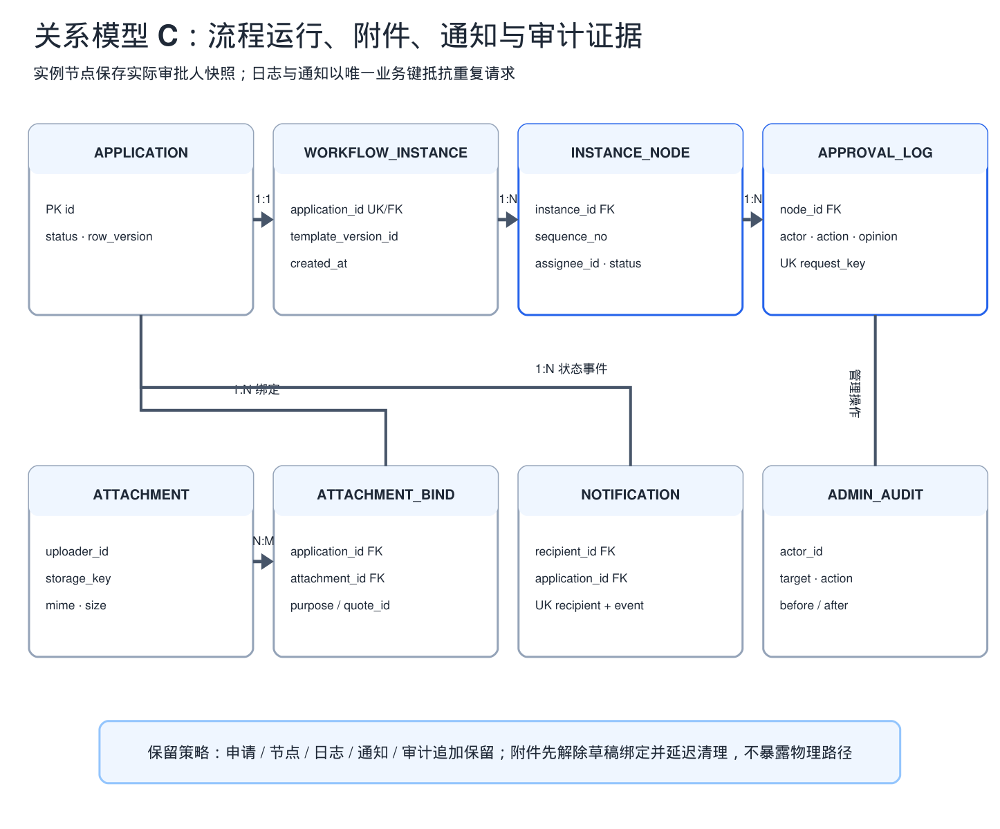

*图 19　运行节点、审批动作、附件归属、通知收件人与管理变更形成独立证据链。*

一份提交申请对应一个流程实例，实例下有有序节点；节点保存名称、规则来源、实际审批人和状态快照。基础版每节点仅一名实际审批人，不让同级两人共享同一任务。未来若扩展会签/或签，必须给每人创建子任务并定义 `ALL`/`ANY_ONE` 聚合规则。

审批日志不可修改，`request_key` 唯一；通知 `(recipient_id, event_key)` 唯一。附件原件与业务绑定分离，上传后只能绑定到本人可编辑草稿或费用项。草稿删除先解除绑定，未引用文件延迟清理；已提交申请、审批日志、通知和审计记录不级联物理删除。

### 4.3 表分组与关键职责

| 分组 | 代表表 | 关键职责/约束 |
|---|---|---|
| 身份权限 | `users`, `departments`, `roles`, `user_departments`, `user_roles` | 用户名/邮箱唯一；客户端不能赋高权限角色；多部门/多角色关系明确 |
| 模板配置 | `workflow_templates`, `workflow_template_versions`, `template_fields`, `template_nodes` | 版本发布后只读；字段 key、节点序号受约束；配置变更可审计 |
| 申请主记录 | `applications` | 唯一申请编号；类型、申请人、部门、状态、金额分等索引字段；提交时保存版本和来源关联 |
| 固定业务数据 | `procurement_items`, `procurement_quotes`, `travel_details`, `reimbursement_details`, `expense_items` | 专属字段结构化，不把多条明细塞入自由文本；精确金额使用整数分或 `DECIMAL` |
| 动态业务数据 | `application_field_values` | 按字段定义和实例版本校验值；避免任意 JSON 成为不可查询的核心数据 |
| 流程运行 | `workflow_instances`, `workflow_instance_nodes`, `approval_logs` | 实例节点保存顺序、assignee 与规则快照；日志追加写入；唯一有效节点/请求键 |
| 文件通知 | `attachments`, `notifications` | 文件只存元数据与受控存储 key；通知按收件人隔离并对事件键唯一 |
| 审计 | `admin_audit_logs` | 角色授权、模板发布、配置变化记录操作者、动作、目标与时间 |

### 4.4 关键字段草案

以下 DDL 是核心表的设计片段，用于确认字段类型、唯一键、事务版本和查询索引；最终迁移脚本还需补齐所有外键名称、业务明细表和审计字段。

```sql
CREATE TABLE applications (
    id                    BIGINT PRIMARY KEY AUTO_INCREMENT,
    application_no        VARCHAR(32) NOT NULL UNIQUE,
    application_type      VARCHAR(32) NOT NULL,
    applicant_id          BIGINT NOT NULL,
    department_id         BIGINT NOT NULL,
    title                 VARCHAR(200) NOT NULL,
    status                VARCHAR(24) NOT NULL,
    total_amount_minor    BIGINT NULL,
    template_version_id   BIGINT NULL,
    source_application_id BIGINT NULL,
    row_version           INT NOT NULL DEFAULT 0,
    submitted_at          DATETIME(3) NULL,
    created_at            DATETIME(3) NOT NULL,
    updated_at            DATETIME(3) NOT NULL,
    INDEX idx_applicant_status_time (applicant_id, status, created_at),
    INDEX idx_department_type_status (department_id, application_type, status, submitted_at)
) ENGINE=InnoDB DEFAULT CHARSET=utf8mb4;

CREATE TABLE workflow_instance_nodes (
    id             BIGINT PRIMARY KEY AUTO_INCREMENT,
    application_id BIGINT NOT NULL,
    sequence_no    INT NOT NULL,
    node_name      VARCHAR(100) NOT NULL,
    assignee_id    BIGINT NOT NULL,
    rule_snapshot  JSON NOT NULL,
    status         VARCHAR(24) NOT NULL,
    acted_at       DATETIME(3) NULL,
    UNIQUE KEY uk_application_sequence (application_id, sequence_no),
    INDEX idx_assignee_status (assignee_id, status, application_id)
) ENGINE=InnoDB DEFAULT CHARSET=utf8mb4;

CREATE TABLE approval_logs (
    id             BIGINT PRIMARY KEY AUTO_INCREMENT,
    application_id BIGINT NOT NULL,
    node_id        BIGINT NULL,
    actor_id       BIGINT NOT NULL,
    action         VARCHAR(24) NOT NULL,
    opinion        TEXT NULL,
    result_status  VARCHAR(24) NOT NULL,
    request_key    VARCHAR(80) NOT NULL UNIQUE,
    created_at     DATETIME(3) NOT NULL,
    INDEX idx_application_time (application_id, created_at)
) ENGINE=InnoDB DEFAULT CHARSET=utf8mb4;

CREATE TABLE notifications (
    id             BIGINT PRIMARY KEY AUTO_INCREMENT,
    recipient_id   BIGINT NOT NULL,
    event_key      VARCHAR(120) NOT NULL,
    notification_type VARCHAR(32) NOT NULL,
    application_id BIGINT NOT NULL,
    read_at        DATETIME(3) NULL,
    created_at     DATETIME(3) NOT NULL,
    UNIQUE KEY uk_recipient_event (recipient_id, event_key),
    INDEX idx_recipient_unread (recipient_id, read_at, created_at)
) ENGINE=InnoDB DEFAULT CHARSET=utf8mb4;
```

### 4.5 数据完整性、事务与删除策略

- MySQL 8.x、InnoDB、`utf8mb4`；金额统一使用整数分（或经论证的 `DECIMAL(12,2)`），审批金额阈值比较不使用浮点数。
- 状态流转、当前节点、审批日志、下一待办、通知事件在同一事务内提交；通知投递可用事务内事件表/Outbox，工作量允许时作为稳健性设计。
- 所有业务外键定义约束；用户/部门/模板等已被引用数据优先停用或软删除，审批日志和已提交申请不可级联物理删除。
- 索引优先覆盖待办查询 `(assignee_id, status, created_at)`、本人申请 `(applicant_id, status, created_at)`、部门统计 `(department_id, type, status, submitted_at)`；按真实查询计划调整。
- 附件二进制不放数据库；数据库保存存储标识、原文件名、MIME、大小、上传人、业务归属、时间及校验摘要。访问文件前先鉴权。
- 迁移脚本纳入 Git；初始化数据可重复执行且只包含合成用户/示例数据。用唯一约束和应用层校验共同防止重复。

## 5. 技术结构与模块依赖

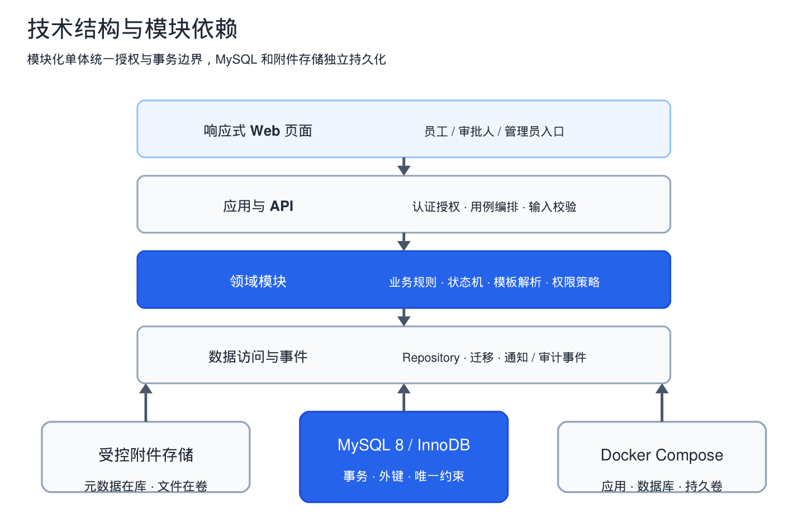

*图 12　模块化单体统一承载权限与事务，MySQL、附件存储和容器部署保持清晰边界。*

初期采用模块化单体而不是拆分微服务。该项目需要在一次审批动作中同步维护申请、节点、日志和通知事件，单体配合 MySQL 事务更容易保证一致性；课程项目的部署、演示和故障定位成本也更低。模块之间仍通过清晰的应用服务接口协作，避免控制器直接访问所有数据表，为未来按边界拆分保留可能。

| 模块 | 主要职责 | 允许依赖 |
|---|---|---|
| 认证与组织 | 注册登录、用户、部门、角色和授权 | 基础持久层、审计模块 |
| 申请中心 | 草稿、统一列表、详情、编号和撤回 | 三类业务模块、工作流、附件 |
| 三类业务 | 采购、差旅、报销的字段与专属校验 | 申请中心提供的领域接口 |
| 工作流 | 模板版本、路径解析、实例节点和状态机 | 组织查询、通知事件、审计日志 |
| 附件 | 上传限制、元数据和受控下载 | 统一授权服务、文件存储 |
| 通知与统计 | 幂等站内通知和授权范围统计 | 申请/工作流只读查询接口 |


### 5.1 页面—接口—服务—数据证据关联

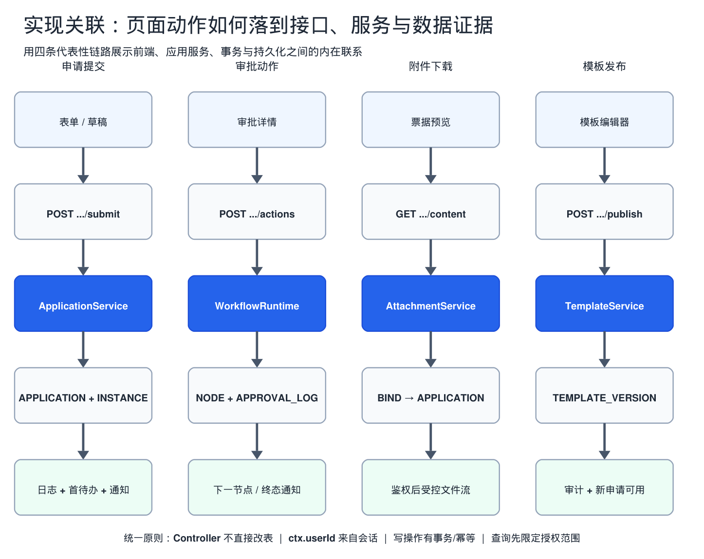

*图 23　四条代表性纵向链路说明页面不是孤立原型，而是由统一接口、服务事务和持久化证据支撑。*

申请提交从表单页面进入提交接口，由申请服务协调业务校验和工作流快照，在同一事务中写申请、实例节点、提交日志、首待办和通知事件。审批动作由工作流服务锁定当前节点并检查实际审批人；成功后只产生一次日志和后续节点或终态通知。两条链路共享幂等键和状态版本，避免重复点击导致多次有效流转。

附件预览不是直接访问静态目录，而是由附件服务根据绑定关系找到申请，再使用统一授权规则返回受控文件流。模板发布由模板服务完成结构、规则和审批人校验，产生不可变版本并写管理审计；发布后的模板才进入员工可选列表。Controller 只负责请求转换与认证上下文，不直接跨模块改表。

这张关联图也是实现拆分依据：每个页面故事必须同时明确 HTTP 契约、应用服务入口、受影响的聚合及可验证数据库证据。测试可以沿同一链路设计正向用例和越权、重试、状态冲突等负向用例。

### 5.2 模块接口设计

以下代码块采用接近 TypeScript 的语言无关伪代码，紧凑表达 L4 模块契约；实际后端使用 Java 接口和 DTO 落地，此处并非实现代码。控制器只能调用应用服务接口，不能绕过服务层直接修改其他模块的数据表。所有身份信息来自 `RequestContext`，客户端请求体不得自行指定当前用户、角色或审批权限。

#### 5.2.1 公共契约

```typescript
// 每次请求由认证中间件创建；userId 不接受客户端覆盖。
interface RequestContext {
  readonly userId: UserId;
  readonly requestId: string;       // 用于日志关联，不等同于业务幂等键
  readonly occurredAt: Instant;     // 服务端时间
}

// 写接口统一返回最新资源版本，便于前端发现并发修改。
interface CommandResult<T> {
  readonly data: T;
  readonly resourceVersion: number;
}

// 列表查询必须服务端分页；cursor/page 方案在技术栈确定后选择一种。
interface PageQuery {
  readonly page: number;
  readonly pageSize: number;        // 服务端限制最大值
}

interface Page<T> {
  readonly items: readonly T[];
  readonly total: number;
}

// 对外错误使用稳定错误码，不暴露 SQL、堆栈和文件存储路径。
type DomainErrorCode =
  | "FORBIDDEN"
  | "VALIDATION_FAILED"
  | "STATE_CHANGED"
  | "IDEMPOTENCY_CONFLICT"
  | "AMBIGUOUS_ASSIGNEE"
  | "ASSIGNEE_NOT_FOUND"
  | "FILE_POLICY_VIOLATION";
```

#### 5.2.2 认证与组织模块

```typescript
interface IdentityOrganizationService {
  // 公开接口：注册时只能申请加入部门，不能声明管理员、财务等高权限角色。
  register(command: RegisterUserCommand): Promise<CommandResult<UserProfile>>;

  // 登录失败统一返回认证失败，避免泄露用户名或邮箱是否存在。
  login(command: LoginCommand): Promise<SessionView>;

  // 当前用户维护自己的非权限资料；用户名/邮箱唯一性由服务端校验。
  updateMyProfile(ctx: RequestContext, command: UpdateProfileCommand)
    : Promise<CommandResult<UserProfile>>;

  // 管理接口：确认部门归属。执行前校验 SYSTEM_ADMIN，并追加管理审计。
  confirmDepartmentMembership(ctx: RequestContext, command: ConfirmMembershipCommand)
    : Promise<CommandResult<DepartmentMembershipView>>;

  // 管理接口：授权采用独立命令，禁止复用普通资料更新接口。
  grantRole(ctx: RequestContext, command: GrantRoleCommand)
    : Promise<CommandResult<RoleGrantView>>;

  // 供其他模块只读查询；不返回密码哈希、会话密钥等敏感字段。
  getActiveUser(userId: UserId): Promise<ActiveUserView | null>;
  getDepartmentManager(departmentId: DepartmentId, at: Instant)
    : Promise<UserId | null>;
}
```

#### 5.2.3 审批岗位与人员变更模块

```typescript
type ApprovalDuty = "DEPARTMENT_REVIEW" | "FINANCE_REVIEW" | "EXECUTIVE_REVIEW";

interface ApprovalPositionService {
  // 同一部门 + 职责 + 生效时间范围内只能存在一个主审批人。
  // 若时间范围与另一主审批人重叠，返回 AMBIGUOUS_ASSIGNEE。
  appointPrimary(ctx: RequestContext, command: AppointPrimaryCommand)
    : Promise<CommandResult<ApprovalPositionView>>;

  // 人员接替不覆盖老人记录：结束旧任期，再创建带生效时间的新任期。
  // 新提交申请解析新人；已提交申请继续使用原审批路径快照。
  replacePrimary(ctx: RequestContext, command: ReplacePrimaryCommand)
    : Promise<CommandResult<ApprovalPositionView>>;

  // 备用人员只是可转办候选人，不与主审批人同时持有有效待办。
  setBackup(ctx: RequestContext, command: SetBackupCommand)
    : Promise<CommandResult<ApprovalPositionView>>;

  // 工作流提交时调用：结果必须为一名具体用户，0 人或多人都视为配置错误。
  resolveSingleAssignee(query: ResolveDutyQuery): Promise<UserId>;
}
```

#### 5.2.4 申请中心模块

```typescript
interface ApplicationService {
  // applicantId、departmentId 和创建时间取自 ctx 与服务端组织关系。
  createDraft(ctx: RequestContext, command: CreateDraftCommand)
    : Promise<CommandResult<ApplicationSummary>>;

  // 只能修改本人草稿；已提交正文不能通过该接口覆盖。
  updateDraft(ctx: RequestContext, applicationId: ApplicationId, command: UpdateDraftCommand)
    : Promise<CommandResult<ApplicationSummary>>;

  // 提交在一个事务中调用业务校验、路径解析、首待办、日志和通知接口。
  submit(ctx: RequestContext, applicationId: ApplicationId, idempotencyKey: string)
    : Promise<CommandResult<ApplicationDetail>>;

  // 与审批竞争时锁定同一申请；若状态已变化返回 STATE_CHANGED。
  withdraw(ctx: RequestContext, applicationId: ApplicationId, idempotencyKey: string)
    : Promise<CommandResult<ApplicationDetail>>;

  // 驳回/撤回后复制成新草稿，并通过 sourceApplicationId 关联原单。
  copyAsNewDraft(ctx: RequestContext, sourceApplicationId: ApplicationId)
    : Promise<CommandResult<ApplicationSummary>>;

  // allowedActions 由服务端计算；详情只返回当前用户有权查看的字段和附件元数据。
  getDetail(ctx: RequestContext, applicationId: ApplicationId): Promise<ApplicationDetail>;
  listMine(ctx: RequestContext, query: ApplicationListQuery): Promise<Page<ApplicationSummary>>;
}
```

#### 5.2.5 采购业务模块

```typescript
interface ProcurementService {
  // 草稿阶段保存结构化采购明细，不使用一段自由文本替代多行项目。
  saveDraftDetails(ctx: RequestContext, applicationId: ApplicationId, command: SaveProcurementCommand)
    : Promise<CommandResult<ProcurementView>>;

  // 提交校验：至少两条明细；通常至少两家报价。
  // 单一来源必须有说明，并在返回视图中设置 singleSourceWarning=true。
  validateForSubmit(applicationId: ApplicationId): Promise<ProcurementValidationResult>;

  // 单价 × 数量与总额由服务端以最小货币单位重新计算。
  calculateExpectedTotal(items: readonly ProcurementItemInput[]): MoneyMinor;

  // 只返回授权用户可见的报价附件引用，不直接返回文件存储路径。
  getView(ctx: RequestContext, applicationId: ApplicationId): Promise<ProcurementView>;
}
```

#### 5.2.6 差旅业务模块

```typescript
interface TravelService {
  saveDraftDetails(ctx: RequestContext, applicationId: ApplicationId, command: SaveTravelCommand)
    : Promise<CommandResult<TravelView>>;

  // 结束时间不得早于开始时间；预算不得为负。
  validateForSubmit(applicationId: ApplicationId): Promise<TravelValidationResult>;

  // 基础口径采用自然日，并把口径写入返回结果，避免前后端各算一套。
  calculateDuration(startAt: Instant, endAt: Instant, policy: "CALENDAR_DAY")
    : TravelDuration;

  // 只列出当前用户本人且状态为 APPROVED 的差旅，供报销选择关联。
  listApprovedForReimbursement(ctx: RequestContext): Promise<readonly TravelReference[]>;
}
```

#### 5.2.7 报销业务模块

```typescript
interface ReimbursementService {
  saveDraftDetails(ctx: RequestContext, applicationId: ApplicationId, command: SaveReimbursementCommand)
    : Promise<CommandResult<ReimbursementView>>;

  // 服务端重新验证关联申请属于本人且已批准，不能信任客户端传来的状态。
  validateLinkedApplication(ctx: RequestContext, linkedApplicationId: ApplicationId)
    : Promise<LinkedApplicationView>;

  // 金额使用“分”或精确 Decimal；同一报销单内票据 ID 不得重复。
  validateAndCalculate(items: readonly ExpenseItemInput[])
    : Promise<ReimbursementCalculation>;

  // 无票例外必须带原因；返回结果供财务页面突出显示。
  validateForSubmit(applicationId: ApplicationId): Promise<ReimbursementValidationResult>;

  getView(ctx: RequestContext, applicationId: ApplicationId): Promise<ReimbursementView>;
}
```

#### 5.2.8 工作流模板与运行模块

```typescript
type AssigneeMode = "SINGLE";
// 基础版本只实现 SINGLE。未来若实现或签/会签，应新增 ANY_ONE / ALL，
// 并为每位审批人创建子任务，不能让两个用户共享同一条待办记录。

interface WorkflowTemplateService {
  createDraft(ctx: RequestContext, command: CreateTemplateCommand)
    : Promise<CommandResult<TemplateDraftView>>;

  updateDraft(ctx: RequestContext, templateId: TemplateId, command: UpdateTemplateCommand)
    : Promise<CommandResult<TemplateDraftView>>;

  // 发布前检查字段 key、节点顺序、适用部门和审批规则。
  // 发布后版本不可修改，再次编辑必须产生新版本。
  publish(ctx: RequestContext, templateId: TemplateId)
    : Promise<CommandResult<PublishedTemplateView>>;

  disable(ctx: RequestContext, templateId: TemplateId)
    : Promise<CommandResult<TemplateView>>;
}

interface WorkflowRuntimeService {
  // 提交时把抽象规则解析成唯一实际用户，并返回不可变节点快照。
  resolveSnapshot(command: ResolveWorkflowCommand): Promise<WorkflowSnapshot>;

  // action 为 APPROVE 或 REJECT；驳回意见必填，requestKey 全局幂等。
  actOnTask(ctx: RequestContext, taskId: TaskId, command: TaskActionCommand, requestKey: string)
    : Promise<CommandResult<WorkflowProgressView>>;

  // 老审批人离职或请假时显式转办；必须记录原人、新人、原因和操作者。
  // 不允许通过直接更新 assignee_id 静默改变历史。
  transferPendingTask(ctx: RequestContext, taskId: TaskId, command: TransferTaskCommand)
    : Promise<CommandResult<WorkflowProgressView>>;

  listMyPendingTasks(ctx: RequestContext, query: TaskListQuery): Promise<Page<TaskSummary>>;
  getProgress(ctx: RequestContext, applicationId: ApplicationId): Promise<WorkflowProgressView>;
}
```

#### 5.2.9 附件模块

```typescript
interface AttachmentService {
  // 校验扩展名、真实 MIME、单文件大小、文件数量和总大小。
  // storageKey 由服务端随机生成；originalName 仅用于显示。
  upload(ctx: RequestContext, command: UploadAttachmentCommand, content: BinaryStream)
    : Promise<CommandResult<AttachmentMetadata>>;

  // 绑定前确认上传者与目标草稿/费用项目关系，防止复用他人的临时文件。
  bindToOwner(ctx: RequestContext, attachmentId: AttachmentId, owner: AttachmentOwnerRef)
    : Promise<CommandResult<AttachmentMetadata>>;

  // 每次预览/下载都沿 owner 关系回到申请重新鉴权。
  // 返回受控流，不向调用方暴露服务器文件系统路径。
  openForAuthorizedUser(ctx: RequestContext, attachmentId: AttachmentId)
    : Promise<AuthorizedFileStream>;
}
```

#### 5.2.10 通知模块

```typescript
interface NotificationService {
  // 仅供业务模块调用；recipientId 由事件规则计算，不接受普通客户端指定。
  // (recipientId, eventKey) 唯一，重试不会创建重复通知。
  appendEvent(command: AppendNotificationEventCommand): Promise<NotificationEventId>;

  // 用户只能读取自己的通知；默认按创建时间倒序分页。
  listMine(ctx: RequestContext, query: NotificationQuery): Promise<Page<NotificationView>>;
  countUnread(ctx: RequestContext): Promise<number>;

  // UPDATE 必须同时匹配 notificationId 与 ctx.userId。
  markRead(ctx: RequestContext, notificationId: NotificationId)
    : Promise<CommandResult<NotificationView>>;
}
```

#### 5.2.11 查询统计模块

```typescript
interface StatisticsService {
  // 个人统计只聚合本人申请、本人待办和本人已办。
  getMyDashboard(ctx: RequestContext, query: TimeRangeQuery): Promise<PersonalDashboardView>;

  // 部门统计先校验负责人身份和授权部门范围。
  // “已通过金额”只统计指定提交时间范围内最终状态为 APPROVED 的申请。
  getDepartmentDashboard(ctx: RequestContext, query: DepartmentStatisticsQuery)
    : Promise<DepartmentDashboardView>;

  // 财务统计不会因为用户拥有 FINANCE 角色就自动覆盖全企业，仍按显式授权范围过滤。
  getFinanceSummary(ctx: RequestContext, query: FinanceStatisticsQuery)
    : Promise<FinanceSummaryView>;
}
```

#### 5.2.12 审计模块

```typescript
interface AuditService {
  // 业务审批写 approval_logs；角色、模板和转办等管理动作写 admin_audit_logs。
  // 两类日志均采用追加写，业务接口不提供 update/delete。
  appendManagementEvent(event: ManagementAuditEvent): Promise<AuditEventId>;

  // 查询审计日志本身也需要授权，并记录查询范围。
  search(ctx: RequestContext, query: AuditQuery): Promise<Page<AuditEventView>>;
}
```

接口之间的调用方向保持单向：页面/API 层调用应用服务，申请服务调用业务校验与工作流，工作流追加通知和审计事件；通知、统计和审计模块不得反向修改申请状态。这样可以避免循环依赖，也使审批事务的边界集中在申请与工作流服务中。

### 5.3 对外 HTTP 契约示例


核心接口以资源为中心，并使用认证会话确定操作者，不允许客户端提交 `applicant_id` 或 `role` 来替代身份。提交、审批和撤回接口接收幂等键；接口响应携带最新状态和允许动作，便于前端在冲突后刷新。

```http
POST /api/applications/{id}/submit
Idempotency-Key: 8d2e...          # 同一提交重试使用同一键

POST /api/tasks/{nodeId}/actions
Idempotency-Key: e91a...
Content-Type: application/json

{"action": "REJECT", "opinion": "报价依据不足，请补充说明"}

GET /api/applications/{id}
-> {"status": "IN_APPROVAL", "allowed_actions": ["VIEW", "WITHDRAW"]}
```

Docker Compose 计划包含应用、MySQL 和持久卷。启动流程依次执行数据库健康检查、迁移和可重复的演示数据初始化；上传目录与数据库分别挂载持久卷。敏感配置通过环境变量注入，仓库只提交 `.env.example`，不提交真实密码或令牌。

实现技术栈固定为 Vue 3 + TypeScript、Java 21 + Spring Boot 3.x、Spring Security 服务端会话、MyBatis、MySQL 8.x 和 Docker Compose。模块化单体、文件与业务数据分离、统一服务端授权入口保持不变；补丁版本由构建清单和镜像标签锁定。

## 6. 设计亮点

### Highlight A：可解释的审批快照（符合基础要求的增强型落实）

申请详情不仅显示“现在谁审批”，还展示提交时模板版本、每个节点的实际审批人和规则来源。模板后来变化不会重写历史流程。这样用户能理解申请为什么到此人，管理员能复盘“当时依据什么规则派给谁”。实现成本主要是实例化时保存快照，能同时解决流程公平性、历史可追溯和配置演进。

该设计比“实例始终引用最新模板”多存储少量快照数据，但换来了稳定解释能力。验收时可以先提交一份使用模板 v3 的申请，再修改负责人并发布 v4；旧申请仍显示 v3 的节点和人员，新申请使用 v4，从演示证据上直接证明历史未被改写。

### Highlight B：事务化流转与可恢复通知（可靠性优化）

将状态变更、节点完成、日志、下一待办和通知事件当作一个业务事实提交；请求幂等键与数据库唯一约束兜底重试。采用 MySQL 事务和 Outbox 时，即便通知发送稍后处理，业务也不会出现“审批成功但待办/日志缺失”或重复消息。页面提供事件时间线，让申请人、审批人看到一致的进度。

Outbox 的核心思想是把“需要发送通知”先作为数据库事件与审批结果一起提交，再由后台任务投递站内通知。若投递过程异常，事件仍在数据库中可重试；`event_key` 唯一约束保证重试不会为同一收件人生成重复通知。基础版本可以同步落库并由页面轮询查询，后续增加邮件或 Web Push 时继续消费同一事件，不改变审批事务。

> 页面布局和错误反馈的正式参考及取舍见 2.8 节。审批快照、事务幂等、岗位任期和任务转办均为本项目根据任务书约束形成的领域设计，不把参考产品的业务行为写成课程系统事实。

## 7. 非功能与安全设计

| 目标 | 设计措施 | 中期/最终验证 |
|---|---|---|
| 权限隔离 | API 层按资源、动作、当前节点校验；默认拒绝 | 越权列表/详情/附件/审批测试 |
| 数据可靠 | InnoDB 事务、外键、唯一键、迁移、持久卷 | 并发审批；重启后核对记录 |
| 凭据安全 | 框架密码哈希；环境变量注入密钥；不提交密钥 | 仓库扫描、注册登录验证 |
| 文件安全 | MIME/后缀/大小/数量限制，随机存储 key，下载前鉴权 | 非授权用户访问应拒绝 |
| 可维护 | 业务模块分离、模板版本、测试与文档同步 | 新建一种模板不改应用代码 |
| 可部署 | Docker Compose、健康检查、迁移说明、示例配置 | 空环境按说明启动成功 |

安全设计遵循默认拒绝和最小授权。注册接口忽略所有高权限字段；管理员授权必须使用独立接口并记录审计。密码至少 8 个字符并使用框架提供的自适应哈希；所有动态查询使用参数绑定；错误响应不返回堆栈、SQL 或存储路径。文件名仅作为显示信息，实际存储使用随机 key，避免目录遍历和重名覆盖。

可靠性目标首先围绕数据正确性，而不是追求不必要的分布式架构。所有已提交业务记录在应用和数据库重启后必须可查询；提交和审批接口的超时重试不得产生重复日志、待办和通知；数据库迁移和初始化数据需可重复执行。性能目标将在测试阶段用演示数据量验证，列表查询必须分页并命中组合索引，附件内容不经过列表接口加载。

## 8. 验证计划与风险

### 测试金字塔


*图 13　规则测试数量最多，部署验收数量最少；权限、事务与幂等性集中在集成层验证。*

单元测试验证金额、日期、动态字段、审批状态机和审批人解析等纯规则；集成测试连接真实 MySQL，验证事务锁、唯一约束、权限查询和附件归属；端到端测试从浏览器完成提交、多人审批、通知和查询；部署验收从空环境启动 Compose，执行迁移和初始化，再通过重启确认持久卷生效。

| 测试主题 | 关键输入 | 预期证据 |
|---|---|---|
| 权限越界 | 普通员工请求他人详情或票据 | 返回拒绝；无业务数据泄露 |
| 本人审批 | 申请人同时兼任部门负责人 | 路径解析或节点执行拒绝自批 |
| 并发审批 | 两个浏览器同时批准同一节点 | 只有一次成功；仅一个下一待办和一条有效日志 |
| 审批与撤回竞争 | 两请求并发操作同一申请 | 最多一方成功，另一方收到状态已变化 |
| 通知幂等 | 相同事件重复投递 | 收件人只得到一条通知 |
| 持久化 | 提交后重启应用与数据库容器 | 申请、日志、通知和附件元数据仍可查询 |

并发场景不能只通过人工快速点击验证，测试应使用两个独立数据库连接和同步屏障，让两个事务在读取同一状态后竞争锁，再检查最终数据库状态及日志数量。演示视频可保留一次双击或两个窗口的直观证据，测试报告则记录自动化结果。

### 关键演示路径

1. 员工提交采购，负责人批准，财务审批，查询完整历史。
2. 员工提交差旅并获批，关联至报销；报销含多行费用与票据，由财务审核。
3. 管理员发布设备借用模板（动态字段 + 两个顺序节点），员工不改代码即可发起并流转。
4. 展示驳回理由、申请人撤回、重复审批被拒、无权附件被拒、通知已读及重启后记录保留。

### 风险登记

| 风险 | 应对 |
|---|---|
| 动态表单过度设计拖延核心闭环 | 先限定基础字段类型及顺序节点，不做任意脚本/循环流程 |
| 角色与数据范围混淆 | 先完成权限矩阵和负向测试，再开放管理界面 |
| 报销附件权限遗漏 | 附件所有访问统一走业务授权服务，并覆盖预览/下载测试 |
| MySQL 与本地演示环境配置不一致 | 早期用 Compose 建立可复现 MySQL 环境和迁移基线 |
| 提分功能挤占基础闭环时间 | 首期不承诺 OCR、会签或独立 App；基础验收稳定后只选择一个可完整演示的增强点 |

## 9. 进度与交付物

| 阶段 | 主要产物 | 完成判据 |
|---|---|---|
| 中期设计 | 本文、原型、ER、流程与权限矩阵 | 设计文档在 2026-11-16 截止前提交 |
| 基础设施/权限 | Compose、MySQL 迁移、认证授权 | 空环境启动；越权用例失败 |
| 工作流/业务 | 通用审批底座、三类表单、自定义模板 | 关键演示路径跑通且日志持久化 |
| 可靠性/体验 | 附件、通知、统计、移动适配 | 幂等、并发、移动核心操作验收 |
| 最终交付 | 源码、报告、手册、演示视频、Git 历史 | 2027-01-03 前材料齐备 |

阶段之间按“设计基线 → 数据与权限底座 → 工作流 → 三类业务 → 自定义模板 → 可靠性与交付”推进。身份权限和工作流是三类业务的共同前置，不应为赶页面进度绕开；移动端和 OCR 等提分项只有在固定业务、自定义流程、附件和通知闭环稳定后再进入。每个阶段以可运行演示、针对性测试、文档同步和独立 Git 提交作为完成条件。

中期评审后仍需在实现仓库锁定依赖补丁版本、容器镜像标签和附件卷目录；独立 App/小程序只在基础功能稳定后另行评估。调整通过设计记录和 Git 提交保留，不无痕覆盖业务边界、MySQL 关系、授权原则和事务语义。

### 报告最终排版建议

正文顺序：封面 → 一页产品全景 → 角色/业务图 → 界面原型 → 复杂流程设计 → ER/表设计 → 技术架构与亮点 → 测试与进度 → 风险/总结。每张图作为本节的视觉入口，随后用文字说明设计动机、对象关系、实现机制和异常边界；只有能帮助评审复杂机制的核心伪代码、DDL 与接口片段放入正文，完整字段字典、API 列表和部署命令放附录。

## 10. 提交前与实现阶段回填清单

- [ ] 按课程封面补充姓名、学院、系、专业、指导教师和提交日期；正文已记录学号。
- [x] 明确技术栈、会话、MySQL、附件卷和 Compose 交付形态；补丁版本由实现构建文件锁定。
- [x] 补充身份入口、三类业务、报销票据、模板、列表通知、响应式审批原型和三张字段级关系图。
- [ ] 实现时根据最终迁移脚本校对字段、外键、索引，避免文档与数据库分叉。
- [ ] 若选移动端提分项，另交小程序或独立 App 的全核心操作原型和演示；响应式 Web 不冒充提分项。
- [x] 外部设计参考已补充官方链接、访问日期和明确取舍；正文原型均为自制图。
- [ ] 补充评审决策记录、实际测试结果、使用手册、测试报告及演示视频。

