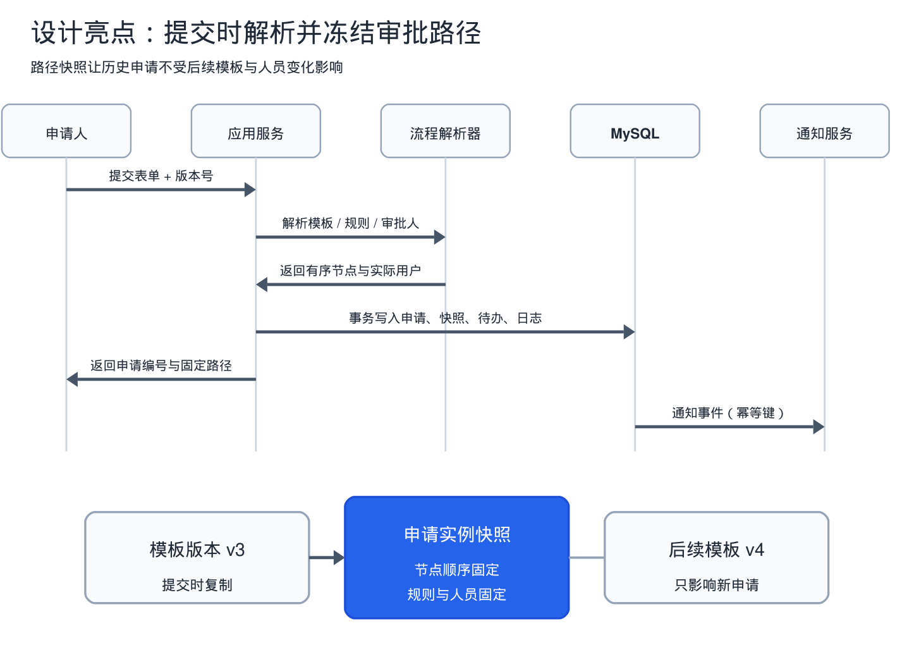

# 企业审批系统中期设计文档

> 课程：BS 体系软件设计　　学生：Bernice-ljm　　学号：3240105697
>
> 版本：中期设计稿　　数据库：MySQL　　日期：待填写

## 文档使用说明

本稿以图示为主要表达方式。所有流程图、架构图、ER 图和低保真原型采用统一视觉规范，并同时保留 PNG 预览、可编辑 SVG 和 PDF 矢量版；正文只补充图中无法表达的设计取舍，避免重复说明。

## 0. 一页总览：我们要做成什么

### 产品定位

面向多部门企业的审批工作台：员工提交采购、差旅、报销或管理员配置的自定义申请；系统按提交时固定的流程分配待办，审批决定、附件和通知可追踪、可审计。

### 目标体验


*图 1　固定业务和自定义申请共享统一流程引擎、MySQL 持久层与查询审计能力。*

**一句话设计主张：**三种固定业务复用同一套申请与审批底座，差异放在业务明细和规则中；自定义流程通过模板版本化接入，而不是复制一套新页面和审批代码。

## 1. 业务全景与范围

### 1.1 角色—动作—数据边界图


*图 2　角色只授予动作能力，具体资源是否可见仍由本人归属、部门范围和当前节点共同决定。*

### 1.2 核心业务闭环


*图 3　主流程保持从左向右，失败、撤回和复制重提作为独立结果展示。*

## 2. 产品界面与原型

### 2.1 信息架构


*图 4　普通工作区围绕任务和申请组织，管理入口独立承载配置与审计。*

### 2.2 桌面端低保真原型（工作台）


*图 5　工作台将待办、本人申请和统计摘要放在首屏，发起申请保持为主操作。*

后续高保真原型还需补充移动端待办、申请表单（含明细行）和模板编辑器，并统一标注空态、加载态、错误态、确认弹窗及无权限态。移动端表格改为卡片，核心操作不横向滚动。

### 2.3 申请详情与审批原型


*图 6　业务正文与审批时间线同屏，审批按钮只在服务端确认当前用户为当前审批人时开放。*

## 3. 复杂流程设计

### 3.1 提交时解析并冻结审批路径（设计亮点一）

**问题：**审批人、金额阈值或模板配置可能在申请提交后变化；若实例继续引用“当前配置”，历史申请会被无声改道，难以解释和审计。



*图 7　上半部分展示提交事务，下半部分强调模板版本与申请实例分离。*


**实现约束：**模板与实例分离；节点存实际审批用户、顺序、节点名称及规则来源快照。管理员修改模板只影响新申请。无法解析审批人时提交失败并给出可理解原因，不生成半条流程。

### 3.2 审批、驳回与撤回并发控制


*图 8　所有竞争操作锁定同一申请记录并重新检查状态，避免重复有效流转。*

**事务方案（MySQL/InnoDB）：**开始事务后锁定申请/当前节点记录（`SELECT ... FOR UPDATE`），重新检查申请状态、节点状态、当前操作者与版本号；仅条件匹配时更新节点和申请状态，并追加审批日志、创建下一待办及通知事件。任一检查失败则回滚并返回“状态已变化，请刷新”。数据库唯一约束和幂等键作为重复请求的第二道保护。不得仅依赖前端禁用按钮。

| 风险 | 控制点 | 验收证据 |
|---|---|---|
| 非当前审批人操作 | 服务端核对当前节点 assignee 与认证用户 | 越权接口测试返回拒绝 |
| 自己审批本人申请 | 创建路径与节点执行前双重校验 | 申请人兼任负责人仍不能自批 |
| 双击/重试重复批准 | 事务锁、状态条件更新、请求幂等键 | 仅一条有效流转日志/下一待办 |
| 撤回与批准同时发生 | 锁定同一申请，终态条件更新 | 两请求最多一个成功 |
| 通知重复 | 唯一业务事件键 | 重试不增加重复通知 |

### 3.3 管理员自定义模板生命周期


*图 9　模板从草稿到发布形成不可变版本，后续修改和停用均不改变历史实例。*

**发布校验：**字段 key 唯一；类型、必填与校验规则合法；审批节点不少于两个且有序；审批规则能解析为有效用户；适用部门有效。基础范围先实现顺序审批，不承诺未在作业要求中定义的条件分支/循环。

### 3.4 报销金额与附件闭环


*图 10　费用、票据和关联申请在服务端汇合校验，精确合计后才生成审批快照。*

## 4. 数据库设计（MySQL）

### 4.1 ER 概念图


*图 11　概念模型按身份权限、模板配置、申请业务和运行审计分区；正式建表时再补充字段级外键与基数。*

### 4.2 表分组与关键职责

| 分组 | 代表表 | 关键职责/约束 |
|---|---|---|
| 身份权限 | `users`, `departments`, `roles`, `user_departments`, `user_roles` | 用户名/邮箱唯一；客户端不能赋高权限角色；多部门/多角色关系明确 |
| 模板配置 | `workflow_templates`, `workflow_template_versions`, `template_fields`, `template_nodes` | 版本发布后只读；字段 key、节点序号受约束；配置变更可审计 |
| 申请主记录 | `applications` | 唯一申请编号；类型、申请人、部门、状态、金额分等索引字段；提交时保存版本和来源关联 |
| 固定业务数据 | `procurement_items`, `procurement_quotes`, `travel_details`, `reimbursement_details`, `expense_items` | 专属字段结构化，不把多条明细塞入自由文本；精确金额使用整数分或 `DECIMAL` |
| 动态业务数据 | `application_field_values` | 按字段定义和实例版本校验值；避免任意 JSON 成为不可查询的核心数据 |
| 流程运行 | `workflow_instances`, `workflow_instance_nodes`, `approval_logs` | 实例节点保存顺序、assignee 与规则快照；日志追加写入；唯一有效节点/请求键 |
| 文件通知 | `attachments`, `notifications` | 文件只存元数据与受控存储 key；通知按收件人隔离并对事件键唯一 |
| 审计 | `admin_audit_logs` | 角色授权、模板发布、配置变化记录操作者、动作、目标与时间 |

### 4.3 关键字段草案

```text
applications
  id BIGINT PK, application_no VARCHAR(32) UNIQUE
  type VARCHAR(32), applicant_id BIGINT FK, department_id BIGINT FK
  title VARCHAR(200), status VARCHAR(24), total_amount_minor BIGINT NULL
  template_version_id BIGINT NULL, source_application_id BIGINT NULL
  submitted_at DATETIME(3), created_at DATETIME(3), updated_at DATETIME(3)

workflow_instance_nodes
  id BIGINT PK, application_id BIGINT FK, sequence_no INT
  node_name VARCHAR(100), assignee_id BIGINT FK, rule_snapshot JSON
  status VARCHAR(24), acted_at DATETIME(3), version INT
  UNIQUE(application_id, sequence_no)

approval_logs
  id BIGINT PK, application_id BIGINT FK, node_id BIGINT NULL
  actor_id BIGINT FK, action VARCHAR(24), opinion TEXT NULL
  result_status VARCHAR(24), request_key VARCHAR(80) UNIQUE
  created_at DATETIME(3)

notifications
  id BIGINT PK, recipient_id BIGINT FK, event_key VARCHAR(120) UNIQUE
  type VARCHAR(32), application_id BIGINT FK, read_at DATETIME(3) NULL
  created_at DATETIME(3)
```

### 4.4 数据完整性、事务与删除策略

- MySQL 8.x、InnoDB、`utf8mb4`；金额统一使用整数分（或经论证的 `DECIMAL(12,2)`），审批金额阈值比较不使用浮点数。
- 状态流转、当前节点、审批日志、下一待办、通知事件在同一事务内提交；通知投递可用事务内事件表/Outbox，工作量允许时作为稳健性设计。
- 所有业务外键定义约束；用户/部门/模板等已被引用数据优先停用或软删除，审批日志和已提交申请不可级联物理删除。
- 索引优先覆盖待办查询 `(assignee_id, status, created_at)`、本人申请 `(applicant_id, status, created_at)`、部门统计 `(department_id, type, status, submitted_at)`；按真实查询计划调整。
- 附件二进制不放数据库；数据库保存存储标识、原文件名、MIME、大小、上传人、业务归属、时间及校验摘要。访问文件前先鉴权。
- 迁移脚本纳入 Git；初始化数据可重复执行且只包含合成用户/示例数据。用唯一约束和应用层校验共同防止重复。

## 5. 技术结构与模块依赖


*图 12　模块化单体统一承载权限与事务，MySQL、附件存储和容器部署保持清晰边界。*

技术框架尚待结合课程要求和实现能力确认；本设计先固定边界：模块化单体、关系库、文件与业务数据分离、统一服务端权限入口。最终定稿补充具体语言/框架版本、API 清单、登录会话策略和部署拓扑。

## 6. 设计亮点

### Highlight A：可解释的审批快照（符合基础要求的增强型落实）

申请详情不仅显示“现在谁审批”，还展示提交时模板版本、每个节点的实际审批人和规则来源。模板后来变化不会重写历史流程。这样用户能理解申请为什么到此人，管理员能复盘“当时依据什么规则派给谁”。实现成本主要是实例化时保存快照，能同时解决流程公平性、历史可追溯和配置演进。

### Highlight B：事务化流转与可恢复通知（可靠性优化）

将状态变更、节点完成、日志、下一待办和通知事件当作一个业务事实提交；请求幂等键与数据库唯一约束兜底重试。采用 MySQL 事务和 Outbox 时，即便通知发送稍后处理，业务也不会出现“审批成功但待办/日志缺失”或重复消息。页面提供事件时间线，让申请人、审批人看到一致的进度。

> 外部参考的候选观察点：GitHub Projects / Linear 的活动时间线可作为“事件可追溯、操作与结果并列展示”的交互参考；仅借鉴信息组织，不照搬其业务流程。正式提交前应打开并核验参考页面、截图与引用日期，不把未经核实的细节写成事实。

## 7. 非功能与安全设计

| 目标 | 设计措施 | 中期/最终验证 |
|---|---|---|
| 权限隔离 | API 层按资源、动作、当前节点校验；默认拒绝 | 越权列表/详情/附件/审批测试 |
| 数据可靠 | InnoDB 事务、外键、唯一键、迁移、持久卷 | 并发审批；重启后核对记录 |
| 凭据安全 | 框架密码哈希；环境变量注入密钥；不提交密钥 | 仓库扫描、注册登录验证 |
| 文件安全 | MIME/后缀/大小/数量限制，随机存储 key，下载前鉴权 | 非授权用户访问应拒绝 |
| 可维护 | 业务模块分离、模板版本、测试与文档同步 | 新建一种模板不改应用代码 |
| 可部署 | Docker Compose、健康检查、迁移说明、示例配置 | 空环境按说明启动成功 |

## 8. 验证计划与风险

### 测试金字塔


*图 13　规则测试数量最多，部署验收数量最少；权限、事务与幂等性集中在集成层验证。*

### 关键演示路径

1. 员工提交采购，负责人批准，财务审批，查询完整历史。
2. 员工提交差旅并获批，关联至报销；报销含多行费用与票据，由财务审核。
3. 管理员发布请假模板（动态字段 + 两个顺序节点），员工不改代码即可发起并流转。
4. 展示驳回理由、申请人撤回、重复审批被拒、无权附件被拒、通知已读及重启后记录保留。

### 风险登记

| 风险 | 应对 |
|---|---|
| 动态表单过度设计拖延核心闭环 | 先限定基础字段类型及顺序节点，不做任意脚本/循环流程 |
| 角色与数据范围混淆 | 先完成权限矩阵和负向测试，再开放管理界面 |
| 报销附件权限遗漏 | 附件所有访问统一走业务授权服务，并覆盖预览/下载测试 |
| MySQL 与本地演示环境配置不一致 | 早期用 Compose 建立可复现 MySQL 环境和迁移基线 |
| 移动提醒占用核心开发时间 | 核心工作流完成后再做响应式/后台推送提分功能 |

## 9. 进度与交付物

| 阶段 | 主要产物 | 完成判据 |
|---|---|---|
| 中期设计 | 本文、原型、ER、流程与权限矩阵 | 设计文档在 2026-11-16 截止前提交 |
| 基础设施/权限 | Compose、MySQL 迁移、认证授权 | 空环境启动；越权用例失败 |
| 工作流/业务 | 通用审批底座、三类表单、自定义模板 | 关键演示路径跑通且日志持久化 |
| 可靠性/体验 | 附件、通知、统计、移动适配 | 幂等、并发、移动核心操作验收 |
| 最终交付 | 源码、报告、手册、演示视频、Git 历史 | 2027-01-03 前材料齐备 |

### 报告最终排版建议

正文顺序：封面 → 一页产品全景 → 角色/业务图 → 界面原型 → 复杂流程设计 → ER/表设计 → 技术架构与亮点 → 测试与进度 → 风险/总结。正文尽量控制为每图 1-3 句说明；把完整字段字典、API 列表、部署命令等放附录。

## 10. 待补素材清单

- [ ] 课程规定的实验报告封面信息与日期。
- [ ] 手机端高保真原型截图，标出关键状态；桌面端低保真原型已完成。
- [ ] 实现阶段根据最终迁移脚本导出物理 ER 图；当前概念 ER 图已完成。
- [ ] 技术栈和实际部署拓扑确认；替换本文中的待定描述。
- [ ] 权限矩阵细化到“资源 × 动作 × 角色 × 部门范围”。
- [ ] 参考产品实际页面的引用链接、访问日期和自制观察截图（如保留参考项）。
- [ ] 评审反馈及据此调整的设计决策记录。

